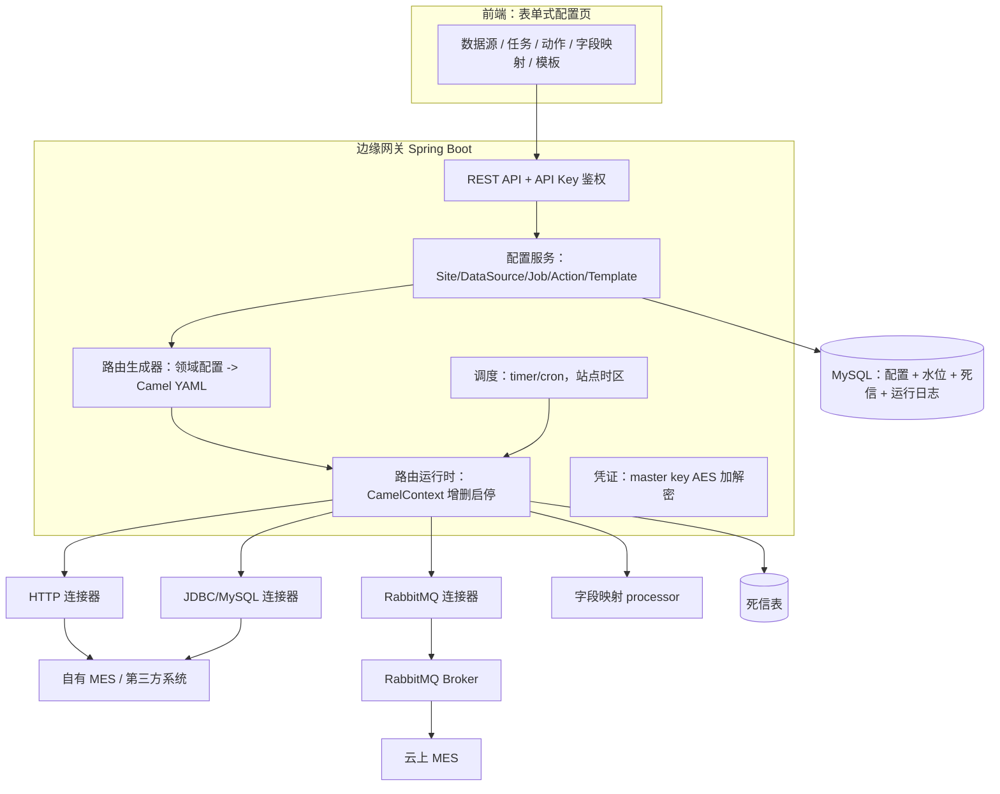

# 边缘数据网关设计（草案）

本文是围绕 Apache Camel 嵌入内核的边缘数据网关设计草案，用于最终确认后进入实现。术语见 [CONTEXT.md](../CONTEXT.md)。

## 1. 目标与范围

面向制造企业的边缘数据网关，部署在客户现场，由本公司工程师快速部署和改配置，并沉淀可复用模板资产。它负责自有 MES 与客户 MySQL 数据库、第三方 HTTP 接口、RabbitMQ 之间的数据同步。

MVP 明确不做：通用编排画布、多租户 SaaS、高可用、KMS、复杂表达式/多表联合、中心化管理端。

## 2. 已确认决策

- 引擎：Apache Camel 嵌入内核，Spring Boot 运行（[ADR-0001](adr/0001-embedded-apache-camel.md)）。
- 通信：南向 MQ 订阅消费、北向边缘出站 HTTP（[ADR-0002](adr/0002-northbound-southbound-transport.md)）。
- 失败：失败即停 + 重试退避 + 死信记录（[ADR-0003](adr/0003-failure-stop-retry-dead-letter.md)）。
- 配置库与客户库统一 MySQL（[ADR-0004](adr/0004-mysql-for-config-store.md)）。
- 表单式配置界面、每站点 API Key、docker-compose 部署、本地 master key + AES。
- MVP 连接器：HTTP、MySQL、RabbitMQ、字段映射、Bearer Token 鉴权。

## 3. 总体架构

## 4. 领域模型与数据模型

核心实体：**站点（Site）、数据源（DataSource）、任务（Job）、动作（Action）、模板（Template）、水位（Watermark）、死信（DeadLetter）、运行日志（RunLog）**。

关键字段：

- DataSource：`id, siteId, name, type(http|mysql|rabbitmq), address, addition(json), encryptedSecrets`。
- Job：`id, siteId, code, name, status(0/1), crontab, timezone, retryCount, backoff, lastRunStatus, lastRunAt`。
- Action：`id, jobId, type(remote|mapObject|mapArray), index, consumeDataType, addition(json)`。
- Template：`id, name, version, config(json)，含可变占位符`。
- Watermark：`jobId, key, value, updatedAt`。
- DeadLetter：`jobId, actionIndex, inputJson, error, retriedAt, status`。

## 5. 执行模型

- 一个启用任务对应一条已注册的 Camel 路由；停用即 `stopRoute`，修改即删旧建新。
- 触发方式：手动执行、cron 定时、第三方 HTTP 调用、RabbitMQ 消费。
- 手动执行接口可携带输入 JSON，作为任务输入（Job Input）。
- 动作按 `index` 顺序执行；`consumeDataType` 决定是否把上一个动作输出作为当前输入。
- 上下文按动作输出顺序保存为列表：`0` 是任务输入，`1..n` 是动作 1..n 的输出；字段来源用"来源步骤 + 字段路径"结构化表达，不在界面上暴露占位符字符串。
- 任务状态机：`disabled -> enabled`，执行中 `running`，结束后 `success | failed`。

## 6. 路由生成规则

路由生成器只认固定模板，每种动作类型对应一种 YAML 形状：

- 远程访问 HTTP：`http:` 端点 + Bearer 鉴权动作。
- MySQL 读取：`sql:` 端点 + 增量 `where updated_at > :#lastRun`。
- MySQL 回写：`jdbc:` + `INSERT ... ON DUPLICATE KEY UPDATE`（幂等）。
- 字段映射：一个固定的 Java processor 读取结构化映射规则（来源步骤 + 字段路径 + 目标字段名 + 转换），不做用户手写表达式。
- RabbitMQ 消费：`rabbitmq:` 消费者端点；RabbitMQ 生产：`rabbitmq:` 生产者端点。
- 错误处理：`onException` + `errorHandler`（重试/退避）+ 写死信。

## 7. 配置界面与交互

- 数据源、任务、动作用表单配置；字段映射用**表格**：目标字段名、来源步骤（下拉：任务输入/动作 N）、字段路径（点选）、转换类型（无/类型/日期/枚举/常量）。用户不写占位符表达式。
- 支持"从样例数据拉取字段"预览；高级用户可切换 JSON/YAML 编辑。
- 模板支持导出/导入和版本号，导出格式为领域模型 JSON。

## 8. 增量和幂等

- 水位按 `jobId + key` 存 MySQL，成功执行后更新。
- 目标写入按业务主键 upsert，避免定时与手动并发、重试产生重复数据。

## 9. 安全

- 网关 REST 接口用每站点 API Key 鉴权。
- 北向 MES 调用使用 Bearer Token。
- 数据源密码、MQ 凭证、API Key 落库前用本地 master key + AES 加密。

## 10. 部署与运维

- 单实例，docker-compose：`edge-gateway` + `MySQL`。
- 日志本地落盘（JSON lines），提供只读日志接口；运行日志、每动作耗时、最近执行结果可见。

## 11. 实现前需要你提供的事实

1. MES 北向接口的真实端点、鉴权细节（Bearer Token 获取方式）和请求/响应样例。
2. RabbitMQ 的队列/交换机命名规则、连接地址和消息 JSON 样例。
3. 客户 MySQL 表结构与字段样例（至少一张真实表）。
4. 一个真实同步场景的端到端验收样例（源数据 → 期望目标数据）。

## 12. 里程碑

- Spike：一条真实链路跑通（HTTP/MySQL/RabbitMQ 之一 + 字段映射 + 增量/幂等）。
- M0：配置模型 + REST + 表单 UI 骨架 + Camel 嵌入。
- M1：HTTP + MySQL + RabbitMQ + 字段映射 + 链执行 + 增量/幂等。
- M2：cron、重试/死信、日志、连接测试、docker-compose 交付。
