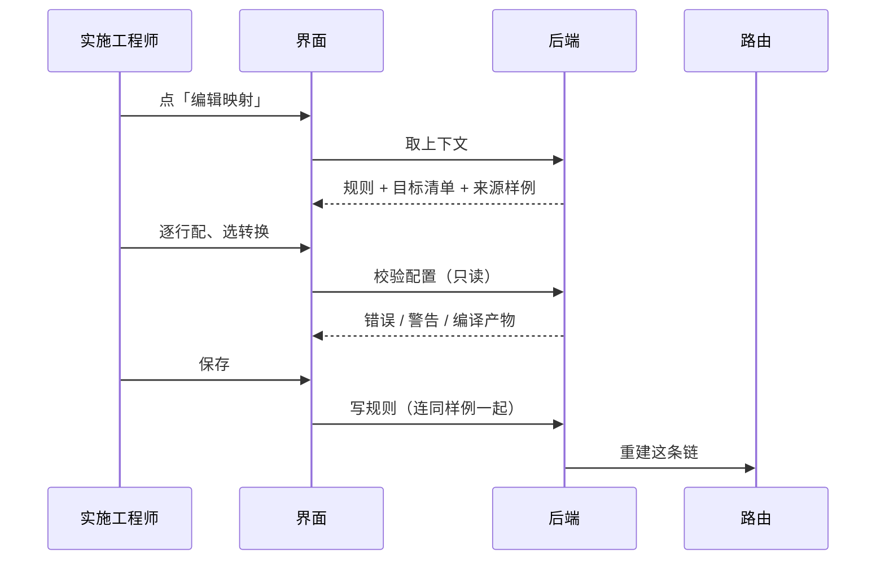
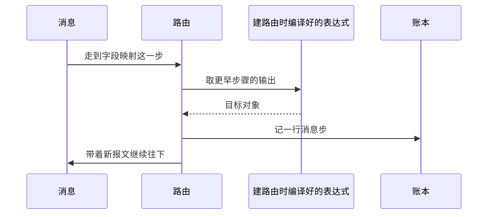

# 字段映射

客户系统给来一份数据，MES 要的字段名、格式、层级都不一样。字段映射就是中间那一步：把来的一份数据改成 MES 要的样子。不写代码，在界面上点出来。

## 从界面开始：配一条映射

1. 任务 → 动作链 → 新建动作，选「字段映射」→ 点「去配字段映射」。**空规则的动作存不下去**，所以创建和配映射是同一步。
2. 顶部选**来源步骤**：这份映射读**哪一步**的结果。不选就是任务的输入。
3. 左边清单点一个字段，填进当前行的「取值」。目标字段清单里没有的，可以直接手输。
4. 每行选一个「转换」：拿到值之后怎么变。
5. 点「校验配置」：错误拦保存，警告只提醒。
6. 点底部「试算」：先跑一遍看看结果。
7. 保存：配置连同手里那份样例一起落库。

## 你实际会遇到的五种活

多数配置就是下面五种之一。对不上号的，再往下看词表。

| 你要的效果 | 界面上怎么做 | 不做会怎样 |
|---|---|---|
| **改个名字**：客户叫 `order_no`，MES 要 `sheet_no` | 右边 `sheet_no` 那一行，左边点 `order_no` | MES 收到的那份数据里没有这个键，而且不报错 |
| **换个值**：`ACTIVE` 要变成 `1` | 那一行选「枚举」，填对照表 | 值原样过去，MES 认不出 |
| **改格式**：`2026/11/14` 要 `2026-11-14` | 那一行选「日期」 | 到写库或接口那一步才报错 |
| **一行变多行**：一张订单里有多条明细 | 目标字段是明细表那一行，选来源的明细数组，再给每条明细配子字段 | 只出来**一个**对象，明细全丢 |
| **多段拼起来**：`BOM-` 和单号拼成一个 | 那一行选「拼接」，加片段 | 拼不出来 |

还有两种不常用的：**常量**（这个字段永远是同一个值，不看来源）、**行号**（第几条，只在"一行变多行"的子行里有意义）。

## 界面上的字，翻译成大白话

对着屏幕查。左列是界面上真出现的字。

| 界面上看到的 | 意思 | 例子 |
|---|---|---|
| 来源步骤 | 这份映射读**哪一步**的结果 | 「2 · 读客户订单」 |
| 取值 | 这个字段的值从哪来 | `order_no` |
| 转换 | 拿到值之后怎么变 | 原样 / 数字 / 日期 / 枚举 / 常量 / 拼接 / 行号 |
| 数组映射（一行变多行） | 一个数组展开成多行 | 订单 → 明细列表 |
| 「外层 · 某字段」 | 子行里用**表头**的值 | 每条明细都带上订单号 |
| 高级：手写 JSONata | 逐行配不出来时，直接写一段表达式 | 整段重排成另一个结构 |
| 校验配置 | 查有没有配错 | 错误拦保存，警告只提醒 |
| 试算 | 先跑一遍看结果 | 底部那个页签 |

## 一条数据走一遍

**进来的一条消息**（链条上一步的输出）：

```json
{"order_no":"PO-2026-001","items":[{"materialCode":"M01","qty":"3"},{"materialCode":"M02","qty":"5"}]}
```

**你填的规则**（3 条顶层 + 数组行下 2 个子行）：

| 目标字段 | 取值 | 转换 |
|---|---|---|
| `poNo` | `order_no` | 原样 |
| `bom.bomLines` | `items`（数组行） | — |
| └ `materialCode` | `materialCode` | 原样 |
| └ `seq` | 行号 | 行号 |
| `bom.title` | 常量 `BOM-` + `order_no` | 拼接 |

**MES 收到的那份数据**（后面动作的输出）：

```json
{"poNo":"PO-2026-001","bom":{"title":"BOM-PO-2026-001","bomLines":[{"materialCode":"M01","seq":1},{"materialCode":"M02","seq":2}]}}
```

这三段里能一次看到四件事：读的是哪一步、普通的一行（`poNo`）、一行变多行（数组行展开成两行）、行号（`seq` 自己数）。把它贴进编辑器的「粘贴 JSON」和「试算」，30 秒能自己跑一遍。

## 这个形状是怎么来的

上面那些结论（递归树、`children`、`$root.`）看起来像是某天定下的。其实是被几条约束一步步逼出来的。这一段是**现在的重建**，不是当时的会议记录。

**约束一：来源和目标都是嵌套的。** 订单里有明细，明细里还有子件；MES 那边的结构又是另一层嵌套。所以规则必须能表达层级，不能只表达「A 字段 → B 字段」这种平面对应。**如果只能平面对应，明细就只能靠代码展开。**

**两条路：扁平列表还是树。** 一种做法是扁平列表，每行写一条完整路径（`bom.bomLines[].materialCode`）。另一种是树，子规则挂在父规则下面。**选了树**，因为扁平列表在**配置期**回答不了两个问题：这条子字段属于哪个数组？它能不能用表头的值？树上父子关系是结构化的，校验可以顺着走，界面也能一行一行展开。**如果选扁平列表，报错只能报「第 3 行路径不合法」，说不清是哪个数组的哪一行。**

**代价是必须接受一个复杂形状。** 树落到库里就是 `children` 数组，前端要递归渲染，编译器要递归编译。**换来的是**「每个目标字段一行」的界面，和「问题能挂到具体那一行」。这条交换在 #99 定的（ADR-0011）。

**来源路径为什么有两种写法。** 数组的子行是一行规则套到每个元素上，所以它说的是"当前元素里的哪个字段"，不是"整份数据里的哪个字段"——这就是相对。表头的值不在元素里，才回到根上取。对错对照见下面「数据结构 · 来源的三种写法」。

**为什么转换是规则的一个属性，不是独立的节点。** 转换（数字、日期、枚举……）只对**一个来源值**做加工，不改变层级关系。如果把它做成独立节点，规则树就会变成「值节点 + 加工节点」两张网，编译和界面都要多一层。**代价是拼接这种多来源的场景要单独引入 `parts`**——这就是为什么拼接的存储形状比别的转换复杂（ADR-0012 决策 1）。

## 数据结构

### 一个映射动作存什么（`FieldMappingConfig`）

| 字段 | 类型 | 说明 |
|---|---|---|
| `mode` | string | 空或 `STRUCTURED` = 用规则树；`EXPRESSION` = 手写表达式 |
| `expression` | string | 手写模式下的一整段 JSONata |
| `rules` | 规则数组 | 结构化模式下的规则树（根节点） |

多一个不认识的字段会被直接拒（`未知字段: xxx`），不静默忽略。

### 一条规则是什么（`FieldMappingRule`）

| 字段 | 类型 | 什么时候用 | 注意 |
|---|---|---|---|
| `sourceStep` | int | 读哪一步的输出；`0` = 任务输入 | 子规则留空，继承父规则的 |
| `source` | string | 来源字段路径 | 组节点写数组路径；特殊值 `$index`、`$root.xxx` |
| `target` | string | 目标字段路径 | 子规则写**相对路径** |
| `transform` | 枚举 | 七种转换之一 | 不写 = 原样 |
| `constant` | string | 仅 `CONSTANT` | 固定值 |
| `enumMap` | object | 仅 `ENUM` | 对照表：来源值 → 目标值 |
| `datePattern` | string | 仅 `DATE` | 格式串，配置期验合法性 |
| `iterate` | string | 仅组节点 | 目前只有 `FOR_EACH` |
| `children` | 规则数组 | 仅组节点 | 非空即「一行变多行」，递归 |
| `parts` | 数组 | 仅 `CONCAT` | 片段：字符串常量 或 `{"path":"..."}` |
| `startAt` | int | 仅 `INDEX` | 行号从几开始，默认 1 |

**一条判据**：`children` 非空就是组节点，否则按 `transform` 决定哪几个字段有用。

### 来源的三种写法

| 界面上怎么选 | `source` 存什么 | 在哪一行 |
|---|---|---|
| 选数组本身 | 数组路径，如 `items` | 父行（组节点） |
| 选数组元素里的字段 | 相对路径，如 `materialCode` | 子行 |
| 选「外层 · 某字段」 | `$root.<路径>` | 子行 |

子行为什么写相对的而不是全路径——因为**一行规则会被套到数组里的每一个元素上**：

| 目标 | 来源写成 | 第 1 个元素 | 第 2 个元素 |
|---|---|---|---|
| `materialCode` | `materialCode`（相对） | `M01` | `M02` ✅ |
| `materialCode` | `items[0].materialCode`（全路径） | `M01` | `M01` ❌ |

写全路径等于每次都去取第 0 个，第二个元素就错了。「相对」相对的是**当前这个元素**，所以子行不用管自己排第几。

表头的字段不属于任何元素，元素里取不到，才回到根上写 `$root.order_no`（界面上选「外层 · 订单号」）。

### `parts` 的四种片段

| 片段长什么样 | 意思 |
|---|---|
| `"BOM-"` | 字符串常量 |
| `{"path":"order_no"}` | 取一个字段 |
| `{"path":"qty","transform":"INT"}` | 取字段并加工（只一层） |
| `{"transform":"INDEX","startAt":1}` | 行号（不带 `path`） |

### 接口的三份载荷

| 端点 | 发什么 | 收什么 |
|---|---|---|
| `POST /api/field-mapping-editor/validate` | 草稿 + 目标清单 + 来源样例 + `sourceFieldsStep` | `errors[]`、`warnings[]`、`compiled.jsonata`、`compiled.rulesJson` |
| `POST /api/field-mapping-editor/trial` | 草稿 + 样例原文 | `fields[]`（逐字段状态）、`metrics`、`failures[]` |
| `PUT /api/jobs/{id}/field-mapping-editor/samples` | 样例原文 | 204 |

前两个只读、不写库；第三个只写样例那一格。

## 两条流程：配置期和运行期

配置期是人和界面在动，运行期是消息在动。两件事分开看，才不会混。

### 配置期：从点开编辑器到保存



三个点：

- **校验和保存是两次请求**。校验只读、不写库，只回答"哪里错"。
- **保存会连同样例一起写**。所以下次打开编辑器，看到的还是当时那份数据。
- **保存之后路由才重建**。新规则对下一次消息到达生效，对已经在跑的没有影响。

### 运行期：消息走到这一步



两个点：

- **表达式是建路由时编译一次的**，不是每条消息现编译。
- **每条消息每过一个动作记一行**，这就是消息历史里能点开看的那一份。

## 实现要点

每个功能一句结论。要细节看「代码位置」。

**编辑器**

- 每个目标字段一行，左边点来源填进来；界面上不出现 `$`。
- 新建字段映射动作也走同一个抽屉：空规则的动作存不下去，所以"创建"和"配映射"必须一次做完。
- 改名称、改序号也走同一次保存——不带映射的更新会被拒。

**校验**

- 分两档：**错误**（结构错、链问题，保存会被拒）和**警告**（依赖样例才成立，不拦保存）。
- 警告不拦，是因为样例可能是旧的，拿旧样例拦人会把新配置误伤。

**样例**

- 两个并列入口：从运行记录探测、粘贴一份 JSON。不分主次。
- 粘的那份，保存时存**原文**；探测那份不存（报文本来就在消息步里）。
- 打开时：存过就用存的，没存过就探测。

**试算**

- 只读、无状态，连数据库都不接。
- 先整份跑一次；抛错再逐行跑，逐行只是定位手段。
- 结果是每个目标字段一档：落值 / 算出来是 null / 被丢掉 / 未映射。

**手写表达式**

- 切过去就是写一整段，跳过规则树校验；那一页是界面上唯一会出现 `$` 的地方。

## 校验：七条依赖样例的检查

这七条都要拿「目标清单」和「来源样例」才能判，所以后端本来查不出来——它们对应的正是"不报错、但结果不对"的那几种。全是警告，一条都不拦保存。

| 检查 | 级别 | 判据 |
|---|---|---|
| 必填的目标字段没有配置来源 | 警告 | 目标清单里必填的字段没有对应规则。数组字段整行报一条；数组配了、只是某个必填子字段没配，才逐条报子字段 |
| 来源字段在样例里不存在 | 警告 | 数组子行按相对路径补上组节点的来源数组再查；`$root.<路径>` 按绝对路径查；`$index` 不查 |
| 枚举表没有覆盖样例里出现过的值 | 警告 | 拿来源字段在这份样例里的实际值比 `enumMap` 的键。查不到键时这个字段从报文里**整个消失**（不是变成 null），也不报错 |
| 文本值直接写进数字类型的字段 | 警告 | 目标列是数字类型、来源在样例里是文本类型。`INT` 转换、行号、常量不算 |
| 拼接里存在空片段 | 警告 | `parts` 里有空串常量，或路径片段没写 `path`。行号片段不算空 |
| 日期格式串在这份样例值上跑不出来 | 警告 | 拿来源字段的实际取值过一遍运行时格式化实现。跑不出来时运行时会**原样发出去**，任务照样成功 |
| 顶层规则漏写来源步骤 | 提示 | 后端把"没写"当成任务输入，查不出这是个错 |

两条口径：

- **只查样例里的值，不执行表达式**。样例空着一律不报——探不出结构不是配置的错。
- **只判来源步骤和这份样例一致的那些行**。跨步骤引用的字段不在这份清单里，拿它去判会整片误报。

## 代码位置

| 区域 | 主要类 | 职责 |
|---|---|---|
| 编译 | `mapping/JsonataRuleCompiler` | 规则树 → 一段 JSONata 表达式 |
| 求值 | `mapping/JsonataFieldMapper`、`JsonataFunctions`、`JsonataInputs` | 跑表达式；日期/数字函数；JDBC 值转 JSON 安全值 |
| 结构校验 | `config/action/FieldMappingConfig`、`mapping/DatePatterns` | 规则结构与日期格式串的合法性 |
| 编辑器后端 | `web/FieldMappingEditorController`、`service/FieldMappingEditorService` | 取上下文：规则、目标清单、来源样例 |
| 草稿校验 | `service/MappingDraftValidationService`、`MappingSampleChecks` | 只读校验；依赖样例的七条检查 |
| 试算 | `service/MappingTrialService`、`MappingTrialReport` | 整份跑 + 逐行归因 + 逐字段状态 |
| 样例 | `service/MappingSampleData`、`MappingSampleService` | 原文 → 字段清单；粘的那份落库 |
| 前端 | `FieldMappingWorkbench.vue`、`MappingRowList.vue`、`MappingSourcePanel.vue`、`MappingTrialPanel.vue`、`mapping/useMappingDraft.ts`、`mapping/draft.ts` | 工作台装配、行渲染、来源清单、试算页、校验请求与问题定位 |

其余 `Mapping*` 组件（参数面板、粘样例框、表达式编辑器）按名字对应。

## 决策时间线

| 日期 | 事件 | 为什么 | 被谁修正 | 锚点 |
|---|---|---|---|---|
| 08-16 | 智能化方向：规则启发式优先，LLM 可替换 | 配置最耗时、需可解释可离线 | 引擎选型后续定 | ADR-0005 |
| 08-19 | addition 类型化（动作侧） | 与数据源同源：每种类型各自处理 | — | DS-2 |
| 08-21 | 引擎选型：**JSONata**（弃 JOLT/AtlasMap/自研） | JOLT 维护休眠且行号弱、AtlasMap 停维护、JSONata 活跃且 A+B 合一 | — | DS-10.2 / research/mapping-framework |
| 08-21 | 多级表格 + 递归组规则编辑器（三栏） | 制品→BOM 两级层级映射 | — | T38 / c1e24fd / f33bfe4 |
| 08-21 | 建议面板改表格+分页+已采用标记 | 候选多、无标记 | — | DS-10.1 |
| 08-21 | 保存静默失败修复 | ENUM 的 JSON.parse 在 try 外 | — | DS-10.3 |
| 08-21 | 建议器组输出（数组识别） | 目标数组生成组建议 | — | T39 / 6541d89 |
| 08-24 | 单值样例不再推荐 CONSTANT | 样例单值≠常量，语义错误 | — | DS-10.4 / 587172a |
| 09-14 | 新版编辑器：每个目标字段一行 + 校验交后端只读接口 | 来源只能手打、配错要等跑起来才知道、层级看不出来 | — | ADR-0011 / #99 |
| 09-14 | 数组映射在三处来源写法上分开：数组 / 相对路径 / 外层引用 | 三种东西填串了就是自相矛盾的规则，后端不报错 | — | #101 / source-picker.ts |
| 09-14 | 手工新增行 + 清除/撤销 | 目标字段清单不全（HTTP/MQ 做目标时探不出结构）时，参照原件那种「行全部由清单生成」的编辑器配不完 | — | #102 / editor-model.ts、rows.ts |
| 09-14 | 「校验配置」：草稿校验收进后端一个只读接口 | 前端不复制任何一条校验规则；错要能定位到行、保存前拦得住 | — | #103 / ADR-0011 / MappingDraftValidationService |
| 09-14 | 补上依赖目标清单与来源样例的六条检查 | 后端本来有四种情况不报错但结果不对（来源路径不存在、拼接有空片段、日期解析失败、枚举查不到键），这六条正是这次改版要照亮的东西 | #111 补上「日期解析失败」那一条（第七） | #104 / MappingSampleChecks |
| 09-14 | 窄屏依次排列、键盘补齐（`/` 换转换、回车选来源、退格清行）、手写 JSONata 入口回到编辑器里 | 深层数组的任意重排只能走手写表达式（#98 F1）：界面不给入口等于悄悄砍掉一条已经承诺的出路；键盘与窄屏是 G 里留给原型的最后一档 | — | #106 / keyboard.ts、expression.ts |
| 09-15 | 撤掉旧编辑器（三栏 + 多级表格 + 建议面板 + ENUM/CONCAT 弹窗） | 新版覆盖了旧版的全部能力，两套编辑器读写的又是同一份数据格式，留着只会让人不知道点哪个入口 | — | #107 / JobsView.vue（`MappingEditor.vue`、`MappingRowsTable.vue` 已删） |
| 09-15 | 第二轮六条：日期格式手输、片段转换、清除的行=未配置、校验两档、来源字段样例导入、试算 | 第一轮上线后实施工程师在真机上撞到的六件事；第 2、5 条推翻第一轮写下的决定（ADR-0011 决策 1/2/9/11/12） | — | ADR-0012 / #110 |
| 09-15 | 日期格式手输 + 格式串合法性校验（配置期错误 + 按样例的警告） | 非法格式串运行时必然抛错而三层都不查；只加输入框等于把一个必然抛错的位置暴露到界面上 | — | #111 / DatePatterns、JsonataFunctions.canFormat、MappingSampleChecks.datePatternWarnings |
| 09-15 | **片段转换：拼接的每段能挂一个转换，存储形状第一次变化** | 客户要的复合值（`BOM-20260821-0001`、`A-启用`）要先加工再拼；做不到就整行走手写 JSONata——而那条路是给深层重排准备的 | — | #112 / ADR-0012 决策 1 / parts.ts、MappingDateParams、MappingEnumParams |
| 09-16 | **拆开 2187 行的 `FieldMappingWorkbench.vue`（五个缝，行为零变化）** | 一张票只要动编辑器里一块，实施的人就得把整份读进来，而这份读取常驻在这之后每一次模型调用的上下文里（#111/#112 实测约 35k token） | — | #117 / MappingSourcePanel、MappingRowList、MappingIssuesPanel、MappingExpressionEditor、useWorkbenchState.ts、useMappingDraft.ts |
| 09-16 | **校验两档落地：只有结构错与链问题拦保存，一行上的全部问题都列在行上，保存 400 带全部并把编译期错前移** | 一行的全部问题要一次看全（改一条点一次来回好几轮）；清掉的行不该再拦保存；重复目标/前缀冲突在停用状态下能存进去、到启用时才失败——门和事实不一致 | — | #113 / ADR-0012 决策 4 / FieldMappingConfig、MappingDraftValidationService、MappingSampleChecks、MappingRowList.vue、fast-config.ts |
| 09-16 | **来源字段样例多了一条路：粘一份来源数据 JSON，与「从运行记录探测」并列** | 来源清单只有「链上更早那个动作最近一次成功运行的输出」一条路：冷启动没有运行记录、MQ 打头的任务不记成功步，左边永远是空的，只能凭记忆手打路径，打错了不报错 | — | #115 / ADR-0012 决策 5 / FieldMappingEditorService.sourceFieldsFromSample、MappingPasteSampleDialog.vue、sample.ts |
| 09-16 | **目标字段清单也能粘一份 JSON（与连库探测并列），必填一律当不必填** | 同一个「从 JSON 推结构」的能力在来源侧跑顺了，就按 ADR-0012 决策 5 那句复用过来；HTTP / MQ 做目标时连库探不了（#98 H3），目标字段只能照着一份目标数据一个个敲 | 顺手删掉未引用的端点 `POST /api/sample-fields` 与 `FieldPathExtractor` | #118 / ADR-0012 决策 5 / FieldMappingEditorService.targetFieldsFromSample、MappingRowList.vue、sample.ts |
| 09-16 | **粘一次就留着：粘进来的那份点保存时落库（`mapping_sample`），下次打开优先用它** | 最需要样例的正是探不出结构的那批任务（冷启动、MQ 打头、HTTP / MQ 做目标）——样例只活在内存里等于关掉就没了；试算（#116）又要拿这份样例真跑，不留住那个页面一打开就是空的 | **修订 ADR-0012 决策 5**「样例只在编辑器里存在，不落库」那半句（ADR-0011 决策 11 的后半句）；探测那份仍然不落库 | #119 / MappingSampleService.java、V3__mapping_sample.sql、FieldMappingEditorService、sample.ts |
| 09-17 | **试算：底部第三个页签，点按钮才跑；求值的超时与递归上限第一次真的接上** | 配完不知道算出来长什么样，只能等任务跑起来去目标系统看——而「字段整个消失」这类问题（来源路径不存在、枚举查不到键、数字转不过去）在网关侧全绿，只在目标那边才暴露；ADR-0011 决策 9 当时把它判给「另一件事」，理由是「需要在受控边界里真的执行表达式」，而那个边界引擎里现成 | **修订 ADR-0011 决策 9**（不做值的试算）；**补上 `mapping-framework.md:170` 那条记了没落地的强制启用**；运行时的 `mode=EXPRESSION` 也带上同一套上限 | #116 / ADR-0012 决策 6 / MappingTrialService.java、MappingTrialPanel.vue、trial.ts、JsonataLimits.java、MappingSampleData.java |
| 09-18 | **试算结果按一次执行的判决展示：逐字段状态表（四档）+ 结论/计量/证据三层，可点回账本那一行，草稿改了挂过期横幅** | 试算跑通了只给一份目标报文，「少了一个字段」在界面上没有位置、还会被说反：没配、配了但取不到值、算出来就是 null 这三件事在最后那个 JSON 里长得一模一样（键都不在），用户只能回行列表里一个个对——设计说明 §12.1 三处失真的第二处 | — | #120 / MappingTrialReport.java、MappingTrialResult.java、MappingTrialRequest.java、MappingTrialPanel.vue、trial.ts、useMappingTrial.ts、draft.ts |

## 限制与绕法

这一节都是**已知的、有意的限制**，不是待修的 bug。遇到时看"怎么办"那一列。

### 能力边界：做不到的事

| 做不到 | 什么情况 | 怎么办 |
|---|---|---|
| 深层重排 | 目标结构和来源结构差得远，要整段重新组织 | 顶部「高级：手写 JSONata」 |
| 数组里套数组 | 来源是多层嵌套数组 | 同上 |
| 从 MQ 打头的任务探测样例 | 链首是 MQ 消费，它不记成功步 | 左边「粘贴 JSON」粘一份；保存后就留着 |
| 探测没跑过的任务 | 任务还没成功跑过一次 | 同上 |

### 使用注意

| 注意 | 会看到什么 | 怎么办 |
|---|---|---|
| 粘的样例按"哪一步"存 | 换过默认来源步骤后，旧那格还在 | 正常。删动作或删任务时才清 |
| MySQL 的 JSON 列读出来是字符串 | 数组变成一个整串，`$map` 只出一个元素 | 源那边先转成真数组，这边改不了 |
| 校验不是实时的 | 改完行，行上状态还是上一次的 | 再点一次「校验配置」 |
| 试算也不自动重算 | 改了行或换了样例，右边还是旧的 | 报告上会挂"草稿已改动"，点「重新试算」 |
| 校验不跑表达式 | 想确认值对不对，它只说结构 | 用「试算」 |
| 片段上的日期、枚举参数不按样例提醒 | 拼接行里的片段配错，校验只说结构错 | 值层面要自己试算看 |
| 片段里的来源路径不进"字段在不在样例里"检查 | 片段路径写错，运行时变成空串 | 靠"空片段"那条警告间接发现 |
| 日期格式串只在点校验时才判 | 手输框不即时变红 | 点一次「校验配置」 |
| 从手写切回逐行 | 手写那边的内容不会回填成行 | 看到的是打开编辑器时那份逐行配置 |
| `Esc` 不关编辑器 | 按 Esc 只收起面板 | 关编辑器点「取消」，防止误按丢草稿 |

## 术语细节

**草稿（Mapping Draft）**：编辑器里还没保存的那份字段映射配置。「校验配置」把它交给后端一个只读接口判断，只出问题与编译产物，不写数据库。
_Avoid_: 临时配置, 未保存配置

**来源字段样例（Source Field Sample）**：一份来源数据的样例，以及从它推出来的字段清单。粘进来的那份点保存时落库（`mapping_sample` 表），探测那份不落库。样例只用于推清单、校验与试算，不进规则、不进任务配置。
_Avoid_: 结构探测（那个要连数据源）、样例值（那是单个字段的例子值）

**试算（Trial Evaluation）**：把当前草稿编译出的表达式拿到一份来源字段样例上真跑一遍，看目标报文长什么样；算错时逐行归因。它不是配置期校验的一部分。
_Avoid_: 预览, 模拟运行
