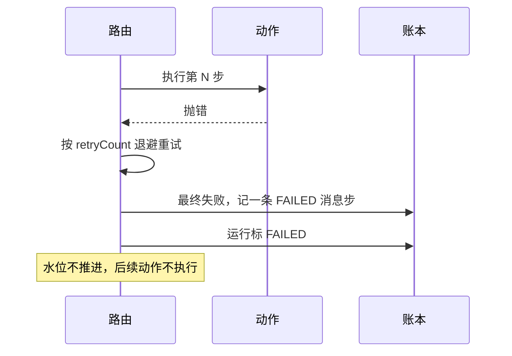
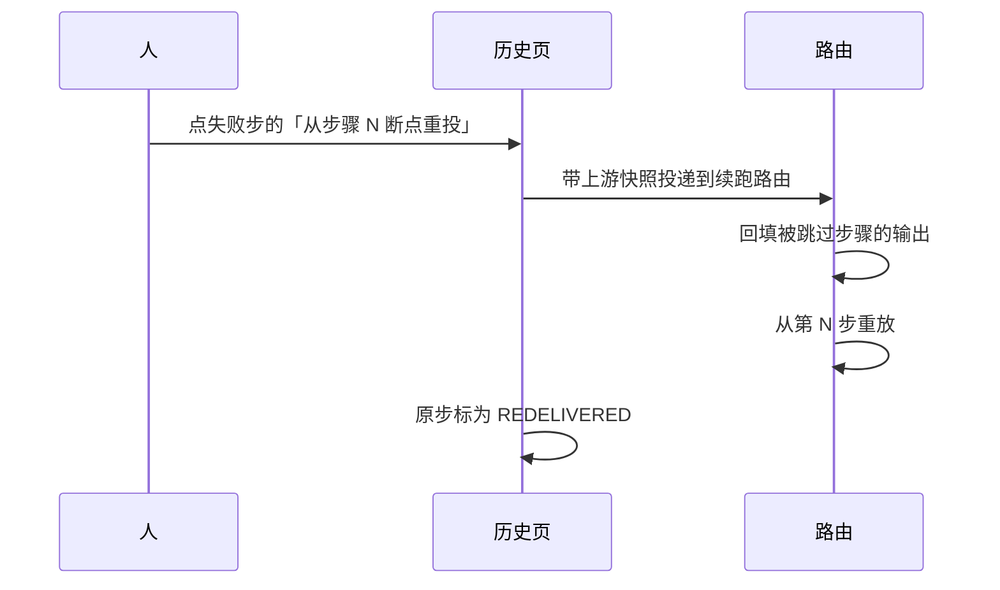

# 可靠性（失败 / 重试 / 消息历史 / 断点重投）

一句话：任何一步失败，整批停下、水位不推进；修好后要么重跑任务，要么从失败那一步断点重投。**不承诺跨系统补偿。**

## 出事之后怎么办

| 情况 | 做什么 | 会怎样 |
|---|---|---|
| 某一步失败 | 重跑任务 | 从未完成的那批重新读、重新出站、跑完下游 |
| 只有一条消息失败 | 从这一步断点重投 | 只重放那一条，上游步骤用快照回填 |
| 想先看看为什么 | 打开消息历史，点开那次运行 | 失败的那一步有报错原文 |
| 任务显示成功但没数据 | 查读 SQL 的水位谓词 | 见「限制与绕法」 |

两种恢复都会让对端**可能再收到一次**，靠业务键幂等兜住。

## 两条流程

### 失败一次

### 断点重投

## 数据结构

**一次运行**（`job_run`）

| 字段 | 说明 |
|---|---|
| `status` | `RUNNING` / `SUCCESS` / `FAILED` |
| `input_snapshot` | 本次的输入 |
| `error` | 失败原因 |
| 起止时间 | `started_at` / `finished_at` |

**一条消息穿过一个动作**（`message_step`）

| 字段 | 说明 |
|---|---|
| `run_id` / `message_id` / `step` | 三个一起唯一 |
| `status` | `SUCCESS` / `FAILED` / `REDELIVERED` |
| `data_snapshot` / `input_snapshot` | 这一步的进出数据，断点重投靠它 |
| `attempt` | 这一共试了几次 |
| `business_key` | 业务键，可为空 |
| `batch_id` / `batch_seq` / `parent_message_id` | 批号、批内序号、父消息。批号管分组，父消息管谱系 |

## 实现要点

- **失败即停**：全链一个异常处理器，重试次数和退避来自任务配置；最终失败记一条 `FAILED` 消息步并把运行标 `FAILED`。
- **总尝试次数**：按"这一步被投递了几次"算，成功步是失败次数 +1，失败步就是失败次数。
- **任务串行**：同一个任务同一时刻最多一个运行，后来的触发直接跳过，返回冲突码，不排队。判据是进程内的集合，**不查库里的 RUNNING 行**——进程被强杀时那行会永远停在那。
- **最近运行结果**：运行结束时统一回写任务上的状态/时间/错误，成功时清空错误。
- **快照是 JSON 值**：对象、数组、标量都能回填；非 JSON 文本不进上下文。
- **容量闸**：快照列是 16 MB。装不下就**当场显式失败**，不写半截——半截快照会让续投在很远的地方报错。

## 限制与绕法

| 注意 | 会看到什么 | 怎么办 |
|---|---|---|
| 至少一次 | 对端可能收到重复 | 目标端按业务键去重；写库用幂等 upsert |
| 串行只在单进程 | 多实例部署时互斥失效 | 要改成数据库锁，另开票 |
| 读 SQL 返回 0 行但成功 | 任务绿、没数据 | 水位谓词要写整段：`WHERE {watermark}` |
| 上游没有快照 | 断点重投后下游取到空 | 只影响被跳过的步骤；改用重跑任务 |
| 不能撤销已发出的请求 | 目标端已经收到了 | 设计上就认这个，靠幂等 |

## 代码位置

| 区域 | 类 | 职责 |
|---|---|---|
| 消息历史 | `MessageHistoryService` | 运行与消息步的读写、断点重投 |
| 记账 | `StepLedger` | 计时、尝试次数、记行、上下文 |
| 失败面 | `ErrorHandling` | 全链异常处理与重试退避 |
| 串行 | `JobRunGuard` | 同一任务的运行互斥 |
| 回写 | `JobLastRunWriter` | 任务上的最近运行结果 |
| 批次 | `BatchStamp`、`ElementMessageFactory` | 批号、批内序号、父消息；元素转消息 |
| 接口 | `HistoryController` | `/api/history/**` |
| 前端 | `history/batch.ts`、`history/redeliver.ts` | 批次分组口径、重投弹窗口径（纯模块） |

## 决策时间线

| 日期 | 事件 | 为什么 | 锚点 |
|---|---|---|---|
| 08-18 | 失败即停 + 重试退避 + 死信（不承诺补偿） | 跨 HTTP/JDBC/MQ 无法可靠补偿；跳过失败不可对账 | ADR-0003 |
| 08-26 | 死信列表分页、默认只看 FAILED | 数据量大时全量返回卡顿 | — |
| 08-26 | 死信输入存真实 JSON | 显示与重投都依赖合法 JSON | — |
| 09-01 | 死信升维为消息历史（运行 + 消息步 + 断点重投 + 业务键） | 死信没有时间戳、没有运行归属，无法精确断点与按业务追溯 | ADR-0009 |
| 09-08 | 最近运行结果统一回写 | 消费与调度链路不回写，任务列表状态与真实执行不一致 | #88 |
| 09-10 | 断点重投回填上游快照 | 被跳过的步骤不写上下文，下游映射会静默出空 | #90 |
| 10-11 | 合并的失败恢复改为重跑任务，删掉"重发这一批" | 原路径要求使用者判断失败发生在出站还是下游，而界面上看不出来 | #147 |
| 11-14 | 任务串行（同一任务互斥） | 有 6 对真机重叠证据 | #146 |
