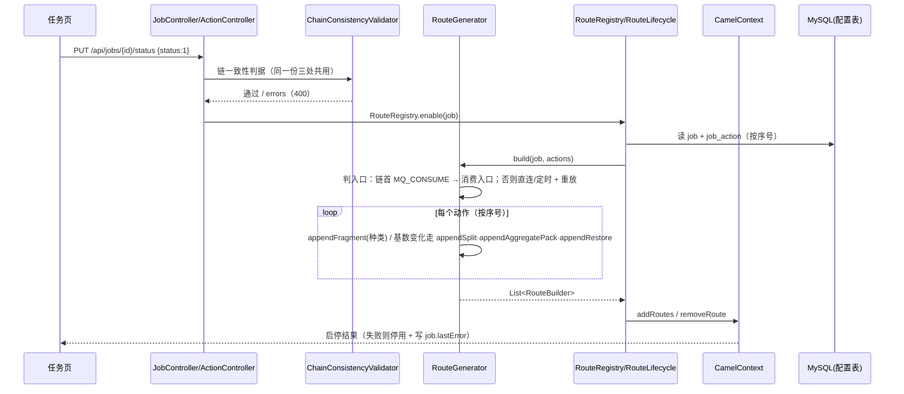

# 动作链编译流（配置 → 校验 → 片段组合成 Camel 路由；含拆分 / 合并 / 还原）

## 场景说明

一条任务的动作链怎么变成真正在跑的东西：**配置落库 → 启用前的链一致性校验 → `RouteGenerator` 按动作种类逐段追加片段 → 按序号串成一条 Camel 路由 → `RouteRegistry` 注册进 CamelContext → 被触发后执行**。
入口 = 任务页的「启用」与动作表的增删改（改完自动重建）；落点 = 运行中的路由，以及每个动作在 `message_step` 上的那一行。

本场景是**编译**视角：与 [配置流](config-flow.md)（录入与生效）和 [可靠性流](reliability-flow.md)（失败 / 重试 / 重投）互补，不重复两者的细节。

### 交互清单

| 角色 | 动作 | 触发方式 | 期望结果 |
|---|---|---|---|
| 实施工程师 | 增删改动作 | 任务页动作表 / `POST`·`PUT`·`DELETE /api/jobs/{id}/actions` | 写时链约束校验；成功后自动重建路由 |
| 实施工程师 | 校验任务 | 任务页「校验任务」/ `POST /api/jobs/{id}/validate` | 链一致性 errors 阻断启用 |
| 实施工程师 | 启用任务 | 任务页「启用」/ `PUT /api/jobs/{id}/status {"status":1}` | 编译并注册路由；失败则自动停用 + 摘路由 + 写 `job.lastError` |
| 调度 / 运维 | 手动执行、定时、外部触发 | 任务页「执行」/ `JobScheduler` / `POST /api/trigger/**` | 投递 `direct:job-<id>`，入口按**链首动作种类**判定 |
| 网关 | 启动重载 | 应用启动（`RouteLifecycle`，`@Order(3)`） | 启用中的任务重建路由；配置类问题停用，其余只记日志 |

## 流程详解

### 时序图



### 逐环节代码走查

| 环节 | 业务动作 | 入口（文件+行号） | 关键类方法 | 数据形态变化 | 错误处理 |
|---|---|---|---|---|---|
| 链一致性判据 | 写时 / `/validate` / 启用前三处共用一份判据 | `service/ChainConsistencyValidator.java:32` | `ChainConsistencyValidator`（MQ_CONSUME 只能链首且最多一个、最多一个带水位 READ_SQL、序号唯一、`sourceStep` 必须存在且更早、还原档要求上游有合并） | 动作列表 → errors / warnings | 写时 400；`/validate` 进 errors 阻断启用；启用前拒绝注册 |
| 入口判定 | 选哪种入口 | `service/RouteGenerator.java:128`（`build`） | `buildPollingEntry`（:206）、`buildConsumerEntry`（:224）、`buildReplay`（:253）、`buildResumeRoute`（:280） | 动作 + 任务 → `RouteBuilder` 列表 | 一条链最多一个 `MQ_CONSUME`（只能在链首） |
| 片段组合 | 按动作种类逐段追加 | `service/RouteGenerator.java:306`（`appendChain`） | `service/ActionFragment.java:52`（`append`，每种动作一段）；每种动作一个 `ActionConfig` record（`config/action/ActionConfig.java:13`） | 有序动作 → 一条 Camel 路由；动作输出写 exchange 属性 `edge.context`（键 = 动作序号，`0` = 任务输入） | 配置解析失败在建路由时抛错 → 由启用闸口拦截 |
| 拆分档（1→N） | 把一片数组摊成 N 条消息 | `service/SplitFragment.java:41`（`appendSplit`） | `resolveSplitSource`、`service/ElementMessageFactory.java:30`（消息标识 / 业务键 / 父消息标识 / 外层字段继承） | 父消息 → N 条子消息（新批号 + 批内序号）；本步自己记一行 | 来源取不出数组 / 路径断了 → 该步**显式失败**，不静默拆出 0 条 |
| 合并档（N→1） | 攒住一批打成一条报文 | `service/AggregateFragment.java:55`（`appendAggregateCollect`）、`:75`（`appendAggregatePack`） | `takeBatch`（:144）；攒批边界 = 上游读取批读完那一刻（不做条数阈值 / 超时） | 一批消息 → 一条报文 `{"<bodyField>":[…]}`；`edge.batchManifest` 挂属性、不进报文 | 凑不满立即失败、绝不发半批；空批 / 整批被续投跳过时挂 `edge.batchEmpty`，后面连出站都不跑 |
| 还原档（1→N） | 按业务键把响应摊回原来那几条 | `service/RestoreFragment.java:40`（`appendRestore`） | `restoreCarrier`（:102）、`markBatchCarrier`（`AggregateFragment.java:170`） | 整批响应 → 每条消息自己那一份（沿用原消息标识与批号，**不换号**） | 响应里有一条配不上 → 整批失败（同成同败） |
| 失败恢复 | 整批重走（**重跑任务**） | 无专用路由：`RouteGenerator.appendChain` 收尾（水位提交挂在一批全部完成之后） | 水位不推进即整批重读重发；合并之前的**单条**仍走断点重投（`direct:job-<id>-resume`） | 目标端会再收到一次该批请求 | 与「至少一次 + 目标端按业务键幂等」一致（#147 已删除「重发这一批」那条只发请求、不跑下游的路径） |
| 消息步 / 运行簿记 | 记一行、算耗时与尝试次数 | `service/StepLedger.java:32`（`StepLedger`） | `beginStep` / `settleStepDuration` / `stepDuration` / `attemptsOnSuccess` / `recordSuccessStep` / `recordFailure` / `finishRun` / `context` | exchange 现场 → `message_step` 与 `job_run` 两行 | 未创建消息时不记步 |
| 错误处理与重试 | 全链失败面 | `service/ErrorHandling.java:26`（`configure`） | `onException` + `maximumRedeliveries`/`redeliveryDelay`（取任务上的 `retryCount`/`backoffMs`）、`onExceptionOccurred` → 自计数、`handled` 策略 | 失败步写 `message_step`（`attempt` = 总投递次数）+ 运行标 FAILED | 消费主路由 `handled=true`；重放 / 轮询 / 断点 / 打包重发 `handled=false`（异常抛回调用方） |
| 水位提交 | 读库那一段的收尾 | `service/ReadWriteFragments.java:108`（`updateWatermark`） | 水位只在**整批成功**时推进 | 水位表游标前移 | 失败整批重读（至少一次） |
| 生命周期 | 注册 / 摘除 / 重建 | `service/RouteRegistry.java:22`、`service/RouteLifecycle.java:20` | 启用注册、停用移除、启动重载、动作变更自动重建 | 配置变更 → 路由重建 | 启用 / 重建失败 → 自动停用 + 摘路由与调度 + 写 `job.lastError` |

### 基数变化动作在链上怎么串（这一段最容易读错）

```text
读库（这一批 N 行）─ 拆分(1→N) ─ N 条 ─ 合并(N→1) ─ 1 条整批报文 ─ HTTP_CALL / MQ_PUBLISH ─ 还原(1→N) ─ N 条 ─ WRITE_UPSERT
```

三条口径（全部见 `docs/action-chain-design.md` §1.1，都是**刻意设计**）：

- **批号只在基数变化动作上转手**：拆分档现生成新号发给子消息，合并再转一次手；**还原档不换号**（它是把这一批还原回成员，不是新的一批）。
- **合并那一行记的是「整批 → 打包报文」**：打包出来的那一条消息在合并动作上记一行（输入整批、输出打包报文）；出站与还原各按**消息粒度**记行——**不再有**用 `batch:<批号>` 承载整份请求与响应的"摘要行"（它为"单独重发某一批"服务，#147 已删除那条路径）。
- **失败恢复统一为「重跑任务」**：一批里任何一步失败时水位都不推进（水位提交挂在一批全部完成之后），重跑即从未完成的那一批整批重走（含下游的还原与写回）；目标端会再收到一次该批请求，与「至少一次 + 目标端按业务键幂等」一致（#147）。
- **片段按层数记账**：读库那层是 `loopDoWhile`，拆分与还原各开一层 `split`；每开一层收尾要 `end()` 一次，且**由内到外**（Camel 的 `end()` 在循环体内只往外退一层，嵌套时只退一次会拿到外层那个 split，路由直接建不起来）。

## 测试环境

- MySQL（`:3306`/`edge_gateway`，`gateway/gateway`），Flyway 启动迁移（`spike/src/main/resources/db/migration/`，V1 建表 + 种子，V2–V7 增量）；
- 后端构建：maven **不在 PATH 上**，用 `D:\workspace\programs\edge-gateway\.tools\apache-maven-3.9.9\bin\mvn.cmd`（离线 `-o` 可用）；
- 单元测试用 H2（`spike/src/test/resources/schema.sql`），不需要 MySQL / RabbitMQ；
- 真机链路要影子站点：`tools/shadow-site/`（SQL Server 容器 + MES 替身 + 造数与验收脚本）。

## 测试数据与造数指导

造一条最小的「批量接口」链，四个基数变化相关的动作关键字段如下（字段名以各自的 config record 为准；界面在任务页动作表里配，接口是 `/api/jobs/{id}/actions`）：

| 动作（按序号） | addition 关键字段 | 配置类 |
|---|---|---|
| READ_SQL | 数据源、SQL（可含 `{watermark}`）、水位策略、水位列、批大小 | `config/action/ReadSqlConfig.java:28` |
| ONE_TO_MANY（拆分） | `mode:"split"`、`sourceStep`、`sourcePath`、`elementKey`（必填）、`keepParent` | `config/action/OneToManyConfig.java:35` |
| AGGREGATE | `bodyField`（整批包成 `{"<bodyField>":[…]}`） | `config/action/AggregateConfig.java:20` |
| HTTP_CALL | 数据源（根地址）、`path`、`method` | `config/action/HttpCallConfig.java:11` |
| ONE_TO_MANY（还原） | `mode:"restore"`、`sourceStep`（填出站那一步）、`resultKeyField`、`attachAs` | `config/action/OneToManyConfig.java:35` |
| WRITE_UPSERT | 数据源、`tableName`、`idempotencyKey` | `config/action/WriteUpsertConfig.java:11` |

反例（都用来看那道门）：

- 拆分档填 `resultKeyField`（别档的键）→ 400「未知字段」；
- 还原档而链上**没有**合并动作 → 写时 400 / `/validate` errors / 启用前拦；
- `sourceStep` 指向序号更晚或不存在的动作 → 同上三处都拦。

## 验证操作

```powershell
# 1) 相关测试类（在 spike/ 下；别一上来跑全量）
& "D:\workspace\programs\edge-gateway\.tools\apache-maven-3.9.9\bin\mvn.cmd" -o -B test `
  "-Dtest=ChainConsistencyValidatorTest,RouteGeneratorTest,RouteGeneratorBatchTest,SplitActionExecutionTest,AggregateActionExecutionTest,ElementMessageFactoryTest,OneToManyConfigTest"

# 2) 接口侧：校验 → 启用 → 手动跑一次
curl -X POST http://localhost:8080/api/jobs/{id}/validate
curl -X PUT  http://localhost:8080/api/jobs/{id}/status -H "Content-Type: application/json" -d '{"status":1}'
curl -X POST http://localhost:8080/api/jobs/{id}/run

# 3) 看批号怎么转手（这是「这几条在某一步上是一批」的唯一权威）
#    select run_id, step, message_id, status, batch_id, batch_seq, parent_message_id
#    from message_step where run_id = <上面那次运行> order by step, batch_seq;

# 4) 真机批量链路（影子站点，可选）
pwsh tools/shadow-site/verify-split-140.ps1
node tools/ui/batch-redeliver-143.cjs
```

## 建议表

| 现象 | 建议 | 理由 | 类型 | 涉及功能 | 状态 |
|---|---|---|---|---|---|
| 后端工程目录仍叫 `spike/`，但它已是真实交付代码 | 改名（如 `backend/`），或至少在根 README 首段说明「spike 就是正式后端」 | 新人按名字会判断成一次性验证工程；而 AGENTS.md 的改动纪律是按真实工程在守的 | 工程整理 / 文档偏差 | 全仓 | **文档侧已闭环**（README 加了「命名提醒」并写进「状态」段的已知债务）；目录改名仍待办 |
| 根 `README.md` 的「状态」一节仍写「进行中：M0（配置模型 + REST + 路由生成器 + 表单 UI）」 | 更新为当前状态（八种 ActionKind、消息历史与重投、基数变化两档、测试项数） | 它是新人读到的第一份文档，与 `docs/features/` 和测试实际已经不一致 | 文档偏差 | 仓库门面 | **已闭环**（本轮重写「状态」段：八种动作、消息历史、624 项测试、已知债务） |
| `RouteGenerator` **1405 行**，且改动集中在 `appendSplit` / `appendAggregatePack` / `appendRestore` 三段 | 按片段与簿记分家（装配 / 拆分 / 合并 / 还原 / 簿记），`appendChain` 只做分派 | AGENTS.md 记录过：该文件曾在一轮里吃 70 次 `edit`（占全部 edit 的 51%），拆开后单次改动面变小 | 设计改进 | 任务与动作链 | **已闭环**（[#145](https://github.com/zz240/sailheader-mes-middleware/issues/145)：装配 1405 → **400 行**（含 javadoc），另立 `StepLedger`(318) / `SplitFragment`(159) / `AggregateFragment`(188) / `RestoreFragment`(152) / `ActionFragment`(189) / `ReadWriteFragments`(204) / `BatchResendRoute`(123) / `ErrorHandling`(37) / `RouteKeys`(84) / `ResponseTexts`(29)；`mvn -o -B test` 624 项 0 失败、用例与断言一字未改） |
| `config/` 包同时装「动作追加配置 record（数据域）」与「Spring / Camel 装配类」 | 已拆成 `config/action/`（动作追加配置 10 个）、`config/datasource/`（数据源追加配置 6 个）与 `config/`（Spring/Camel 装配 + 共用的 `ConfigValues`） | 两类关注点生命周期完全不同，现在找文件靠记名字 | 设计改进 | 全仓 | **已闭环**（本轮：21 个文件 `git mv` 保留历史、26 个文件改 import；`mvn test` 624 项 0 失败） |
| 原以为文档里仍有旧名 `SPLIT` / `FANOUT` 的叙述（`docs/design/docking-scenarios-spec.md`、`docs/adr/0014`） | 无需再扫 | 本轮复核（全 `docs/**/*.md` 检索）：那两处已无该旧名，#144 已收口；现存 `fanout` 字样都是 **RabbitMQ exchange 类型**（ADR-0010、`features/transport` 等），不是动作名 | 文档偏差 | 任务与动作链 | **已闭环**（复核确认无残留） |
| `docs/features/job-action-chain/README.md` 的「代码位置」点名 `appendFanout` / `prepareFanout` | 已改为 `appendRestore` / `restoreCarrier` / `markBatchCarrier`（本轮修正） | #143 中版把这两段改名了：照旧名去 `RouteGenerator.java` 里搜一个都搜不到（本轮 grep 确认只有 `appendRestore:654` / `restoreCarrier:717` / `markBatchCarrier:735`） | 文档偏差 | 任务与动作链 | **已闭环**（本轮） |
| 链一致性只校验 `sourceStep` 的**存在性与先后**，不校验语义漂移 | 若要收紧，得先给动作一个稳定身份（而不是序号） | 重排后「同序号换成了另一个动作」仍会静默放行 | 设计改进 | 任务与动作链 | 已知限制（功能页已记） |
| `docs/flows/field-mapping/*` 里对 `FieldMappingConfig` 的**行号引用整体漂移约 10 行**（文档引 `validate():67` / `problems():86`，实测在 `config/action/FieldMappingConfig.java:78` / `:97`） | 做一轮「按代码核对行号」，或把这些位置的引用降级成只写方法名（`FieldMappingConfig.problems()`） | 这两处是**本次挪包之前就漂的**（不是 +1 偏移造成的）；行号引用在这种热点文件上维护成本高于收益 | 文档偏差 | 字段映射 / 任务与动作链 | 待办（本轮测量，未实施） |
