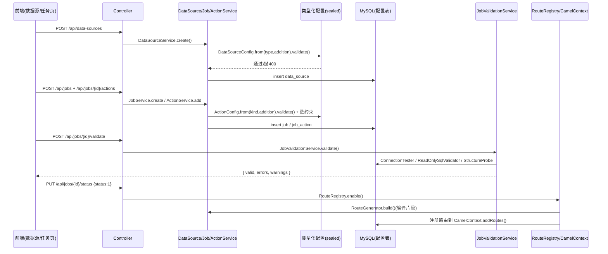

# 配置流（数据源 / 任务 / 动作 / 模板 / 站点）

## 场景说明

配置如何进入系统并生效：**录入（表单/API）→ 校验（必填 / 取值 / 未知字段 / 强类型）→ 落库（MySQL 配置表）→
生效（启用时注册 Camel 路由，动作变更自动重建）**。入口 = 前端表单 + REST；落点 = 配置库与运行中的 Camel 路由。
本场景不止一次交互：**建数据源 → 建任务/动作 → 校验 → 启用**。

### 交互清单

| 角色 | 动作 | 触发方式 | 期望结果 |
|---|---|---|---|
| 实施工程师 | 新建数据源 | 数据源页 / `POST /api/data-sources` | 数据源落库，名称站点唯一 |
| 实施工程师 | 新建任务 + 动作链 | 任务页 / `POST /api/jobs`、`POST /api/jobs/{id}/actions` | 任务与动作落库，序号唯一 |
| 实施工程师 | 校验配置 | 任务页"校验任务" / `POST /api/jobs/{id}/validate` | 返回 `{valid,errors,warnings}` |
| 实施工程师 | 启用任务 | 任务页"启用" / `PUT /api/jobs/{id}/status` | 路由注册到 Camel；动作变更后自动重建 |

## 流程详解

### 时序图



### 逐环节代码走查

| 环节 | 业务动作 | 入口（文件+行号） | 关键类方法 | 数据形态变化 | 错误处理 |
|---|---|---|---|---|---|
| 建数据源 | 录入连接实例 | `DataSourceService.create`（`service/DataSourceService.java:28`） | `DataSourceRequest` `@JsonCreator` 按 `type` 分派 → `DataSourceConfig.from().validate()` | JSON → 类型化 record → `toMap()` 落库 | 未知键/缺必填→400；同站点重名→409（`DUPLICATE_NAME`） |
| 建任务 | 录入任务元信息 | `JobService.create`（`service/JobService.java:24`） | `JobService.validate`（:89） | JSON → `Job` 实体 | 必填/重名→400/409 |
| 建/改动作 | 按类型填字段 | `ActionService.add`（`service/ActionService.java:47`）/ `update`（:67） | `ActionConfig.from().validate()` + `validateChain`（:169） | `Action` + `addition`（JSON 列） | MQ_CONSUME 只能链首、序号唯一、最多一个 CONSUME/水位 READ_SQL |
| 配置校验 | 连通性+只读 SQL+北向字段存在性 | `JobValidationService.validate`（`service/JobValidationService.java:58`） | `validateRemoteAction`（:81）、`validateSql`（:104） | 无状态变更 | errors 阻断启用，warnings 仅提示 |
| 启用 | 注册/移除路由 | `RouteRegistry.enable`（`service/RouteRegistry.java:52`）/ `disable`（:70） | `RouteGenerator.build`（`service/RouteGenerator.java:70`） | 配置 → Camel `RouteBuilder` | 注册失败→停用任务；启动 `reloadEnabledJobs`（:41）单个失败跳过 |

配置强类型分派：`DataSourceRequest`/`ActionRequest` 用 `@JsonCreator` 手工分派（Jackson `EXTERNAL_PROPERTY` 对
record 不可用），`DataSourceConfig.from` / `ActionConfig.from` 用 `rejectUnknownKeys` 拒绝未知键（DS-2）。

## 测试环境

- MySQL（`:3306`/`edge_gateway`，`gateway/gateway`），Flyway 启动迁移（`db/migration/V1__init_schema.sql` 建表+种子）；
- 前端（5173，代理 `/api`→8080）或直接 `curl`；配置 CRUD/校验无需 RabbitMQ/mock（连通性测试需对应服务在线）。

## 测试数据与造数指导

| 环节 | 入（怎么造） | 出 | 验证 |
|---|---|---|---|
| 建 HTTP 数据源 | `POST /api/data-sources` `{"name":"mes-api","siteId":1,"type":"HTTP","address":"http://localhost:9099","addition":{"token":"mock-token"}}` | `data_source` 一行 | 201 + 列表可见 |
| 建非法数据源（失败） | 缺 `password` 的 MYSQL：`{"type":"MYSQL","addition":{"url":"...","username":"u"}}` | 400 | `message` 定位字段 |
| 建未知键（失败） | `{"type":"HTTP","addition":{"token":"x","foo":1}}` | 400 | `未知字段: foo` |
| 校验任务 | `POST /api/jobs/{id}/validate` | `{valid,errors,warnings}` | `READ_SQL` 需连接/只读 SQL 通过，北向字段存在性给 warnings |
| 启用 | `PUT /api/jobs/{id}/status {"status":1}` | Camel 路由注册 | `RouteRegistry` 日志 / `GET /actuator/camelroutes`（若有） |

## 验证操作

```powershell
curl -X POST http://localhost:8080/api/data-sources -H "Content-Type: application/json" -d '{"name":"mes-api","siteId":1,"type":"HTTP","address":"http://localhost:9099","addition":{"token":"mock-token"}}'
curl -X POST http://localhost:8080/api/jobs/{id}/validate
curl -X PUT http://localhost:8080/api/jobs/{id}/status -H "Content-Type: application/json" -d '{"status":1}'
```

## 建议表

| 现象 | 建议 | 理由 | 类型 | 涉及功能 | 状态 |
|---|---|---|---|---|---|
| C2 `RabbitMqDataSourceConfig` 仍强制 `queue` | 已在 **745bb99**（数据源连接级统一）实施：数据源仅 `host/port/username/password`（默认值），`queue` 进动作（`MqConsumeConfig` 必填/`MqPublishConfig` 可选）；写入 `queue` 得 400 未知字段（`DataSourceConfigTest` 断言）；`DataSourceAdditionMigration` 清存量。本次仅修正 `model/DataSource.java` 遗留 javadoc | 与 ADR-0007 一致：数据源=连接实例，资源在动作 | 设计改进/缺陷 | 数据源 | 已闭环 |
| C4 `job` 表残流水位列（`watermark_type`/`watermark_column`，745bb99 前的存量库） | 已引入 Flyway（`flyway-core`+`flyway-mysql`）版本化迁移：`db/migration/V2__drop_job_watermark_columns.sql` 启动时自动删列，存量库 baseline-version=1 只跑增量；代码侧（init.sql/schema.sql/Job 实体/`types.ts`/任务表单）已在 745bb99/9737fe7 清理 | 水位已迁到 READ_SQL 动作，属迁移残留；旧库无迁移机制，由 Flyway 接管 | 文档偏差 | 数据源/配置界面 | 已闭环 |
| 文档原称"MySQL 密码经 AES 加密落库"，但代码无 AES/Cipher/MasterKey | 改为与实现一致的"明文落库" | `features/data-source` 页存在敏感字段脱敏待办，需文档与代码一致 | 文档偏差 | 数据源 | 已闭环 |
| 数据源 addition 原为 JSON textarea | 已改为按类型特化表单（以 address 为准 + 高级 JSON 兜底） | `config-ui` 页已列入时间线 | 业务改进 | 配置界面 | 已闭环 |
