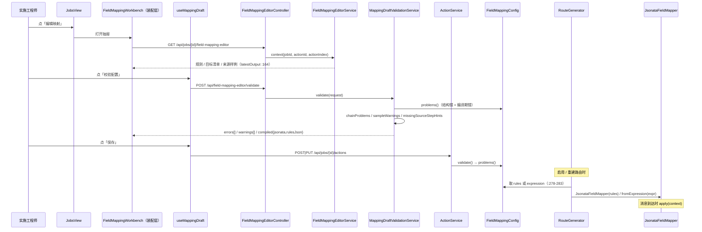

# 字段映射（走查总览）：规则模型 → 编译 → 求值，两档校验与保存那道门

> 本轮走查（2026-09-16，第三次；#117 编辑器拆份之后）**只读当前工作树代码，未运行任何测试或真机脚本**。
> 文中「文件+行号」取自本轮读到的版本；凡引用历史实测，均注明当时的验收脚本或测试类。
> 术语用 `CONTEXT.md` 的定义；决策依据见 `docs/adr/0011`、`docs/adr/0012`；功能现状见 `docs/features/field-mapping/README.md`。

## 场景说明

字段映射 = **FIELD_MAP 动作**：把动作链上更早某一步的输出，按规则转换成后续动作要消费的目标结构。
入口只有一个——动作表上的「编辑映射」（`frontend/src/views/JobsView.vue:117`，抽屉在 `:245`；
新建 FIELD_MAP 也从这里进，`#107` 起旧三栏编辑器已删）；落点 = 一个目标对象（`Map`），
交给后面的 `HTTP_CALL` / `MQ_PUBLISH` / `WRITE_UPSERT`。

字段映射**按映射形态拆成五份**走查，本文件只讲形态无关的三件事：编辑器怎么装配、校验与保存那道门怎么设、
规则怎么变成表达式并在消息到达时求值。

| 形态 | 场景（入口 → 落点） | 产物文件 |
|---|---|---|
| 标量行 | 一个目标字段一行 → 行级转换（STRING/INT/DATE/ENUM/CONSTANT/INDEX）→ 目标字段 | [scalar-row-mapping.md](scalar-row-mapping.md) |
| 数组 / 层级 | 数组行选来源数组 + 子行相对路径 + 「外层 · 」引用 → 目标数组 | [array-mapping.md](array-mapping.md) |
| 拼接 / 片段 | 一个目标字段多段拼起来，每段各挂一个转换（#112） | [concat-part-mapping.md](concat-part-mapping.md) |
| 手写表达式 | `mode=EXPRESSION`：整段 JSONata，跳过规则树校验 | [expression-mode.md](expression-mode.md) |
| 建议器 | 结构探测 → 归一化 → 相似度 → 历史复用 → 转换推断（当前无 UI 入口） | [suggester.md](suggester.md) |

### 交互清单（形态无关的那几条）

| 角色 | 动作 | 触发方式 | 期望结果 |
|---|---|---|---|
| 实施工程师 | 打开编辑器 | 动作表「编辑映射」/ 新建 FIELD_MAP 时的「去配字段映射」 | 抽屉里回填这份动作的规则、目标清单、来源样例 |
| 实施工程师 | 校验草稿 | 抽屉里的「校验配置」 | 问题按行定位 + 编译产物两份文本；**不写库** |
| 实施工程师 | 保存 | 抽屉里的「保存」（新建时顺带建动作） | 规则落库；只有**错误**拦得住 |
| 系统 | 编译 | 路由构建期（启用 / 重建 / 启动重载） | `rules` 或 `expression` → JSONata 表达式，构建期一次 |
| 系统 | 求值 | 消息到达那一步 | 上下文 → 目标对象 |

## 流程详解

### 时序图（形态无关的主链）



### 逐环节代码走查（形态无关）

| 环节 | 业务动作 | 入口（文件+行号） | 关键类方法 | 数据形态变化 | 错误处理 |
|---|---|---|---|---|---|
| 编辑器装配 | 抽屉 + 状态编排 + 键盘 | `frontend/src/views/JobsView.vue:117`、`:245`；`components/FieldMappingWorkbench.vue:370`（接线）、`:152-158`（子组件与组合式函数） | `useWorkbenchState` / `useMappingDraft` / `keyIntent` | 动作 `addition` → 行模型 | 子组件不发请求（#98 D1 的延续） |
| 拉上下文 | 打开编辑器时那份事实 | `web/FieldMappingEditorController.java:39-40`；来源清单 `:47` → `service/FieldMappingEditorService.java:61`、`latestOutput:164` | `context` | 动作链 + 最近一次成功运行输出 → 编辑器视图 | 探不到结构 → 空清单（**不是**配置的错） |
| 校验草稿 | 「校验配置」 | `web/FieldMappingEditorController.java:69-70` → `service/MappingDraftValidationService.java:60`（模式分岔 `:213`、编译 `:176`、规则 JSON `:197`） | `validate` | 草稿 + 目标清单 + 样例 → `errors[]/warnings[]/compiled` | 只读：不写库、不改规则格式 |
| 结构错 | 后端会不会拒 | `config/FieldMappingConfig.java:67`（`validate()` 抛 `problems()` 拼成的一条）、`:86` | `problems()` | 规则树 → 问题列表 | #113 补重复目标/前缀冲突、#114 补目标字段路径不合法 |
| 链一致性 | sourceStep 指得对不对 | `service/ChainConsistencyValidator.java:42`、`:82`（草稿校验共用）、`:105`；`service/JobValidationService.java:142` | `check` / `checkRules` / `describeAll` | 动作链 + rules → 问题列表 | sourceStep 悬空/错位/指向自己或更晚 → 错误 |
| 保存 | 写库那道门 | `service/ActionService.java:120`（`validate` 定义）；新增 `:55` `validate` / `:56` `addition().validate()` / `:57` `validateChain`，修改 `:71` / `:72` / `:73`；存完 `rebuildRoutesIfEnabled`（`:65` / `:81`） | — | 编辑器草稿 → `addition` JSON | 有问题 → 400，消息是**全部**结构问题用 `；` 连接 |
| 编译 | 路由构建期一次 | `service/RouteGenerator.java:278-283` → `mapping/JsonataRuleCompiler.java:36`、`mapping/JsonataFieldMapper.java:26`（`fromExpression`） | `compile` | `rules` / `expression` → JSONata 表达式 | 编译期错已在 `problems()` 里报，构建期不再第一次遇见 |
| 求值 | 消息到达那一步 | `mapping/JsonataFieldMapper.java:46`（引擎 dashjoin jsonata 0.9.10，`spike/pom.xml:119`；实例在构建期建好、跨消息复用，`RouteGenerator.java:281-284`） | `apply` | 上下文 `Map<Integer,Object>` → 目标对象 | 求值异常 → FAILED 消息步 |
| 输入规范化 | 求值前处理 JDBC 值 | `mapping/JsonataInputs.java:22` | `normalize` | 非 JSON 安全的 JDBC 类型 → JSON 值 | — |

### 两档校验与保存那道门（各形态的具体检查见各份文件）

- **错误** = 这份草稿现在存下去后端会拒，只有两类：**结构错**（`FieldMappingConfig.problems()`，
  `config/FieldMappingConfig.java:86`，`validate():67` 抛的就是它拼起来的那一条）与**链问题**
  （`ChainConsistencyValidator`）。#113 起编译期才发现的重复目标字段 / 前缀冲突也在这里报，#114 起目标字段路径
  不合法（`a..b` / `.a` / `.`）同样在这里报——以前它们只在启用重建路由时炸。
- **警告** = 能存能跑、结果大概不是你要的：依赖目标清单与来源样例的六条（`service/MappingSampleChecks.java`
  `unknownSources:69` / `missingRequiredTargets:91` / `uncoveredEnumValues:104` / `textIntoNumberTarget:117` /
  `emptyConcatParts:138` / `datePatternWarnings:160`）+ 顶层漏写 `sourceStep` 的提示
  （`MappingDraftValidationService.missingSourceStepHints:154`）。后端从来不拒这几种。
- **保存只被错误拦住**（`frontend/src/mapping/useMappingDraft.ts:227` 保存、`:76` 校验、`:161` `hasValidation`）：
  行右侧那三种状态**只由后端那一次结果给**；没校验过的草稿不冒充校验过。
- **日期格式串两层**：合法性是**错误**（`mapping/DatePatterns.java:44` `isLegal` / `:49` `problem`，默认值 `:35`），
  按样例值真跑一遍跑不出来是**警告**（`mapping/JsonataFunctions.java:57` `canFormat`，运行时实现是 `:43` `formatDate`）。
- **请求与响应形状**：`web/dto/MappingDraftRequest.java:24-31`（`draft` / `targets` / `sourceFields` /
  `sourceFieldsStep` / `earlierActionIndexes` / `defaultSourceStep` / `actionIndex`）、
  `web/dto/MappingDraftValidation.java:20-24`（`valid` / `errors[]` / `warnings[]` / `compiled{jsonata,rulesJson}`）；
  问题定位用 `Problem(target, parent, message)`（`:33`，数组子行写相对路径）。
- **它替代不了 `POST /api/jobs/{id}/validate`**：那个按 job id 校验**已经存进数据库**的配置
  （`web/JobController.java:115-116`）。

## 测试环境

| 要什么 | 用在哪 | 本轮是否启动 |
|---|---|---|
| 后端 8080 | 编辑器上下文、`/api/field-mapping-editor/validate`、`/api/jobs/{id}/validate`、`/api/mapping-suggestions` | 未启动（本轮只读代码） |
| 配置库 MySQL | 动作、规则、消息步（来源样例取自最近一次成功运行） | 未启动 |
| 浏览器 + `tools/ui/*.cjs` | 真机 UI 验收（脚本自带 playwright，按功能命名） | 未运行 |
| 什么都不用 | 编译与求值（`mapping/JsonataRuleCompilerTest`、`JsonataS0SpikeTest`）、纯前端模块自检 | 未运行 |

前端 `frontend/src/mapping/` 里除 `useWorkbenchState.ts`、`useMappingDraft.ts` 两个组合式函数外都是纯模块
（不碰 DOM、不发请求），可以用 `node --experimental-strip-types` 直接跑。

## 测试数据与造数指导

形态无关的三份最小输入（各形态的细则见各份文件）：

| 要给什么 | 形状 | 用在哪 |
|---|---|---|
| 规则草稿 | `{"rules":[{"sourceStep":1,"source":"order_no","target":"sheet_no"}]}` | 保存 / 校验 / 编译 |
| 手写表达式草稿 | `{"mode":"EXPRESSION","expression":"{ \"sheet_no\": $s_1.order_no }","rules":[]}` | 同上（`mode` 分岔） |
| 校验请求 | `{"draft":{...},"targets":[{"path":"sheet_no","type":"VARCHAR","required":true,"element":null}],"sourceFields":[{"path":"order_no","type":"VARCHAR","samples":["PO-2026-001"]}],"sourceFieldsStep":1,"earlierActionIndexes":[1],"defaultSourceStep":1,"actionIndex":2}` | `POST /api/field-mapping-editor/validate` |

**失败样例（形态无关的那两条）**：

| 失败 | 入 | 出 | 验证 |
|---|---|---|---|
| 两条规则写同一个目标字段 | 两条 `target` 都写 `sheet_no` | 400 | 消息含「重复映射」，且 `errors[]` 里也有一条（#113） |
| 顶层规则 `sourceStep` 指向自己 / 更晚 / 不存在的动作 | `sourceStep: 3`（本动作序号 2） | 400 | `ChainConsistencyValidator.describeAll` 的原话（#89） |

## 验证操作

```powershell
# 只读校验编辑器里的草稿（不写库）
curl -X POST http://localhost:8080/api/field-mapping-editor/validate -H "Content-Type: application/json" -d '{...}'
# 校验已经存进库的配置
curl -X POST http://localhost:8080/api/jobs/1/validate
# 相关测试（本轮一条都没跑）
mvn -f spike/pom.xml test -Dtest='JsonataRuleCompilerTest,MappingDraftValidationServiceTest,FieldMappingEditorControllerTest,JobValidationServiceTest'
node --experimental-strip-types frontend/src/mapping/checks.ts
```

## 建议表

> 本表只收**跨形态**的条目；五份形态文件各自还有自己的建议表。各文件里的 `N*` 是**该文件内**的新发现
> 编号，跨文件不连续（判据：走查只产出文档与建议清单，路由方式见 [../README.md](../README.md) 文末）。

| 现象 | 建议 | 理由 | 类型 | 涉及功能 | 状态 |
|---|---|---|---|---|---|
| N1 旧 `docs/flows/transform-flow.md` 的行号（`FieldMappingWorkbench.vue`、`MappingEditor.vue`、`RuleMappingSuggester:25` 等）在 #107/#117 之后大面积失效，一份文件里混着五种映射形态 | 已拆成五份按形态走查 + 本总览；旧文件留导航与旧编号对照，正文不再维护（ADR-0011/0012 对 P9、F1 的引用照对照表仍能落地） | 一张票只动一种形态，读者与实施者都少读一半；行号集中在一处维护 | 文档偏差 | 字段映射 | 已闭环（本轮） |
| N2 `docs/flows/README.md` 索引里字段映射一行的「涉及的页面/模块」写着**建议面板**——该面板已随 #107 与旧编辑器一起删除，界面上没有建议入口 | 索引改成五个形态各一行（建议器那行注明「当前无 UI 入口」）；总览里同步说清 | 索引是读序第一站，写着不存在的入口会让人去找 | 文档偏差 | 字段映射 | 已闭环（本轮） |
| N3 `docs/flows/northbound-sync.md:54-55`、`notify-push.md:45-46`、`southbound-sync.md:46-47` 把 `appendFragment` 当成动作类型的注解（「FIELD_MAP（`appendFragment`）」）——它是 `RouteGenerator` 的**私有**路由拼装方法（`service/RouteGenerator.java:271`，由 `appendChain:251` 调用），不是动作类型，也不能用来区分动作 | 三份文件里把那处括号删掉或改成「经 `appendChain` → `appendFragment` 拼装」，别让读者以为存在一个叫 `appendFragment` 的动作种类 | 动作类型只有 `ActionKind` 那几种；这类注解会被当成契约抄进新文档 | 文档偏差 | 配置流 / 字段映射 | 待评估（未改这三份，属其它场景的走查） |
| N4 `AGENTS.md` 的 token 预算一节写「最大文件 `frontend/src/mapping/checks.ts`（1610 行）、`MappingDraftValidationServiceTest`（1272 行）」「`MappingRowList.vue`（约 755 行）」——这三份在 #113/#114/#117 之后都长了；本轮按**整文件行数（含空行）**数是 **1706 / 1309 / 775** | 下次动 `AGENTS.md` 时把三个数更新，并注明口径「含空行的整文件行数」：`Get-Content <f> \| Measure-Object -Line` 会**漏掉空行**，同一份文件它数出 1547 / 1118 / 696——口径不写清就会越改越乱 | 预算一节是用来决定「先读哪一份」的，数字错了选文件就错 | 文档偏差 | 字段映射 | 待评估 |
| N5 「校验不是实时的」（改完行要再点一次「校验配置」，行状态不随编辑失效）是 #98 的决定，但第二轮（#113）之后行上同时挂着前端自己的提醒（清掉的行那条），两种来源的状态容易让人以为已经重新校验过 | 保持现状；已在各形态文件与本总览里写明「行状态只由后端那一次结果给、前端提醒不冒充结论」 | 没跑过的草稿不该冒充跑过 | 文档偏差 | 字段映射 | 已闭环（本轮：写明口径） |
| N6 旧文档与旧索引把建议端点写成 `POST /api/suggestions`——真实路径是 `POST /api/mapping-suggestions`（`web/SuggestionController.java:15`）；结构探测端点也不是 `/api/structure-probe`，而是 `/api/data-sources/{id}/probe`、`/api/probe/sample`、`/api/data-sources/{id}/suggest-table`（`web/StructureProbeController.java:29、48、54`） | 本总览与 [README.md](../README.md) 索引已改成真实路径；其余旧引用见 [建议器](suggester.md) 的 N1 | 照旧文档敲 curl 会 404，排查成本白花 | 文档偏差 | 字段映射 | 已闭环（本轮：总览与索引） |
