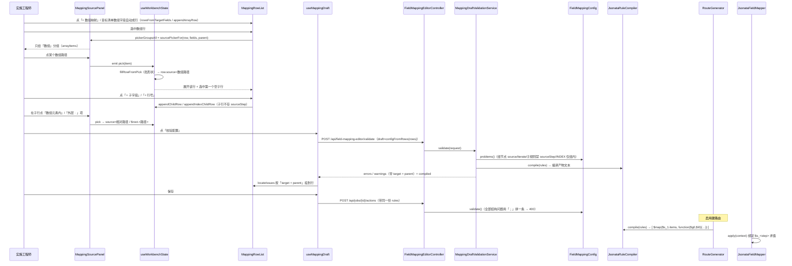

# 数组 / 层级映射：数组行 + 子行 + 外层引用 → `$map` 组规则

> 本轮（#117 重构后）走查只读当前工作树代码，未运行任何测试或真机脚本；文件中行号取自本轮读到的版本。

关联形态：[标量行映射](scalar-row-mapping.md)、[拼接与片段转换](concat-part-mapping.md)、[总览](README.md)；
术语按 `GLOSSARY.md`（**字段映射规则**、**转换**、**片段转换**、**草稿**、**来源字段样例**、**配置期校验**）。

## 场景说明

**业务故事**。上一步动作（`READ_SQL` 读客户 ERP 的 BOM 表、或 `MQ_CONSUME` 收到的报文）输出一份 JSON：
既有表头字段（`bomNo` / `productCode` / `productName`…），又有一个明细数组（`items`，每个元素是一条用料明细）。
目标系统（MES）要的不是「一条明细一行」，而是**一张 BOM 带一个明细数组**。实施工程师在字段映射编辑器里：

1. 给目标数组字段 `bom.bomLines` 占**一行**，在这一行上选**来源数组** `items`；
2. 这一行下面展开**子行**（分组标题「数组元素内」），逐条把明细字段写进数组元素的相对目标字段
   （`lineNo` / `materialCode` / `qty` …）；
3. 明细每一行还要带表头的值（比如 `productName`）——子行从左边清单的**「外层」**分组点一项，
   界面显示「外层 · productName」，规则里存成 `$root.productName`。

**链路形态**：入口 = 动作表上的「编辑映射」（`frontend/src/views/JobsView.vue:112-117`）→ 逐行编辑器
（数组行 + 子行，`frontend/src/components/FieldMappingWorkbench.vue` 装配，
`frontend/src/views/JobsView.vue:243-255`）→ 保存 = `POST /api/jobs/{id}/actions` 把 `rules` 落库
→ 启用建路由时编译成 JSONata（`spike/.../service/ActionFragment.java:58-60`）→ 消息到达时求值
（`spike/.../mapping/JsonataFieldMapper.java:46-55`）→ 落点 = 目标对象（`Map`），供后续 HTTP/MQ/写库消费。

**「外层」的语义**（本形态最容易填错的一处）：它**始终指这份来源数据的顶层对象**，不是「上一层」、
不是「父级数组元素」。界面上叫「外层 · 字段名」（`frontend/src/mapping/source-picker.ts:61-62`、
`frontend/src/mapping/labels.ts:8,12-13,45`），规则里存 `$root.<路径>`（`source-picker.ts:265`），
编译器还原成 `$s_<step>.<路径>`（`spike/.../mapping/JsonataRuleCompiler.java:313-315`）——
它是**绝对路径**，跟当前数组元素无关。

### 交互清单

| 角色 | 动作 | 触发方式 | 期望结果 |
|---|---|---|---|
| 实施工程师 | 让目标数组字段占一行 | 目标清单里有数组字段（`TargetField.element` 非空）时自动长成组行；清单不全时点「+ 数组映射」手加 | 一行数组映射（`iterate='FOR_EACH'`），值列写「还没选来源数组」 |
| 实施工程师 | 选来源数组 | 选中数组行 → 左边清单（这一行只给「数组」分组）点一个数组路径 | 行上 = 数组路径；该数组行自动展开并选中第一个空子行 |
| 实施工程师 | 展开 / 收起子行 | 数组行下面「数组元素内」标题上的「▾ 收起 / ▸ 展开」，或行头「收起全部数组」 | 子行铺出来 / 收起来；问题列表跳行时先自动展开祖先数组行 |
| 实施工程师 | 加子行 | 数组行上的「+ 子字段」/「+ 行号」 | 多一行子行（目标字段写相对路径）；行号子行取值固定是行号、起始值就地改 |
| 实施工程师 | 子行取数组元素内的字段 | 选中子行 → 清单「数组元素内」分组点一项 | 行上 = 相对路径（`materialCode`），且**子行不带 `sourceStep`** |
| 实施工程师 | 子行取外层表头字段 | 选中子行 → 清单「外层」分组点一项 | 行上显示「外层 · 字段名」，规则里 = `$root.<路径>` |
| 实施工程师 | 校验草稿 | 点顶部「校验配置」 | 问题按「目标字段 + 所属数组行」挂到行上；底部两页给出编译产物（JSONata / 规则 JSON） |
| 实施工程师 | 保存 | 抽屉「保存」（先自动跑一次校验，**只有错误**拦下并跳到第一条错误行） | `rules` 落库（组节点 + `iterate` + `children`）；被拒时抽屉不关 |
| 系统 | 编译与求值 | 启用（重建路由）/ 消息到达 | `[ $map($s_1.items, …) ]` 恒为数组；求值出目标对象 |

## 流程详解

### 时序图



### 逐环节代码走查

| 环节 | 业务动作 | 入口（文件+行号） | 关键类方法 | 数据形态变化 | 错误处理 |
|---|---|---|---|---|---|
| ① 生成数组行 | 目标清单里的数组字段占一行并带子行 | `frontend/src/mapping/editor-model.ts:51-60`；手加走 `editor-model.ts:84-89` | `rowsFromTargetFields` / `appendArrayRow` | `TargetField{element[]}` → 组行（`children` = 元素字段各一行） | 无（只是行模型） |
| ② 选来源数组（清单） | 数组行只给数组，别的项给了就是接不上 | `frontend/src/components/MappingSourcePanel.vue:50-51` → `source-picker.ts:107-122` | `sourcePickerFor` / `arrayItems`（`source-picker.ts:193-212`） | 来源字段清单 → `PickableItem{kind:'array'}` | 分组为空时给一句说明（`source-picker.ts:64-65`） |
| ③ 选来源数组（填行） | 点一项填进这一行，形状不对就拒 | `source-picker.ts:247-274`；调用方 `frontend/src/mapping/useWorkbenchState.ts:383-405` | `fillRowFromPick` | `PickableItem` → `row.source='items'`；数组行选完自动选中第一个空子行并展开（`useWorkbenchState.ts:394-401`） | `reason='array-expects-array'/'not-array'/'child-wants-relative'`，文案见 `source-picker.ts:277-286` |
| ④ 展开 / 收起子行 | 收起的子行不铺出来 | `MappingRowList.vue:89-106,405-417`；`useWorkbenchState.ts:140-169` | `toggledRowIds` / `visibleRows`（`source-picker.ts:291-315`）、`displayRows` | 行树 + 收起集合 → 界面上「数组元素内」标题与其子行 | 跳行前先展开祖先数组行（`useWorkbenchState.ts:407-419`、`source-picker.ts:323-337`） |
| ⑤ 加子行 / 加行号子行 | 「+ 子字段」/「+ 行号」 | `MappingRowList.vue:536-543` → `useWorkbenchState.ts:205-222` → `source-picker.ts:339-358` | `appendChildRow` / `appendIndexChildRow` | `children` 追加一行；行号子行 = `source='$index'`、`transform='INDEX'`、`startAt=1`、**不存 sourceStep** | 非数组行直接原样返回（`source-picker.ts:341,354`） |
| ⑥ 子行取「数组元素内」 | 相对路径进子行 | `MappingSourcePanel.vue:50-51` → `source-picker.ts:128-140,151-170`；填行 `source-picker.ts:265-268` | `childRowGroups` / `elementItems` | 探测路径 `items[0].materialCode` → 项 `materialCode` → 行 `source='materialCode'`、`sourceStep=null` | 顶层行收了元素字段会被挡（`source-picker.ts:261`） |
| ⑦ 子行取「外层 · 」 | 顶层对象引用 | `source-picker.ts:138,176-190`；填行 `source-picker.ts:263-268` | `outerItems` / `fillRowFromPick` | 顶层字段 `productName` → 行 `source='$root.productName'`、界面「外层 · productName」 | 普通行没有「外面那一层」，会被挡（`source-picker.ts:262-263`） |
| ⑧ 行号子行 | 取值固定是行号，起始值就地改 | `MappingRowList.vue:525-533` → `frontend/src/components/MappingIndexParams.vue:21-23`；规则侧 `frontend/src/mapping/rows.ts:155-159` | `onStartAtChange` / `ruleFromRow` | `startAt` 写进行与规则；`source` 恒为 `$index` | 起始值空 → 1（一处定义，`MappingIndexParams.vue:4-6`） |
| ⑨ 清除 / 撤销一行 | 清的是「值怎么取」，子行留着 | `rows.ts:239-251`（`clearRowMapping`）、`rows.ts:185-206`（`isRowConfigured`） | `clearRowMapping` / `isRowConfigured` | 数组行清完 = 「一行没有来源数组的数组映射」，`children` 不动（`rows.ts:233-237`） | 清完的行不进草稿（`editor-model.ts:334-340`），目标字段与子行留着 |
| ⑩ 校验草稿（前端装请求） | 草稿 = 保存会写出去的那份 | `frontend/src/mapping/useMappingDraft.ts:76-96` → `frontend/src/mapping/draft.ts:90-100` | `draftRequest` | 行树 → `{draft:{rules[]}, targets, sourceFields, sourceFieldsStep, …}` | 请求失败提示「校验没跑起来」（`useMappingDraft.ts:96`） |
| ⑪ 校验草稿（结构 + 链） | 后端判对错 | `spike/.../web/FieldMappingEditorController.java:69-72` → `spike/.../service/MappingDraftValidationService.java:60-92` | `MappingDraftValidationService.validate` → `FieldMappingConfig.problems()`（`FieldMappingConfig.java:87-107,213-270`） | 草稿 JSON → `FieldMappingConfig` → `RuleProblem{target,parent,message}` | 错误只有结构错与链问题（`MappingDraftValidationService.java:78-82`），全部「错误」才 `valid=false` |
| ⑫ 校验草稿（样例依赖的警告） | 来源路径在不在、必填配没配 | `MappingDraftValidationService.java:119-130` → `spike/.../service/MappingSampleChecks.java:69-79,91-101` | `unknownSources` / `missingRequiredTargets` / `RuleScope`（`MappingSampleChecks.java:184-217`） | 相对路径补上组节点的来源数组再查（`MappingSampleChecks.java:205-210,227-237`）；`$root.` 去掉前缀按绝对查 | 全是警告，一条都不拦保存（`MappingSampleChecks.java:36-38`） |
| ⑬ 编译产物 | 草稿编成 JSONata 文本 | `MappingDraftValidationService.java:176-194` → `JsonataRuleCompiler.java:36-48,127-164` | `compile` / `groupExpr` | `List<FieldMappingRule>` → `[ $map($s_1.items, function($g0, $i0) { {…} }) ]` | 编不出来补一条错误（`MappingDraftValidationService.java:184-189`） |
| ⑭ 保存 | 同一份 rules 落库 | `frontend/src/views/JobsView.vue:340-357` → `POST /api/jobs/{id}/actions` → `FieldMappingConfig.validate()`（`FieldMappingConfig.java:67-75`） | `validate` / `problems` | 前端行 → `ruleFromRow`（顶层写 `sourceStep`，子规则不带，`rows.ts:131-171`）→ `rules` | 400 带上全部结构问题（`；` 连接），抽屉不关（`JobsView.vue:361` 注释所在分支） |
| ⑮ 映射历史沉淀 | 组行落库 | `spike/.../service/ActionService.java:157-163` → `MappingHistoryService.java:59-74` | `recordFromAction` / `upsert`（`:130-155`） | 只遍历**顶层**规则：组行按「数组路径 → 目标数组」入历史，`children` 一条都不入 | 链上还没有读入口时整份跳过（`MappingHistoryService.java:64-68`） |
| ⑯ 编译（路由构建期） | 启用时把规则编成表达式 | `service/ActionFragment.java:58-60`（FIELD_MAP 那段片段） | `JsonataFieldMapper(rules)` → `JsonataRuleCompiler.compile`（`JsonataFieldMapper.java:21-22`） | `rules` → dashjoin JSONata 实例（跨消息复用） | 编译失败 → 使路由构建/启用失败 |
| ⑰ 求值 | 消息到达时按上下文求值 | `JsonataFieldMapper.java:46-55` | `apply(context)`；`frame.bind("s_"+step, …)`（`:53`） | 上下文 `Map<Integer,Object>` → 目标对象；`$g0`/`$i0` 由 `$map` 逐元素提供 | 求值异常 → 该消息步失败（落消息历史） |

#### 三种来源写法对照表（界面 ↔ 规则 `source` ↔ 编译产物）

| 界面写法 | 行上的形状 | 规则里的 `source` | 编译产物 | 行号证据 |
|---|---|---|---|---|
| 数组行选「数组」分组里的字段 | 数组行：`iterate='FOR_EACH'`（行级 `transform` 不参与编译） | 数组路径 `items` | `[ $map($s_1.items, function($g0, $i0) { {…} }) ]` | `source-picker.ts:117,193-212`；`rows.ts:92-96,160-169`；`JsonataRuleCompiler.java:150-164` |
| 子行选「数组元素内」的字段 | 子行：`depth>0`，**不存** `sourceStep` | 相对路径 `materialCode` | `$g0.materialCode` | `source-picker.ts:128-140,151-170,266-268`；`JsonataRuleCompiler.java:167-172,317-318` |
| 子行选「外层 · 」的字段 | 子行：`depth>0`，`source` 带 `$root.` 前缀 | `$root.productName` | `$s_1.productName` | `source-picker.ts:176-190,265`；`labels.ts:45,87`；`JsonataRuleCompiler.java:313-315` |
| 「+ 行号」子行 | 子行：`transform='INDEX'`、`source` 固定 `$index`、`startAt` 默认 1 | `$index` + `startAt` | `$i0 + 1` | `source-picker.ts:347-358`；`rows.ts:155-159`；`JsonataRuleCompiler.java:183,321-325` |

> 三处写法落进规则是**同一种东西的三种形状**，谁抄谁的路径都会得到一份自相矛盾的规则：
> 数组行要的是数组路径、子行要的是相对路径与 `$root.` 前缀——界面在 `fillRowFromPick`
> 里挡形状（`source-picker.ts:253-264`），后端不判形状对不对（见下文关键实现第 9 条）。

### 关键实现

1. **组节点 = `children` 非空**，不是靠 `iterate` 认的：`FieldMappingRule.java:19-34` 的字段定义 + 编译器
   `boolean group = rule.children() != null && !rule.children().isEmpty()`（`JsonataRuleCompiler.java:110`），
   结构校验同一判据（`FieldMappingConfig.java:221`）。空 `children` 的组行会被当成普通叶子——那就是
   「一整个数组写成一个值」的静默错，前端为此在 `isRowConfigured` 里更严一层（`rows.ts:187-190`）。
2. **`$g<depth-1>` 只绑当前层**：`groupExpr` 用 `$g{depth}` / `$i{depth}` 声明元素变量，并把 `depth+1`
   交给子表达式（`JsonataRuleCompiler.java:150-172`）；子规则解析来源时用 `$g` + `(depth-1)`
   （`JsonataRuleCompiler.java:317`）。所以顶层数组（depth 0）的子规则拿到 `$g0`，嵌套数组（depth 1）
   的子规则拿到 `$g1`——**中间层组的元素变量没有名字可写**。
3. **`$root` 是绝对前缀，始终指顶层对象**：`source.startsWith("$root")` → `"$s_" + step + 余下部分`
   （`JsonataRuleCompiler.java:313-315`）。这条与第 2 条合起来就是 P9：组内只能引用当前层 `$g<depth-1>`
   或 `$root`（顶层根），**中间层组的元素无法被更内层引用**——要做只能改手写 JSONata。
4. **嵌套数组：编译器支持，界面不做**。编译器两层嵌套是通的（`JsonataRuleCompiler.java:167-172` 递归
   `groupExpr`；`JsonataRuleCompilerTest.nestedGroupsSupportTwoLevels`，`:245-278` 断言 `sections → items`
   两层各 2 / 1 / 2 行），但来源清单只给**第一层**元素字段：`isTopLevelElementField` 把 `.parts.code`
   这种再带一段的元素字段滤掉（`source-picker.ts:85-89`），`elementItems` 用它过滤（`:156`）。
5. **`$index` / `startAt` 语义**：`$i` 是 **0 基**行号，目标行号 = `$i + startAt`（默认 1）——
   `indexExpr` 的 `base = startAt == null ? 1 : startAt`、返回 `"$i" + (depth-1) + " + " + base`
   （`JsonataRuleCompiler.java:321-325`）；界面同一口径（`labels.ts:39-41` 读作「行号 · 从 N 起」，
   `MappingIndexParams.vue:21-23` 把空归一成 1）。**注意**：类注释里写的 `$i<d> + (startAt-1)`
   （`JsonataRuleCompiler.java:23`）与实现不一致，见建议表 N6。
6. **`$index` 只在数组元素里有意义，压在两处**：结构校验 `depth == 0` 时拒 INDEX（`FieldMappingConfig.java:239-241`），
   组内还要求 `source` 恰好是 `$index`（`:241-243`）；界面把顶层行的「行号」置灰并写明理由
   （`frontend/src/mapping/transforms.ts:51-64`）。拼接里的行号片段同理（`JsonataRuleCompiler.java:249-255`、
   `FieldMappingConfig.java:315-317`）——细节见[拼接与片段转换](concat-part-mapping.md)。
7. **数组组 `[ ]` 恒为数组**：`groupExpr` 返回 `"[ $map(…) ]"`（`JsonataRuleCompiler.java:160-163`），
   代码注释说这是 S0 实测的结论（`$map` 单元素结果会被 JSONata 序列扁平化，退化成对象）——
   **本轮未复跑那条实测**，历史结论的落点是 `JsonataRuleCompilerTest.singleElementArrayStaysAnArray`
   （`:142-159`，用单元素源断言 `bomLines` 仍是 `List`）与 `tools/ui/array-mapping-101.cjs`（#101 真机端到端脚本，本轮未运行）。
8. **组内子规则禁 `sourceStep`**（继承组节点）：结构校验逐个子规则查（`FieldMappingConfig.java:229-235`），
   链级校验只看顶层（`MappingDraftValidationService.java:132-146`）；前端两条路都保证——写规则时子规则不带
   （`rows.ts:141,165-168`），填来源时元素字段与外层引用都不存步骤（`source-picker.ts:266-268`）。
9. **组节点的 `source` 只查「非空」**：`FieldMappingConfig.java:226-228`。也就是说「数组行的来源必须是一个
   数组」这条只在界面挡（`source-picker.ts:253-256`）——绕过界面（手写规则 JSON / 存量配置）能存下
   `$map(<非数组路径>, …)`，见建议表 N3。
10. **组节点的 `transform` 不参与编译**：编译器只认组节点的 `children`（`JsonataRuleCompiler.java:141-142`），
    所以组行上的日期/枚举参数没有意义，样例检查也明确不看组节点（`MappingSampleChecks.java:317-322`）。
11. **路径口径去 `[0]`**：来源样例给的是探测路径（`items[0].materialCode`），草稿里的子行写相对路径；
    比对前两边折成同一种形状（`MappingSampleChecks.java:49-51,205-210`），嵌套数组前缀沿路累积
    （`arrayPathOf`，`:219-225`，用例 `nestedArrayPathsAccumulateTheirPrefixes`，`:284-310`）；
    目标清单那一侧同样去掉下标（`frontend/src/mapping/editor-model.ts:175-178`）。
12. **组节点自身的来源数组在样例里怎么算「存在」**：结构探测把数组展开成元素字段，**不会**单独给出
    `items` 这一条（`spike/.../service/StructureProbeService.java:145-162` 的 `walk` 只对 List 下 `[0]`，
    不产出数组字段本身），所以 `existsInSample` 按「有没有以它开头的元素字段」判
    （`MappingSampleChecks.java:450-466`；用例 `anArraySourceIsKnownWhenItsElementFieldsAreInTheSample`，
    `MappingDraftValidationServiceTest.java:266-278`）。
13. **外层引用在样例里按绝对路径判**：`$root.` 去掉前缀后不再补数组前缀（`MappingSampleChecks.java:204-210`），
    所以「外层 · materialCode」与数组元素里的 `materialCode` 是两份不同的字段——
    在 `erp测试数据.json` 里两个都存在（顶层 `materialCode` 与 `items[0].materialCode`），
    正是这条口径要分开的地方（用例 `unknownSourcePathsAreWarnedAboutOnTheirRows`，`:179-214`）。

## 测试环境

- **后端**：`spike/`（Spring Boot，默认 8080）。本形态的校验、编译、求值三段**不需要外部服务**：
  - 结构校验/草稿校验/编译：`MappingDraftValidationService` 是只读无状态的（`MappingDraftValidationService.java:24-40`），
    草稿、目标清单、来源样例全在请求体里，不读数据库；
  - 求值：dashjoin JSONata 在进程内跑（`JsonataFieldMapper.java:33-41`），只要有一份上文 `Map<Integer,Object>`。
- **数据库**：只有两处**需要连库**——① 目标表结构探测 `POST /api/actions/{id}/probe-target`
  （`FieldMappingEditorController.java:54-61`）② 直接读源表做结构探测（`StructureProbeService.probeFromDb`，
  `:69-85`，仅 MySQL，表名只允许字母/数字/下划线 `:73-75`）。
- **前端**：`frontend/` 的 dev server（真机脚本里写的是 `http://127.0.0.1:5173`，见 `tools/ui/array-mapping-101.cjs` 头部）。
- **来源样例从哪来**：编辑器左边清单 = 链上**更早那个动作最近一次成功运行的输出快照**经 `probeSample` 展开
  （`spike/.../service/FieldMappingEditorService.java:94-96,143-154,164-179`）。已知限制：MQ 消费动作不记成功步，
  所以 MQ 打头的任务在编辑器里没有来源样例（`docs/features/field-mapping/README.md:107`）。
- **现成样例行**：`spike/src/test/resources/json/erp测试数据.json`（`erpBom` 表头 + `items` 两条明细）、
  `MES测试数据.json`；后端测试 fixture 的样例字段清单来自前者（`MappingDraftValidationServiceTest.java:1371-1383`）。
- **历史真机脚本**（本轮**未运行**，仅作引用来源）：`tools/ui/array-mapping-101.cjs`（#101：制品 → BOM 层级映射，
  在真浏览器里配数组行 → 子行相对路径 → 子行「外层 · 」→ 保存 → 跑真链路核对目标系统收到的 `bomLines` 每行五个字段）、
  `tools/ui/manual-rows-102.cjs`（#102：手工新增行 / 手输目标字段，第二段即「+ 数组映射」+「+ 行号」+「+ 子字段」全手配后保存并跑通）。

## 测试数据与造数指导

下面这份 `rules` 就是本形态的「正常形状」，可直接作为 `POST /api/field-mapping-editor/validate` 的
`draft` 字段，或 `POST /api/jobs/{id}/actions` 的 `addition`（形状与
`MappingDraftValidationServiceTest.bomDraft()`，`:1195-1208` 一致；`items` / 顶层字段名字取自
`erp测试数据.json`）：

```json
{
  "rules": [
    {
      "sourceStep": 1,
      "source": "items",
      "target": "bom.bomLines",
      "transform": "STRING",
      "iterate": "FOR_EACH",
      "children": [
        { "source": "$index", "target": "lineNo", "transform": "INDEX", "startAt": 1 },
        { "source": "materialCode", "target": "materialCode", "transform": "STRING" },
        { "source": "quantity", "target": "qty", "transform": "INT" },
        { "source": "$root.productName", "target": "productName", "transform": "STRING" }
      ]
    }
  ]
}
```

预期编译产物（与 `MappingDraftValidationServiceTest.java:45-59` 同一形状，只有字段名不同）：

```
{
  "bom": {
  "bomLines": [ $map($s_1.items, function($g0, $i0) { {
    "lineNo": $i0 + 1,
    "materialCode": $g0.materialCode,
    "qty": $number($g0.quantity),
    "productName": $s_1.productName
  } }) ]
  }
}
```

| 环节 | 入 | 出 | 验证 |
|---|---|---|---|
| ② 数组行选来源数组 | 来源样例含 `items[0].*` | 左边清单只有「数组」分组，一项 `items` | 点它之后行上写数组路径（`source-picker.ts:193-212`；前端断言在 `checks.ts:684-688`） |
| ⑥ 子行相对路径 | 选中子行 | 「数组元素内」分组给 `materialCode` / `quantity` …（不带 `items[0].` 前缀） | 规则里子行 `source='materialCode'` 且**没有** `sourceStep`（`checks.ts:851-858`） |
| ⑦ 子行「外层 · 」 | 选中子行 | 「外层」分组给 `productName`（顶层字段），排除自己那个数组 | 规则里 `source='$root.productName'`（`checks.ts:843-844,857-858`） |
| ⑧ 行号子行 | 数组行「+ 行号」 | 子行 `$index` / `INDEX` / `startAt=1` | 编译产物 `$i0 + 1`（`JsonataRuleCompilerTest.java:115-116`） |
| ⑬ 编译 | 上面那份 `rules` | `errors=[]`，`compiled.jsonata` 里有 `[ $map($s_1.items, function($g0, $i0) { {` | 逐字断言见 `MappingDraftValidationServiceTest.java:42-59` |
| ⑰ 求值 | 上下文 `{1:{items:[{materialCode:"MAT-718H",quantity:1},…]}}` | `bom.bomLines` 两行，`lineNo` 1/2、每行都带同一个 `productName` | 历史用例：`JsonataRuleCompilerTest.bomArrayMappingCompilesToMapAndCarriesEveryColumn`（`:125-139`）、`rootReferencePullsHeaderIntoEachLine`（`:222-243`） |
| 空数组 / 单元素 | 源数组只有一个元素 | `bomLines` 仍是数组（不是对象） | `JsonataRuleCompilerTest.singleElementArrayStaysAnArray`（`:142-159`） |

**失败样例**（四条，都能对着上文代码读出判据；本轮未实际发起请求）：

1. **顶层用 INDEX**（行号子行写在了数组行外面）：

```json
{ "rules": [ { "sourceStep": 1, "source": "$index", "target": "bom.lineNo", "transform": "INDEX", "startAt": 1 } ] }
```

预期：`INDEX 转换只能在数组组内使用: bom.lineNo`（`FieldMappingConfig.java:239-241`；同一条在编译期由
`JsonataRuleCompiler.java:249-255` 对**拼接片段**再报一次，逐字相同的两条由
`MappingDraftValidationService.addOnce`（`:100-105`）合成一条）。

2. **组内子规则写了 `sourceStep`**（前端不会产出，手写/存量配置会有）：

```json
{
  "rules": [ {
    "sourceStep": 1, "source": "items", "target": "bom.bomLines", "transform": "STRING", "iterate": "FOR_EACH",
    "children": [ { "sourceStep": 1, "source": "materialCode", "target": "materialCode", "transform": "STRING" } ]
  } ]
}
```

预期：`组内子规则不允许再选 sourceStep（继承组节点）: bom.bomLines -> materialCode`，且 `parent='bom.bomLines'`
→ 界面上挂到那条子行（`FieldMappingConfig.java:229-235`）。

3. **子行来源字段不在样例里**：把子行 `source` 改成 `materialCodex`（样例里没有它）。

预期（警告，不拦保存）：`来源字段不在样例里: materialCodex（按样例算是 items.materialCodex，字段清单里没有它）`，
`parent='bom.bomLines'`（`MappingSampleChecks.java:227-237`；逐字断言见
`MappingDraftValidationServiceTest.java:192-196`）。

4. **组内两行写同一个目标字段**：`{ "source": "quantity", "target": "qty", … }` 与
   `{ "source": "lossRate", "target": "qty", … }` 同时放进 `children`。

预期：`qty|bom.bomLines|目标字段重复映射: qty`——**错误**（拦保存），且带上所属数组行
（`MappingDraftValidationServiceTest.compileProblemsInsideAGroupCarryTheirArrayRow`，`:1002-1022`）。

## 验证操作

> 下列命令**只写不跑**（本轮为只读走查）。

```powershell
# 1) 只读草稿校验：拿上面的 rules 当 draft，请求体与 DraftRequestBody 一一对应
#    （frontend/src/mapping/draft.ts:51-60：draft / targets / sourceFields / sourceFieldsStep /
#     earlierActionIndexes / defaultSourceStep / actionIndex）
curl -X POST http://localhost:8080/api/field-mapping-editor/validate `
  -H "Content-Type: application/json" `
  -d '{"draft":{"rules":[]},"targets":[],"sourceFields":[],"sourceFieldsStep":1,"earlierActionIndexes":[1],"defaultSourceStep":1,"actionIndex":2}'
# 看 errors[].target/parent 与 compiled.jsonata

# 2) 保存（真的落库）：带编辑器那份 rules 建/改 FIELD_MAP 动作
curl -X POST http://localhost:8080/api/jobs/{id}/actions -H "Content-Type: application/json" -d '{...}'
# 期望：200；非法时 400，消息是「；」连接的全部结构问题（FieldMappingConfig.java:67-75）

# 3) 后端相关测试类
cd spike
mvn -Dtest=MappingDraftValidationServiceTest test
mvn -Dtest=JsonataRuleCompilerTest test
mvn -Dtest=MappingHistoryServiceTest test

# 4) 前端纯逻辑检查（不需要 Vue 运行时）
node --experimental-strip-types frontend/src/mapping/checks.ts
# 第 6 组「数组映射（#101）」在 checks.ts:659-734；流程与规则断言在 :834-861、:953-964

# 5) 结构探测（要看真实样例字段清单时）
curl -X POST http://localhost:8080/api/actions/{id}/probe-target -H "Content-Type: application/json" -d '{"table":"dbg_bom","refresh":true}'
```

要看运行时目标报文：跑一条「读源 → FIELD_MAP → HTTP_CALL(本地 mock)」的链路，核对接到的 `bomLines` 每行
字段（历史脚本 `tools/ui/array-mapping-101.cjs` 就是这么核的，本轮未运行）。

## 建议表

| 现象 | 建议 | 理由 | 类型 | 涉及功能 | 状态 |
|---|---|---|---|---|---|
| **P9**（迁自旧 `transform-flow.md` 建议表；该文件已改成导航页，编号对照见 [transform-flow.md](../transform-flow.md)）组内只能引用当前层 `$g<depth-1>` 或 `$root`（顶层根）——**中间层组的元素无法被更内层引用**（本轮核对：`JsonataRuleCompiler.java:150-172,317` 与 `:313-315`） | 待评估：精确化文档边界（"深层任意重排"的确切成因）或扩展变量绑定 | 与 `features/field-mapping` 已知限制对应，但现有描述不够精确 | 文档偏差 | 字段映射 · 数组层级 | 待评估 |
| **T37 约定**（迁自旧 `transform-flow.md` 建议表）映射历史对组规则：组行落库、INDEX 子规则不入库 | 保持现状，已在文档注明（`features/field-mapping` 已知限制，T37 约定） | T37 约定 | 文档偏差 | 字段映射 · 数组层级 | 已闭环 |
| **已知限制 · 本形态表述**（迁自旧 `transform-flow.md` 建议表）深层数组任意重排仍建议走 `mode:EXPRESSION` | 已在文档注明（`features/field-mapping` 已知限制："数组迭代段 + 相对路径"边界）；本形态里的具体表现是**来源清单只给第一层元素字段**（`source-picker.ts:85-89,156`），嵌套数组的子行只能手写 JSONata | 层级路径支持有限 | 业务改进 | 字段映射 · 数组层级 | 已闭环 |
| **N1** `source` 写成 `$index` 但 `transform` 不是 INDEX 时，**没有任何一处**拦：结构校验只要求来源非空（`FieldMappingConfig.java:266-269`），界面读配置时把 `source='$index'` 显示成「行号 · 从 N 起」（`editor-model.ts:264-273`、`labels.ts:39-41`），保存又原样写回（`rows.ts:137` 只按 `transform` 分支），编译出来是 `$s_1.$index` / `$g0.$index` 这样一个取不到任何字段的表达式 | 待评估：读入时按 `$index` 归一（像 `rows.ts:111-112` 那样），或在结构校验里加一条「非 INDEX 转换不得以 `$index` 为来源」 | `$index` 只在行号语义里成立；这种形状只能由手写规则 JSON 造出来（界面两条路都会清掉：`transforms.ts:164-169` 换转换时清、`source-picker.ts:347-358` 加行时固定 INDEX），所以是校验缺口而非日常使用中会碰到的问题 | 缺陷 | 字段映射 · 数组层级 | 待评估 |
| **N2** 迁移条目 T37 的表述是「组行落库、**INDEX 子规则**不入库」，但本轮读到 `recordFromAction` 只遍历**顶层**规则（`MappingHistoryService.java:71-73`），**所有**组内子规则（元素字段、外层引用、行号）一条都不入历史；用例也只断言组行那一条（`MappingHistoryServiceTest.java:189-214`） | 待评估：把 `features/field-mapping` 已知限制那条改成「组行落库，组内子规则一律不入库（含 INDEX）」，或在实现里真的递归入历史 | 现行文档只提 INDEX，会让人以为元素字段已经在历史里、能参与建议器的历史复用 | 文档偏差 | 字段映射 · 数组层级 | 待评估 |
| **N3** 「数组行的来源必须是一个数组」只在界面挡（`source-picker.ts:253-256`），结构校验对组节点的来源只查非空（`FieldMappingConfig.java:226-228`）——手写规则 JSON 能存下 `$map(<非数组路径>, …)` | 待评估：结构校验加一条需要样例的形状提示（样例里以该路径开头的元素字段存不存在），或明确记为已知限制 | 与 `docs/features/field-mapping/README.md:108`（源里数组必须是真数组）是同一类问题的两个方向：那边是源形状，这边是配置形状 | 设计改进 | 字段映射 · 数组层级 | 待评估 |
| **N4** 目标字段补全对嵌套数组**会往下展开**（`editor-model.ts:115-131` 的 `elementPaths` 递归），而来源清单只给第一层元素字段（`source-picker.ts:85-89,156`）——子行选了一个嵌套元素目标路径（如 `parts.code`）时，「数组元素内」这一组里没有任何一项能填它 | 待评估：两边取同一种深度口径（补全也只给第一层，或来源清单在嵌套时给出提示「深层重排请走手写 JSONata」） | 当前是「清单里有这个目标字段、却是死路」的体验，容易让人以为字段丢了 | 设计改进 | 字段映射 · 数组层级 | 待评估 |
| **N5** `frontend/src/mapping/labels.ts:12-13` 的注释仍写着「（`docs/flows/transform-flow.md` P9）」，而本次拆分后 `transform-flow.md` 只留导航与旧编号对照（`docs/flows/README.md:27`），P9 的正文搬到本文件 | 待评估：注释改指 `docs/flows/field-mapping/array-mapping.md`（建议表 P9） | 指针指到只留导航的文件，等于下次走查又得重找一遍 | 文档偏差 | 字段映射 · 数组层级 | 待评估 |
| **N6** `JsonataRuleCompiler` 类注释写「INDEX → `$i<d> + (startAt-1)`」（`JsonataRuleCompiler.java:23`），实现是 `$i<depth-1> + startAt`（`indexExpr`，`:321-325`）：`startAt=1` 时产物是 `$i0 + 1`（`JsonataRuleCompilerTest.java:115-116` 的断言、`labels.ts:39-41` 的界面文案都按「从 1 起」） | 待评估：把类注释改成 `$i<d-1> + startAt`（与实现、界面、用例三处一致） | 照注释推语义会以为起始值要减 1，排查行号差一位时会走错方向 | 文档偏差 | 字段映射 · 数组层级 | 待评估 |
