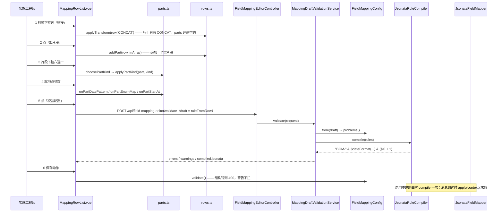

# 拼接与片段转换：多段拼接 + 片段六选一 → & 表达式

> 本轮（#117 重构后）走查只读当前工作树代码，未运行任何测试或真机脚本；行号取自本轮读到的版本。

相关形态：[标量行映射](scalar-row-mapping.md)、[数组 / 层级映射](array-mapping.md)、[总览](README.md)。
本文件只讲「一个目标字段由多段拼起来」这一种形态；数组行 / 组节点本身的展开、`$root` 跨层引用、
手写 JSONata 与建议器都在各自文件里。

## 场景说明

客户的 `bomNo` 在 MES 那边要的是 `BOM-20260821-0001` 这样的复合值，而来源侧是三个彼此独立的字段
（物料编码、创建时间、单位）。整行走手写 JSONata 能做到，但那条路是给深层重排准备的（见
[手写表达式](expression-mode.md)），实施工程师需要的只是「把几段拼起来，其中某一段顺手加工一下」。

于是有了本形态：**一行一个「值」格 = 这一行的 `transform` 是 `CONCAT`，行里挂着有序的 `parts`（片段），
每个片段自己再挂一个转换**（#112 起）。片段能挂的转换是**六选一**：常量、直接取值、数字转换、日期格式化、
枚举映射、行号（`frontend/src/mapping/parts.ts:27`）。界面上片段是「值」那一列里的一串小块
（`MappingRowList.vue:499-514`），点一下就地展开这个片段的参数面板（`MappingRowList.vue:645-722`）。

两条边界决定了整个设计：

- **一个片段只能挂一个转换，深度锁死一层**——片段里不能再放拼接、也不能放数组迭代。理由直接写在存储形状
  与代码注释里：不给拼接是因为拼接是结合的、摊平即可；不给数组迭代是因为它会改变片段数量
  （`JsonataRuleCompiler.java:230-231`，`docs/adr/0012-field-mapping-editor-round-two.md` 决策 1）。
  六选一那个下拉里没有第二层的入口，`partExpr` 里也没有嵌套分支。
- **存储形状第一次变化**（ADR-0012 决策 1）：老形状是加工片段的退化情形，**读取兼容、不做数据迁移**，
  老配置打开 → 保存 → 编译产物逐字节不变（`docs/features/field-mapping/README.md:63`）。

### 交互清单

| 角色 | 动作 | 触发方式 | 期望结果 |
|---|---|---|---|
| 实施工程师 | 把这一行的取值方式选成「拼接」 | 行上「值」列的转换下拉（`transforms.ts:154-155`） | `row.transform = 'CONCAT'`，`parts` 为空数组——**不会自动补一个片段**，要自己点「加片段」 |
| 实施工程师 | 加一个片段 | 片段面板底部「加片段」（`MappingRowList.vue:713-715`） | 追加一个空片段；顶层默认是常量片段，数组子行默认是取值片段（`MappingRowList.vue:309`） |
| 实施工程师 | 给这段挂一个转换 | 片段那一行的六选一下拉（`MappingRowList.vue:648-662`） | 参数跟着换、旧的清掉；顶层拼接行上「行号」置灰并写明原因（`parts.ts:139-143`） |
| 实施工程师 | 就地改片段参数 | 日期面板 / 枚举表 / 起始值输入框（与行级**同一套组件**，`:687-711`） | 写回片段自己那一格（`part.datePattern` / `part.enumMap` / `part.startAt`） |
| 实施工程师 | 按来源名字一键填空白片段 | 「自动匹配同名」（`fast-config.ts:610-627`） | 只往**等路径**的片段里填，且只填**路径那一格**，片段上已配好的转换与参数留着 |
| 实施工程师 | 校验草稿 | 「校验配置」→ `POST /api/field-mapping-editor/validate`（`FieldMappingEditorController.java:69`） | 问题列表 + 编译产物；片段上的问题带「拼接第 N 个片段：…」 |
| 实施工程师 | 保存 | 动作保存（后端 `FieldMappingConfig.validate()`） | 结构错 400（`；` 连接全部问题）；警告不拦（`MappingDraftValidationService.java:80-88`） |
| 系统 | 编译 + 求值 | 启用重建路由时编译一次；消息到达时求值 | 编译成 `A & B & C` 串；`JsonataFieldMapper.apply` 绑定 `$s_<step>` / `$g<d>` / `$i<d>` 求值 |

## 流程详解

### 时序图

一个箭头 = 一个环节。



### 逐环节代码走查

| 环节 | 业务动作 | 入口（文件+行号） | 关键类方法 | 数据形态变化 | 错误处理 |
|---|---|---|---|---|---|
| 1 选 CONCAT | 把这一行的取值方式选成「拼接」 | `frontend/src/mapping/transforms.ts:154-155`（`applyTransform` 的 CONCAT 分支） | `applyTransform` | `row.transform = 'CONCAT'`；`parts` 取 `params.parts`，否则「上一行也是 CONCAT 就留着，不然给空数组」 | 无；空 `parts` 由后端报「CONCAT 转换需要 parts 片段」（`FieldMappingConfig.java:287-289`），前端 `isRowConfigured` 先把它挡在规则之外（`rows.ts:199-202`） |
| 2 加片段 | 拼接里追加一段 | `MappingRowList.vue:308-311`（`addPart`）→ 按钮 `:713-715` | `addPart` | `row.parts` 追加 `{type: inArray ? 'path' : 'const', value: ''}`；同时 `markHumanEdited` 摘掉「自动」标记 | 无。顶层默认给**常量**片段、数组子行默认给**取值**片段（这一条与「自动匹配」的交互见建议表 N5） |
| 3a 片段挂「常量」 | 这一段是写死的字面量 | 下拉 `MappingRowList.vue:648-662`；值输入框 `:663-669` | `choosePartKind` → `applyPartKind`（`parts.ts:100-104`） | 片段变 `{type:'const', value:''}`，路径清空、参数一并清掉 | 常量片段值为空串时，编译成 `""`（不报错），样例检查报「拼接里有 N 个空片段」（`MappingSampleChecks.java:436-439`） |
| 3b 片段挂「直接取值」 | 这一段原样取一个来源字段 | 同一处下拉；路径选择框 `:670-681` | `applyPartKind` 的 default 分支（`parts.ts:124-128`） | `{type:'path', value:'<路径>'}`；`kind === 'STRING'` 时**不写** `transform`（老形状就是这样） | 没写 `path` 时结构校验报「拼接第 N 个片段：缺少来源字段 path」（`FieldMappingConfig.java:311-313`） |
| 3c 片段挂「数字转换」 | 这一段取回来再转成数字 | 同上 | `applyPartKind`（`parts.ts:124-128`，`kind === 'INT'` 写 `transform`） | `{path, transform:'INT'}` | 运行时 `$number("abc")` 会抛异常导致任务 FAILED（历史结论，来源：旧走查 P8 / ADR-0012 决策 8） |
| 3d 片段挂「日期格式化」 | 这一段按格式串格式化 | 同一处下拉；参数面板 `MappingRowList.vue:687-694` | `choosePartKind` / `choosePartDatePattern`（`:324-327`）→ `applyPartKind`（`parts.ts:112-117`） | `{path, transform:'DATE', datePattern: normalizeDatePattern(...)}`；没给参数就用 `keptDate ?? DEFAULT_DATE_PATTERN` | 非法格式串是**错误**（结构校验 + 保存都拦）：`FieldMappingConfig.java:322-326` → `DatePatterns.problem`；编译器同一判据在 `JsonataRuleCompiler.java:241-243` |
| 3e 片段挂「枚举映射」 | 这一段查键值表 | 同一处下拉；枚举表 `MappingRowList.vue:695-701` | `choosePartKind` / `onPartEnumMap`（`:339-342`）→ `applyPartKind`（`parts.ts:118-123`） | `{path, transform:'ENUM', enumMap}`；占位键（还没填键的格子）不进规则（`parts.ts:57-62` + `rows.ts:33-39`） | 表空时结构校验报「拼接第 N 个片段：枚举转换需要 enumMap」（`FieldMappingConfig.java:327-330`） |
| 3f 片段挂「行号」 | 这一段是数组元素的行号 | 同一处下拉（顶层**置灰**，`:660`）；起始值面板 `:702-711` | `partKindDisabledReason` / `canUsePartKind`（`parts.ts:134-143`）；`applyPartKind`（`parts.ts:105-111`） | `{type:'path', value:'', transform:'INDEX', startAt}`——**不带 path** | 顶层拼接行上选它：界面不给（置灰），结构校验报（`FieldMappingConfig.java:314-318`），编译器也不放行（`JsonataRuleCompiler.java:250-254`），三处同一条理由 |
| 4 片段参数就地编辑 | 改格式串 / 改枚举表 / 改起始值 | `MappingRowList.vue:330-348` | `onPartDatePattern` / `onPartDateCommit` / `onPartEnumMap` / `onPartStartAt` | 直接写在片段那一格上（`part.datePattern ?? ''`、`part.enumMap`、`part.startAt`）；日期手输期间原样落、失焦/回车才 `normalizeDatePattern`（`:335-337`） | 组件自己一条错都不判（`MappingDateParams.vue:6`）；格式串合不合法只由后端那条只读接口说 |
| 5 保存（前端 → 规则 JSON） | 把行收成 `rules` | `frontend/src/mapping/rows.ts:149-154` | `ruleFromRow` | `row.parts.filter(partFilled).map(partRuleOf)`；一个都没填够时 `delete rule.parts` | 前端不复制后端校验规则（`rows.ts:176-178` 的口径），能收就收、拒由后端拒 |
| 6 编译 | `rules` → JSONata | `JsonataRuleCompiler.java:178` → `concatExpr:205-225` → `partExpr:233-263` | `concatExpr` / `partExpr` / `partPath` / `indexExpr` | `List<Object> parts` → `String.join(" & ", parts)`（`:224`） | 片段不是字符串也不是对象 → `拼接第 N 个片段：片段只能是字符串常量或一个对象`（`:217-218`）；`parts` 空 → `CONCAT 转换需要 parts 片段`（`:221-222`）；认不出的转换 → `:261-262` |
| 7 校验草稿（只读接口） | 一次看全问题 + 编译产物 | `FieldMappingEditorController.java:69-71` → `MappingDraftValidationService.java:60-92` | `validate` / `problems` / `compile` | `MappingDraftRequest`（`web/dto/MappingDraftRequest.java:24-31`）→ `errors` / `warnings` / `compiled.jsonata` | 结构错与链问题进 `errors`；样例类进 `warnings`；编译期异常也补进 `errors`（`:185-186`）；同一条只留一条（`addOnce:100-105`） |
| 8 求值 | 消息到达时按上下文求值 | `mapping/JsonataFieldMapper.java:46` | `apply(Map<Integer,Object>)` | 上下文 → 目标对象；`$s_<step>` / `$g<d>` / `$i<d>` / `$root` 在这里绑定 | 编译产物跑不起来 → 该动作 FAILED |

### 四种存储形状 ↔ 编译产物对照

`parts.ts` 的文件头注释（`:6-11`）就是这张表；下面每一行的行号证据都是本轮读到的。

| 存储形状 | 行模型（`parts.ts` / `rows.ts`） | 编译产物（`JsonataRuleCompiler.java`） | 行号证据 |
|---|---|---|---|
| `"BOM-"`（常量） | `{type:'const', value:'BOM-'}` | `"BOM-"` | 读：`parts.ts:69`；写：`parts.ts:50`；编译：`concatExpr:210-211` |
| `{"path":"product.productCode"}`（老形状，取值） | `{type:'path', value:'product.productCode'}`（**不写** `transform`） | `$s_1.product.productCode` | 读：`parts.ts:70-76`；写：`parts.ts:55` + `:63`（`STRING` 不写键）；编译：`partExpr:234-236` → `sourceExpr:309-319` |
| `{"path":"createdTime","transform":"DATE","datePattern":"yyyyMMdd"}`（加工） | `+ transform` / `+ datePattern` | `$dateFormat($s_1.createdTime, "yyyyMMdd")` | 编译：`partExpr:241-243`；格式串默认值：`datePatternOf(Object):281-284` |
| `{"path":"qty","transform":"INT"}`（加工） | `+ transform` | `$number($s_1.qty)` | 编译：`partExpr:238-239` |
| `{"path":"unit","transform":"ENUM","enumMap":{...}}`（加工） | `+ transform` / `+ enumMap` | `$lookup({"PCS":"件"}, $s_1.unit)` | 编译：`partExpr:245-247` + `enumMapOf:299-302` |
| `{"transform":"INDEX","startAt":1}`（行号，**不带 path**） | `{type:'path', value:'', transform:'INDEX', startAt:1}` | `($i0 + 1)`（括号由编译器加） | 读：`parts.ts:75`（值留空）；写：`parts.ts:51-54`；编译：`partExpr:249-260` → `indexExpr:321-325` |

取值片段那一格「值」在界面上是**按转换解释的**：常量与格式串落在 `extra`、取值落在 `source`
（`parts.ts:173-188` 的 `partLabelSpec`），所以片段与行级能共用同一份人话 `transformLabelFor`。

### 关键实现

- **`&` 与 `+` 同级左结合，所以行号片段必须加括号。** 引擎里 `"a" & 1 + 2` 会解析成 `("a" & 1) + 2`
  直接抛「+ 的左边要是数字」，所以 `partExpr` 对 INDEX 片段编出 `"(" + indexExpr(...) + ")"`
  （`JsonataRuleCompiler.java:256-259`；同一件事在用例注释里也钉着，`JsonataRuleCompilerTest.java:522-524`）。
- **老形状逐字节不变。** `concatExpr` 对字符串片段只做 `jsonString`，对对象片段走
  `partExpr`（`transform` 空或 `STRING` → 纯来源表达式），拼接符恒为 `" & "`（`:224`），
  所以老配置的产物文本与 `#112` 之前完全一致；钉住它的是写死产物文本 + 真跑值的
  `JsonataRuleCompilerTest.legacyConcatPartsCompileByteForByteTheSame:456-467`（历史结论：该用例由
  #112 引入，本轮只读未运行）。前端侧的对应保证是 `partRuleOf(partFromRule(raw)) === raw`
  （`checks.ts:613-619`）。后端把规则读回来再写出去也不丢这一格：`toMap` 原样带回 `parts`
  （`FieldMappingConfig.java:381-382`），往返用例 `JsonataRuleCompilerTest:317-336` 断言 `"BOM-"` 与
  `{"path":"product.productCode"}` 都在（历史结论，本轮未运行）。
- **片段上的日期参数配错了是静默的（除非格式串本身非法）。** 运行时跑的是
  `JsonataFunctions.formatDate`：值解析不出来就**原样返回**、任务照样成功（`JsonataFunctions.java:43-49`），
  所以「片段上挂了个日期格式化但没生效」只在目标报文里看得见；能拦下来的只有格式串本身不合法那一档
  （`DatePatterns.problem:49` / `isLegal:44-45`），判据在 `FieldMappingConfig.java:322-326`
  与编译器 `JsonataRuleCompiler.java:241-243`，两边是同一条。
- **空片段那条是警告，注册在样例检查那一路。** `MappingDraftValidationService.sampleWarnings` 把它和
  「必填没配来源」「来源不在样例里」等放在一起（`MappingDraftValidationService.java:119-130` 的 `:127`），
  所以它进的是 `warnings` 而不是 `errors`，不拦保存（对照
  `MappingDraftValidationServiceTest:615-619`）。
- **`partEmpty` 只看值那一格。** 「空片段」警告统计的是「常量片段是空串」或「`path` 键在、值是空串」，
  行号片段没有任何路径但有内容，不算空（`MappingSampleChecks.java:436-446`）；
  前端 `partEmpty` 也是同一条口径（`parts.ts:158-160`，行号片段直接 `false`）。
- **`partNeedsPath` 只填路径、不冲转换。** 「自动匹配同名」往拼接行填的时候，先按
  `partNeedsPath` 找第一个「还在等路径」的片段（`fast-config.ts:621`），并且**只改 `value` 那一格**
  （`:624`），片段上已配好的 `transform` / `datePattern` / `enumMap` / `startAt` 都留着。
  `partNeedsPath` 把常量片段与行号片段都排除在外（`parts.ts:168-171`）——#112 之前这两处判的是
  「`type === 'path'` 且值是空串」，会把行号片段误当成空片段、还会把它的转换冲掉。
- **片段参数的样例检查是缺的（#112 的取舍）。** 行级那两条样例检查只看规则自己的字段：
  枚举那条读 `rule.enumMap()`（`MappingSampleChecks.java:267-270`）、日期那条读 `rule.datePattern()`
  （`:367-371`），两条都只递归 `children`、从不进 `parts`。所以片段上的日期/枚举参数配错了，
  「校验配置」不会按样例提醒（结构错照报）。原因写在 `docs/features/field-mapping/README.md:115`：
  问题的定位只有「目标字段 + 所属数组行」，没有片段序号。
- **`addOnce` 把同一条合成一条。** 结构校验按片段报一条，编译器在同一处也报逐字相同的一条
  （#112 起片段消息带序号，两边一模一样），服务那边用 `addOnce` 去重——界面上把一条错显示成两条，
  会让人以为有两个问题要改（`MappingDraftValidationService.java:94-105`，
  `FieldMappingConfig.java:121-122` 也点了这一条）。
- **「拼接行」是一个特例。** 普通行「点一下来源」写的是 `row.source`，而拼接行的「来源」就是它的片段，
  所以自动匹配单独走 `fillBlankConcatPart`（`fast-config.ts:502-512`、`:610-627`），
  并且 `isBlankRow` 对拼接行改用「还有没有等路径的片段」判（`:529`）。
- **片段里没有 `$`。** 界面上的片段人话一个 `$` 都不出现（`checks.ts:652-657`），`parts.ts:18` 也写明
  「括号那段只写在编译产物里」——这是 #98 那张「界面上不出现 `$`」对照表的延续。
- **面板样式单独一份文件。** 片段面板的 `.wb-part` / `.wb-part-kind` / `.wb-part-params`
  放在 `frontend/src/styles/workbench-panel.css:29-32`（窄屏在 `:57-58`），因为组件里 scoped 的样式
  到不了另一个组件内部。

## 测试环境

- **编译 / 求值**：不需要任何外部服务（历史结论，来源：旧走查 `docs/flows/transform-flow.md` 的「测试环境」
  段；本轮未运行）。`JsonataRuleCompilerTest` 里有产出文本与真跑值两段。
- **`POST /api/field-mapping-editor/validate`**：后端（默认 8080）在跑即可。这个接口**只读且无状态**——
  收什么由请求决定，不读也不写数据库（`web/dto/MappingDraftRequest.java:11-12`），所以片段这一形态
  可以完全用请求体造出来，不需要现成的 job / 动作。
- **真机验收**：`tools/ui/part-transform-112.cjs` 是 #112 的真机验收脚本（本轮只确认文件在，
  未运行），需要前端 dev server + 后端 + 一个可编辑的 `FIELD_MAP` 动作（这一条要数据库）。
- 片段一行一共只碰 `rules` 这一份存储契约（`docs/features/field-mapping/README.md:124`）；
  表达式不落库，所以这一形态没有额外的表 / 队列。

## 测试数据与造数指导

按环节给「入 → 出 → 验证」三元组。行号仍是本轮读到的版本。

| 环节 | 入 | 出 | 验证 |
|---|---|---|---|
| 2 加片段 | 顶层拼接行点「加片段」 | `parts` 多一格 `{type:'const', value:''}` | 界面上多一个「（空片段）」小块（`MappingRowList.vue:204`）；点「校验配置」会得到「拼接里有 1 个空片段」那条**警告**（`MappingSampleChecks.java:300-307`） |
| 3 片段挂转换 | 六选一里选「日期格式化」 | `{path, transform:'DATE', datePattern:'yyyy-MM-dd'}` | 面板出现预设按钮 + 手输框（`MappingDateParams.vue:51-77`）；摘要读作「日期格式化 · yyyy-MM-dd（…）」（`checks.ts:642-645` 的口径） |
| 5 保存 | 一行 `CONCAT` + 五个片段 | `{"target":"bom.bomNo","transform":"CONCAT","parts":[…]}` | `rules` JSON 里片段顺序与界面一致；空片段被 `filter(partFilled)` 滤掉（`rows.ts:152`） |
| 6 编译 | 上面那份 rules | `"bomNo": "BOM-" & $s_1.product.productCode & $dateFormat($s_1.createdTime, "yyyyMMdd") & $lookup({"PCS":"件"}, $s_1.unit) & $number($s_1.qty)` | `compiled.jsonata` 字段；形状对照 `JsonataRuleCompilerTest.concatPartsCarryTheirOwnTransform:486-491` 与 `MappingDraftValidationServiceTest.validPartTransformsAreAccepted:931-933` |
| 3f/6 行号片段 | 数组子行上的 `["LOT-", {"transform":"INDEX","startAt":1}]` | `"lineNo": "LOT-" & ($i0 + 1)` | 括号必须在；对照 `JsonataRuleCompilerTest.indexPartCompilesToTheArrayRowNumber:523-524` 与 `MappingDraftValidationServiceTest.anIndexPartIsAllowedInsideAnArrayChildRow:948` |
| 7 求值 | 上下文 `{1:{product:{productCode:"PRD-001"},createdTime:"2026-08-21T10:20:30Z",status:"A",unit:"PCS",qty:24}}` | `bom.bomNo = "BOM-PRD-00120260821启用24"` | 历史结论，来源：`JsonataRuleCompilerTest.concatPartsCarryTheirOwnTransform:493-498`（本轮未运行） |

可直接复制的 rules JSON（含四种片段形状；`targets` / `sourceFields` 按需补，空着时那几条样例检查不报）：

```json
{
  "draft": {
    "rules": [
      {
        "sourceStep": 1,
        "source": "",
        "target": "bom.bomNo",
        "transform": "CONCAT",
        "parts": [
          "BOM-",
          { "path": "product.productCode" },
          { "path": "createdTime", "transform": "DATE", "datePattern": "yyyyMMdd" },
          { "path": "unit", "transform": "ENUM", "enumMap": { "PCS": "件" } },
          { "path": "qty", "transform": "INT" }
        ]
      },
      {
        "sourceStep": 1,
        "source": "product.bomItems",
        "target": "bom.bomLines",
        "transform": "STRING",
        "iterate": "FOR_EACH",
        "children": [
          {
            "source": "",
            "target": "lineNo",
            "transform": "CONCAT",
            "parts": ["LOT-", { "transform": "INDEX", "startAt": 1 }]
          }
        ]
      }
    ]
  },
  "targets": [],
  "sourceFields": [],
  "sourceFieldsStep": 1,
  "earlierActionIndexes": [1],
  "defaultSourceStep": 1,
  "actionIndex": 2
}
```

组节点那一条只写 `source` / `iterate` / `children`：组节点不参与片段编译，结构校验对它是先走组那几条
就 `continue`（`FieldMappingConfig.java:221-237`）。

### 失败样例

| 失败样例 | 造法 | 期望 |
|---|---|---|
| 空片段 | `"parts": ["BOM-", ""]` | **警告**（不拦保存）：`拼接里有 1 个空片段（这一行最后会拼出空字符串）`；对照 `MappingDraftValidationServiceTest:503-521` |
| 片段上非法 datePattern | `{"path":"createdTime","transform":"DATE","datePattern":"ISO-8601"}` | **错误**：`拼接第 1 个片段：日期格式串不合法: ISO-8601（Unknown pattern letter: I）——运行到这个转换时任务会直接失败: bom.bomNo`；对照 `MappingDraftValidationServiceTest.partProblemsPointAtTheOffendingPart:894-896` |
| 行号片段出现在顶层拼接行 | `"parts": ["LOT-", {"transform":"INDEX","startAt":1}]` 挂在顶层规则上 | **错误**：`拼接第 2 个片段：行号片段只能在数组映射的子行里用: bom.bomNo`；结构校验与编译器报同一条，服务合成一条；对照 `MappingDraftValidationServiceTest:901-902` 与 `JsonataRuleCompilerTest:546-548` |
| 对象片段没写 `path` 键 | `"parts": ["BOM-", {"nope":"productCode"}]` | **错误**：`拼接第 2 个片段：缺少来源字段 path: bom.bomNo`——注意这一条**不算**「空片段」警告；对照 `MappingDraftValidationServiceTest:561-566` |
| 片段整个不是字符串也不是对象 | `"parts": [42]` | **错误**：`拼接第 1 个片段：片段只能是字符串常量或一个对象: bom.bomNo`；对照 `MappingDraftValidationServiceTest.anUnreadablePartPointsAtItsIndex:906-910` |

## 验证操作

以下命令本轮**只写不跑**。

```powershell
# 1 只读校验：草稿 + 编译产物（不需要数据库）
curl -X POST http://localhost:8080/api/field-mapping-editor/validate `
  -H "Content-Type: application/json" -d '@draft.json'

# 2 前端纯逻辑自检（片段模型与六选一，不碰 DOM、不发请求）
node --experimental-strip-types frontend/src/mapping/checks.ts

# 3 相关测试类（后端）
#   mapping/JsonataRuleCompilerTest —— 点名 legacyConcatPartsCompileByteForByteTheSame、
#     concatPartsCarryTheirOwnTransform、aDatePartWithoutAPatternUsesTheDefaultFormat、
#     indexPartCompilesToTheArrayRowNumber、anIndexPartOnATopLevelConcatIsRejectedWhenCompiling、
#     anUnknownPartTransformIsReportedWithItsIndex
#   service/MappingDraftValidationServiceTest —— 点名 legalBomDraftHasNoProblems、
#     partProblemsPointAtTheOffendingPart、validPartTransformsAreAccepted、
#     anIndexPartIsAllowedInsideAnArrayChildRow
mvn -f spike/pom.xml test -Dtest=JsonataRuleCompilerTest,MappingDraftValidationServiceTest
```

真机验收（#112）：`node tools/ui/part-transform-112.cjs` —— 这是 #112 那一票的验收脚本
（需要前端 dev server + 后端 + 可编辑的 `FIELD_MAP` 动作）。全量 `mvn test` 与 `tools/ui/*.cjs`
按仓库惯例留到收尾各跑一次（`AGENTS.md` 的「命令归一、输出限量」）。

## 建议表

搬迁说明：`docs/flows/transform-flow.md` 的正文在本轮工作树里已被 #117 换成导航页
（现在只剩 35 行导航与旧编号对照），所以下面 M 开头的搬迁条目核对的是 **git 历史里的旧正文**
（`git diff -- docs/flows/transform-flow.md` 能看到删掉的 101 行）。旧正文的建议表里**没有**一条属于本形态：
`C6` / `P6` / `P7` / `P8` 是标量行、`P9` 与「映射历史 INDEX 子规则不入库」是数组、`F1` 与 `F2/F6`–`F9`
是建议器——它们各自搬到 [标量行映射](scalar-row-mapping.md)、[数组 / 层级映射](array-mapping.md)、
[建议器](suggester.md)，本文件只交叉引用。属于本形态的既有结论是旧正文里的
「关键实现」一行与「覆盖样例」一行，以及散在功能页与测试里的空片段口径，即 M1–M3。

| 现象 | 建议 | 理由 | 类型 | 涉及功能 | 状态 |
|---|---|---|---|---|---|
| **M1** 旧走查把 #112 只记成一行覆盖样例：「拼接片段上的五种片段转换（#112：直接取值 / 数字转换 / 日期格式化 / 枚举映射 / 行号）」（旧正文「测试数据与造数指导」末行），没有本形态的独立走查 | 已按映射形态拆出本文件，覆盖结论保留在「测试数据与造数指导」表里；事实由 `JsonataRuleCompilerTest.concatPartsCarryTheirOwnTransform` 与 `MappingDraftValidationServiceTest.validPartTransformsAreAccepted` 佐证 | 「一行一个目标字段」与「一段一个片段转换」是两种不同的配置心智，混在一个文件里读不出边界 | 文档偏差 | 字段映射 | 已闭环 |
| **M2** 旧正文「关键实现」只有一句「`&`（CONCAT）」，`&` 与 `+` 同级左结合、行号片段必须加括号这条最容易踩的坑没写 | 已迁到本文件「关键实现」首条，并给出编译处行号（`JsonataRuleCompiler.java:256-259`）与用例（`JsonataRuleCompilerTest.java:522-524`） | 不括起来整条拼接一跑到就炸，而产物面板上看不出问题 | 文档偏差 | 字段映射 | 已闭环 |
| **M3** 空片段那条警告的口径（#104 起就有）散在功能页与测试里，旧走查没搬：`parts` 里有空串常量片段、或路径片段的值是空白 → 警告；行号片段不算空（#112） | 已迁到本文件「关键实现」与「失败样例」，标明「只看值那一格」的判据在 `MappingSampleChecks.java:436-446` | 这条是配置错了却全绿的主要路径（编译出来是空字符串，看着像配了） | 文档偏差 | 字段映射 | 已闭环 |
| **N1** `docs/features/field-mapping/README.md:42` 把「空片段」写成功「`parts` 里有空串常量片段，或路径片段没写 `path`」——「没写 `path`」在实现里指**值是空白**（`MappingSampleChecks.java:441-442` 要 `path` 键在），**键整个缺失**是结构错（`FieldMappingConfig.java:311-313`），不算那条警告 | 把功能页那一句改成「路径片段的 `path` 是空串或只有空白」；键缺失那种另有错误那条 | 措辞含糊会让人以为键缺失也走警告，而那种形状保存就被 400 拦下（`MappingDraftValidationServiceTest:551-566` 正是为这条歧义写的） | 文档偏差 | 字段映射 | 待评估 |
| **N2** 片段上的 `startAt` 是非数字（如 `"abc"`）时**静默按 1 编译**：`startAtOf` 认不出返回 `null`（`JsonataRuleCompiler.java:287-296`）→ `indexExpr` 取默认 1（`:321-325`）；结构校验对行号片段只查位置、不查 `startAt`（`FieldMappingConfig.java:314-318`），一条问题都不报 | 结构校验补一条「起始值不是整数」（与日期格式串同档：配置期错误）；或明确文档写「认不出的起始值按 1」 | 对照行级：`startAt` 在 `FieldMappingRule.java:57` 就 `Integer.valueOf`，非法值会让整份草稿读不出来（`MappingDraftValidationService.java:67-70`）——同一份配置里两处一个硬报一个静默 | 缺陷 | 字段映射 | 待评估 |
| **N3** 片段级枚举面板给了「按样例补全」按钮（`MappingRowList.vue:698` 传 `sample-field`，`MappingEnumParams.vue:59-66` 算缺哪些键），但校验器**不按样例检查片段枚举覆盖**（`MappingSampleChecks.java:267-270` 只看 `rule.enumMap()`） | 要么把片段枚举也接进 `collectUncoveredEnumValues`（问题定位得能带片段序号），要么在片段面板上说明「这里不会按样例提醒」 | 现在同一件事：界面用样例提示用户补全，校验结果里却一个字不说，用户会以为覆盖齐了；功能页已把「不查」记为取舍（`README.md:115`），但界面没体现 | 设计改进 | 字段映射 | 待评估 |
| **N4** 手写行号片段不带 `startAt`（`{"transform":"INDEX"}`）时，编辑器保存会补成 `{"transform":"INDEX","startAt":1}`：`partFromRule` 只在键在时读（`parts.ts:80`），`partRuleOf` 无条件写（`parts.ts:53`） | 明确「形状不变」只承诺老形状（常量 / 取值）与已带 `startAt` 的行号片段，并把这个形状写进对照表；或让 `partRuleOf` 缺省时也不写 `startAt` | 语义等价但形状变了；`checks.ts:622-628` 的往返样例显式带 `startAt: 1`，所以这条没被覆盖 | 文档偏差 | 字段映射 | 待评估 |
| **N5** 顶层拼接行「加片段」默认给**常量**片段、数组子行默认给**取值**片段（`MappingRowList.vue:309`），而 `partNeedsPath` 把常量片段排除在外（`parts.ts:168-171`）：结果是顶层新增片段之后「自动匹配同名」既不会填它（`fast-config.ts:621`），整行也被判成非空白行而不参与匹配（`:526-531`） | 顶层新增片段也默认成取值片段（与数组子行一致），或让「自动匹配」把「只有常量片的拼接行」也算空白 | 同一操作在两个位置行为不同，且顶层的那个恰好让「一键填上」失效；这是 #112 引入的不对称 | 设计改进 | 字段映射 | 待评估 |
| **N6** `partEmpty(part)` 与 `!partFilled(part)` 逐字等价（`parts.ts:151-160`），`partNeedsPath`（`:168-171`）又是 `partEmpty` 去掉常量片段的子集——三条判断、一套判据 | 留 `partFilled` 与 `partNeedsPath` 两条，`partEmpty` 改成 `!partFilled(part)`（或直接删掉它、调用点用它取反） | 同一份口径写三遍，改一处漏两处的风险；`checks.ts:630-632` 已经把两者的等价关系钉住了 | 设计改进 | 字段映射 | 待评估 |
| **N7** 行摘要里片段之间用 ` + ` 连接（`transforms.ts:316` 的 `parts.join(' + ')`），编译产物用 ` & `（`JsonataRuleCompiler.java:224`），而这个引擎里 `&` 与 `+` **同级左结合**（`:256-258` 的注释） | 摘要里的分隔符换成「＋」以外的记号（如 `·` 或直接 `&`），或在悬停里说明这只是显示 | 拼接与加法在 JSONata 里不是一回事，界面上的 ` + ` 容易让人以为插值/求和也能这么用 | 设计改进 | 字段映射 | 待评估 |

> 判据：走查只产出文档与建议清单，不实施业务建议（缺陷修复除外）；建议按 Matt 流程路由到对应技能，
> 见 [README.md](README.md) 文末。
