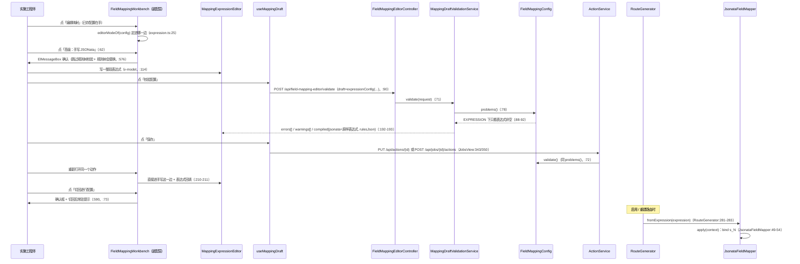

# 手写 JSONata（EXPRESSION 模式）：整段表达式 → 跳过规则树 → 直接求值

> 本轮（#117 重构后）走查只读当前工作树代码，未运行任何测试或真机脚本；行号取自本轮读到的版本。
> 凡引用历史实测，均注明当时的验收脚本或测试类。术语用 `CONTEXT.md`，决策依据见 `docs/adr/0011-field-mapping-editor-rework.md`。

## 场景说明

字段映射编辑器有**两边**：默认那一边是逐行配置（一行一个目标字段、一行一个转换，产出 `rules[]`），
另一边是**手写 JSONata**——写**一整段表达式**，保存成 `{mode:'EXPRESSION', expression, rules:[]}`
（`frontend/src/mapping/expression.ts:42-44`、`config/FieldMappingConfig.java:19-22`）。

业务故事：ERP 制品里 `items` 数组要变成 BOM 的 `bomLines`，可**目标数组的顺序、层级、元素个数与来源完全对不上**
（来源两层数组压成一层、要按某个字段分组、行号要重算、某几行要丢掉）。逐行配置表达的层级是
「数组迭代段 + 相对路径」（`docs/features/field-mapping/README.md:104`），嵌套数组不做（同文件 `:106`），
表单里没有地方放 `$map` 套 `$map`。于是实施工程师点顶部那个不显眼的文字按钮「高级：手写 JSONata」，
把整段表达式写进去——**这是界面上唯一会出现 `$` 的地方**
（`frontend/src/components/MappingExpressionEditor.vue:52-58`；ADR-0011 第 13 条，`docs/adr/0011-field-mapping-editor-rework.md:84-91`），
也是**深层数组任意重排的唯一出路**。

这条路与逐行配置的**数据格式是同一份**（`{mode? / expression? / rules[]}`，ADR-0011 第 2 条），
所以随时能来回切；后端按 `mode` 分岔，EXPRESSION 下**跳过规则树那一整套校验**
（`service/MappingDraftValidationService.java:213-215`、`config/FieldMappingConfig.java:88-93`）。

### 交互清单

| 角色 | 动作 | 触发方式 | 期望结果 |
|---|---|---|---|
| 实施工程师 | 切到手写这一边 | 顶部「高级：手写 JSONata」文字按钮（逐行那边才显示） | 确认框说清两件事，确认后整块换成表达式文本框 |
| 实施工程师 | 写表达式 | 文本框 `v-model` | 每一笔原样交给工作台那唯一一份副本；键盘一个键都不抢 |
| 实施工程师 | 校验配置 | 抽屉顶部「校验配置」 | 发出去的草稿就是保存会写出去的那一份（`{mode:'EXPRESSION', expression, rules:[]}`）；问题按错误 / 警告列在表达式下面（没有「哪一行」可言） |
| 实施工程师 | 保存 | 抽屉顶部「保存」 | 空表达式先被本地拦一句；否则落库成 `{mode, expression, rules:[]}`，并在任务已启用时触发路由重建 |
| 实施工程师 | 打开一个已是 EXPRESSION 的动作 | 动作表「编辑映射」 | **直接进手写这一边**，表达式回填（不再只给一条「这一轮看不了它」的警告） |
| 实施工程师 | 切回逐行配置 | 手写这一边的「切回逐行配置」 | 确认框说清「保存时规则树会替换掉这份表达式」；切回后行列表上一条常驻提示；保存前再确认一次 |
| 系统 | 编译 | 启用 / 重建 / 启动重载时重建路由 | EXPRESSION 直接拿 `expression` 当表达式交给 JSONata 引擎（不经过规则树编译器） |
| 系统 | 求值 | 消息到达 FIELD_MAP 那一步 | 上下文各步骤绑成 `$s_<step>`，整段表达式求值 → 目标对象 |

### 本形态的两条硬边界（来自功能现状的「已知限制」）

- **层级路径只支持「数组迭代段 + 相对路径」**（`docs/features/field-mapping/README.md:104`）：逐行那一边的
  数组能力止步于「一层 `$map` + 元素内相对路径 + 外层 `$root` 引用」，中间层元素引用不到
  （编译器的组变量边界，见 [数组 / 层级映射](array-mapping.md) 的 P9）；
- **嵌套数组不做**（同文件 `:106`）：数组元素里还有数组时，表单没有第二层的表达方式。

两条合起来就是场景说明里那句话的成因：**深层数组的任意重排只能走这条路**
（`docs/features/field-mapping/README.md:57` 也记着同一句话——#111 的日期格式手输就是为了不让人因为「挑不到格式」
而整行走手写，把这条通道留给深层重排）。

## 流程详解

### 时序图



### 逐环节代码走查

| 环节 | 业务动作 | 入口（文件+行号） | 关键类方法 | 数据形态变化 | 错误处理 |
|---|---|---|---|---|---|
| 1 打开编辑器定边 | 已存配置是 `mode=EXPRESSION` 就直接进手写这一边 | `components/FieldMappingWorkbench.vue:210-216`；`mapping/expression.ts:25-27` | `editorModeOf` / `expressionOf` | `addition` → `'expression'` 分支 + 表达式文本 | 表达式空着的 EXPRESSION **也进这一边**（正是要人去补；进逐行会把已存在的配置悄悄丢掉，`expression.ts:22-23`） |
| 2 切入手写 | 点「高级：手写 JSONata」 | `FieldMappingWorkbench.vue:62-68`（按钮）、`:575-587`（`openExpression`） | `ElMessageBox.confirm` | 逐行草稿 → 手写这一边 | 取消则原样停留；确认后清掉上一次校验结果、参数面板、未走完的「选来源」（`:584-586`） |
| 3 确认框说什么 | 切之前把两件事讲清 | `FieldMappingWorkbench.vue:576-580`；文案 `mapping/expression.ts:57-60`（`expressionSkipNotice`）与 `:63-66`（`expressionReplacedNotice`） | `expressionReplacedNotice` + `expressionSkipNotice` | — | 历史验收记着这两句都在框里：`tools/ui/keyboard-narrow-screen-106.cjs:327-328`（真机脚本，本轮未跑） |
| 4 写表达式 | 一整段 JSONata，原样保存 | `FieldMappingWorkbench.vue:110-120`（装配）、`MappingExpressionEditor.vue:62-71`（文本框，`:69` 有 placeholder） | `v-model` → `expressionText` | 文本 → 工作台那唯一一份副本（`MappingExpressionEditor.vue:36-39` 不存第二份） | 键盘不接管（见「关键实现」第 4 条） |
| 5 点「校验配置」 | 把草稿交给只读接口 | `mapping/useMappingDraft.ts:76-101`（`:90` 手写那侧换草稿）、`mapping/draft.ts:90-100`（装请求） | `validateConfig` / `draftRequest` | `{mode:'EXPRESSION',expression,rules:[]}` + 目标清单 + 样例 + 链上事实 → 请求体 | 没跑起来（网络 / 服务端错）只提示，不拦（`:95-97`） |
| 6 后端 mode 分岔 | EXPRESSION 下不查规则树 | `web/FieldMappingEditorController.java:69-72` → `service/MappingDraftValidationService.java:60-92`、`:213-215`（`isRules`）、`:120/:134/:155`（三处短路） | `validate` / `isRules` | 草稿 Map → `FieldMappingConfig(mode,expression,rules)` | 草稿连配置都读不出来（未知键、认不出的转换名）→ 一条定位不到行的问题（`:64-73`） |
| 7 表达式这条路的校验范围 | 只判表达式非空 | `config/FieldMappingConfig.java:86-106`（`:88-92` EXPRESSION 分支、`:94-96` RULES 带 expression 报错） | `problems()` / `validate()` | — | 空表达式 → 「mode=EXPRESSION 需要 expression 表达式」；**语法错不会在这里出现**（见 N1） |
| 8 校验结果落界面 | 错误 / 警告列在表达式下面 | `mapping/useMappingDraft.ts:164-171`（`expressionIssues`）、`:130-139`（手写侧不与前端提醒合并） | `expressionIssues` | `errors[]/warnings[]` → 一维列表（丢掉 target/parent） | 显示在 `MappingExpressionEditor.vue:77-86`，这一边的问题**点不动**（没有行可跳） |
| 9 保存 | 先拦空表达式，再跑一次校验 | `useMappingDraft.ts:227-262`（`:229-232` 空表达式、`:257` 保存前校验、`:263` 手写侧不问「哪几行没配好」） | `save` / `getConfig`（`:206-210`） | 表达式文本 → `{mode:'EXPRESSION',expression,rules:[]}` | 后端 400 → `ElMessage.error`，抽屉不关（`views/JobsView.vue:360-364`） |
| 10 落库 | 动作 `addition` 写回 | `views/JobsView.vue:339-365`（`:343-345` PUT 已有动作 / `:350-353` POST 新建）→ `service/ActionService.java:69-83`（`:72` `request.addition().validate()`、`:81` `rebuildRoutesIfEnabled`） | `ActionService.update` / `add` | 配置 → `addition` JSON 落库 | 只有**结构错**拦得住（`FieldMappingConfig.java:66-74`）；链校验在 `:73` 对空 rules 无话可说 |
| 11 切回逐行配置 | 说清规则树会替换表达式 | `FieldMappingWorkbench.vue:590-599`（确认框）、`:73-80`（常驻提示，条件 `rowsMode && storedExpression`）、`useMappingDraft.ts:234-244`（保存前再确认一次） | `switchBackToRows` | 手写这一边 → 逐行行列表（行是编辑器里现在这些，不重新生成） | 取消则留在手写这一边；`expressionText` **不清空**，切回去再切回来还在 |
| 12 构建期编译 | 启用 / 重建 / 启动重载时建路由 | `service/RouteRegistry.java:46-63`（`:56` `routeGenerator.build`）→ `RouteGenerator.java:211-252`（`:251` `appendFragment`）→ `:277-283` | `fromExpression`（`JsonataFieldMapper.java:26-31`） | `expression` 文本 → dashjoin `Jsonata` 实例（构建期一次，跨消息复用） | 编译失败 → `IllegalArgumentException("字段映射编译失败: …")`（`:37-39`），被 `RouteRegistry.java:60-63` 与 `RouteLifecycle.java:70-72` 包一层后任务自动停用（见 N2） |
| 13 运行期求值 | 消息到达那一步 | `mapping/JsonataFieldMapper.java:42-56` | `apply` | 上下文 `Map<Integer,Object>` → 规范化 → 绑定 `s_<step>` → 目标对象 | 求值抛错 → 任务那一步 FAILED（历史实测同形：`RouteGeneratorBatchTest.java:120-139` 用手写表达式里的 `$error('boom on batch2')` 断言批失败不推水位） |

## 关键实现

1. **mode 判定「不是 EXPRESSION 就当 RULES」**：后端 `problems()` 只看 `"EXPRESSION".equals(mode)`
   （`config/FieldMappingConfig.java:88`），草稿校验的分岔也是 `!"EXPRESSION".equals(config.mode())`
   （`service/MappingDraftValidationService.java:213-215`）；前端同一个口径
   （`mapping/expression.ts:25-27`，`checks.ts:1591-1596` 把这四种情形钉住：EXPRESSION / 只有 rules /
   `null` / EXPRESSION 但表达式空）。文档里旧说法 `mode: STRUCTURED` 在代码里**不存在**
   （`docs/features/field-mapping/README.md:10-11` 已注明以代码为准）。
2. **`isRules` 分岔是这条路的全部「跳过」**：草稿校验里四处按它短路——`sampleWarnings`（`:119-130`，靠
   目标清单与来源样例的六条警告）、`chainProblems`（`:133-146`，`sourceStep` 链一致性）、
   `missingSourceStepHints`（`:154-166`，顶层漏写 `sourceStep` 的提示）、`compile`（`:176-194`）。
   EXPRESSION 下四条全返回空 / 走另一支，所以**手写这一边只有「表达式非空」一条判据**。
3. **表达式校验与规则树校验的差别**：规则树那条路上，结构错（含 #113 的重复目标 / 前缀冲突、#114 的目标
   路径不合法）来自 `FieldMappingConfig.problems()`，编译错来自 `JsonataRuleCompiler.compile`
   （`MappingDraftValidationService.java:178-190`）；手写这条路上**只有 `problems()` 的一个分支**，
   而且那个分支只查 `expression == null || isBlank()`（`FieldMappingConfig.java:88-92`）——
   **表达式本身从不编译**：`compile()` 在 `isRules` 为假时直接把文本当编译产物返回
   （`MappingDraftValidationService.java:192-193`，对应 `web/dto/MappingDraftValidation.java:39` 那句
   「`mode=EXPRESSION` 时就是那份手写表达式」）。这条缺口记为本轮 **N1**。
4. **键盘不抢键的例外**：`keyIntent` 在任何 `inTextEntry` 为真时返回 `null`
   （`mapping/keyboard.ts:75-77`，`checks.ts:1632-1635` 三条断言），而工作台在手写这一边**还没走到那一步就先让开**：
   `onKeydown` 一进来就 `if (editorMode.value === 'expression') return`
   （`components/FieldMappingWorkbench.vue:436-439`），另有「确认框开着时不接管」（`:441`）。
   逐行那一边的上下键例外（目标字段单行输入框 + 补全下拉没开着）**不适用于这里**，
   手写这一边一个键都不接（`:438` 的注释原文：那边只有一段文本，键盘全归输入框）。
   监听走捕获阶段（`:566-567`），理由见 `:431-434`。
5. **编译产物两份文本**：`compiled.jsonata` 在 EXPRESSION 下**就是那份手写表达式原文**（含用户写的换行与
   空白，`:192-193` 只做了非空判断；`checks.ts:1606` 钉住「表达式按用户写的原样保存，不去动它的空白」）；
   `compiled.rulesJson` 是后端按现在的规则读出来的那份 JSON（`MappingDraftValidationService.java:197-199`
   走 `FieldMappingConfig.toMap()`），EXPRESSION 下长成 `{"mode":"EXPRESSION","expression":"…","rules":[]}`
   （`FieldMappingConfig.java:342-353`，`:351` 恒定带 `rules` 键；测试断言见
   `MappingDraftValidationServiceTest.java:1096-1099`）。
6. **`rules: []` 不能省**：`expressionConfig` 恒定带上它（`mapping/expression.ts:42-44`），
   一个理由是 `toMap()` 恒定带这个键（上条），另一个是回填时 `rowsFromConfig` 读到空数组不会多出东西
   （`expression.ts:38-40`）。前端还锁住了「保存的这份里没有规则树」——键集合恰好三个
   （`checks.ts:1604-1605`）。
7. **两侧读写同一份格式，所以随时能来回切**：定边用 `editorModeOf`、回填用 `expressionOf`
   （`expression.ts:25-33`），切走时**不清空** `expressionText`（`FieldMappingWorkbench.vue:211` 只初始化一次）；
   切回逐行后，只要已存配置里本来有表达式，行列表顶上就常驻一句提示
   （`:73-80`，条件来自 `storedExpression`），保存前还会再问一次「会替换手写表达式」（`useMappingDraft.ts:234-244`）。
8. **`$s_N` 变量在本模式下的写法**：求值时把上下文里**实际存在的每一步**绑成 `s_<step>`
   （`mapping/JsonataFieldMapper.java:49-54`，`frame.bind("s_" + entry.getKey(), normalized)`，先过
   `JsonataInputs.normalize` 把 JDBC 日期类型转成 JSON 安全值，`JsonataInputs.java:22-49`），
   `$s_0` 是任务输入；界面这一页原样写出这两个变量名与用法
   （`MappingExpressionEditor.vue:52-58`：`$s_<动作序号>`、`$dateFormat(值, "yyyy-MM-dd")`），
   而 `dateFormat` 是构造时注册的自定义函数（`JsonataFieldMapper.java:36`）。
   根对象也可用（`$` / `$$`，`:44` 的注释），但传进去的根是**以动作序号为整数键**的上下文 Map
   （`:55` `expression.evaluate(safe, frame)`），所以按根取值这条路本轮**未实测**，日常写法仍是 `$s_N`。
   失败可控这一点有历史实测：表达式里 `$error(...)` 能把那一步打成 FAILED（`RouteGeneratorBatchTest.java:130-138`）。
9. **构建期与运行期的错误路径**：编译错误从 `RouteRegistry.enable` 的 try 里抛出、被包成
   `IllegalStateException("注册路由失败: " + jobId)`（`RouteRegistry.java:60-63`），再被
   `RouteLifecycle.enableOrAutoDisable` 包成「…，任务已自动停用: …」写进 `job.lastError`
   （`RouteLifecycle.java:67-74`、`:80-86`）——**原始那句「字段映射编译失败: …」只在 cause 链里**，
   用户看到的是 jobId。这条记为本轮 **N2**。

## 测试环境

| 要什么 | 用在哪 | 本轮是否启动 |
|---|---|---|
| 后端 8080（`spike/src/main/resources/application.yml:2`） | `GET /api/jobs/{jobId}/field-mapping-editor`、`POST /api/field-mapping-editor/validate`、动作保存 | 未启动（本轮只读代码） |
| 配置库 MySQL（`application.yml:11`） | 动作与 `addition` 落库、消息步（来源样例取自最近一次成功运行） | 未启动 |
| 前端 dev（浏览器 + `tools/ui/*.cjs`，自带 playwright） | 真机验收：本形态的历史脚本是 `tools/ui/keyboard-narrow-screen-106.cjs`（`:320-392` 那一大段） | 未运行 |
| 什么都不用 | `JsonataRuleCompilerTest`（`:339-382` 的手写用例在这里真跑引擎）、`MappingDraftValidationServiceTest`、`FieldMappingEditorControllerTest`、`node --experimental-strip-types frontend/src/mapping/checks.ts` | 未运行 |

本形态与前八份走查共用同一套环境口径，细节见 [总览](README.md) 的「测试环境」；
表单那一边的逐行能力（标量 / 数组 / 拼接）见 [标量行映射](scalar-row-mapping.md)、
[数组 / 层级映射](array-mapping.md)、[拼接 / 片段映射](concat-part-mapping.md)。

## 测试数据与造数指导

最小链路：动作 1 = `READ_SQL`（ERP 制品行）→ 动作 2 = `FIELD_MAP`（手写，本形态）→ 动作 3 = `WRITE_UPSERT`。

| 环节 | 入 | 出 | 验证 |
|---|---|---|---|
| 5-6 送校验 | `POST /api/field-mapping-editor/validate`，body 见下（合法样例） | `{"code":"OK","data":{"valid":true,"errors":[],"warnings":[],"compiled":{"jsonata":"…","rulesJson":"…"}}}`（信封来自 `web/ApiEnvelopeAdvice.java:16-39`，契约锁在 `FieldMappingEditorControllerTest.java:44-50`） | `compiled.jsonata` **逐字等于**请求里那段表达式；`compiled.rulesJson` 含 `"mode" : "EXPRESSION"` 与 `"rules" : [ ]`（`MappingDraftValidationServiceTest.java:1085-1100`） |
| 7 空表达式 | 同下，`expression` 改成 `"   "` | `valid=false`，`errors[0].message` = 「mode=EXPRESSION 需要 expression 表达式」，`target`/`parent` 都是 `null` | `FieldMappingConfig.java:88-92`；后端单测同形 `JsonataRuleCompilerTest.java:371-376`；界面上还能更早被 `useMappingDraft.ts:229-232` 拦一句提示 |
| 9-10 保存 | 动作 body `{"name":"映射BOM","type":"FIELD_MAP","index":2,"addition":{…}}`，`PUT /api/actions/{id}`（新建用 `POST /api/jobs/{id}/actions`） | 201 / 200；库里 `addition` = `{"mode":"EXPRESSION","expression":"…","rules":[]}` | 重新打开该动作：直接进手写这一边且表达式回填（`FieldMappingWorkbench.vue:210-211`；历史真机断言 `tools/ui/keyboard-narrow-screen-106.cjs:373-376`） |
| 12-13 构建期与运行期 | 启用任务（或已启用状态下保存触发重建）→ 触发一次执行 | 目标对象（数组 / 对象形状由表达式决定） | 目标系统收到的报文与表达式语义一致；同形历史实测 `RouteGeneratorBatchTest.java:120-139`、`JsonataRuleCompilerTest.java:339-366` |

可直接复制的校验请求（合法样例）：

```json
{"draft":{"mode":"EXPRESSION","expression":"$map($s_1.items, function($v, $i) { {\"lineNo\": $i + 1, \"item\": $v.name} })","rules":[]},
 "targets":[{"path":"bom.lines","type":"ARRAY","required":true,"element":[{"path":"lineNo","type":"INT","required":true,"element":null},{"path":"item","type":"VARCHAR","required":false,"element":null}]}],
 "sourceFields":[{"path":"items","type":"ARRAY","samples":[[{"name":"a"},{"name":"b"}]]},{"path":"items[0].name","type":"VARCHAR","samples":["a"]}],
 "sourceFieldsStep":1,"earlierActionIndexes":[1],"defaultSourceStep":1,"actionIndex":2}
```

**失败样例**（按「本轮读到的代码会怎么走」标注；未实测的写「未实测」）：

| 失败 | 入 | 出（代码推断） | 验证 |
|---|---|---|---|
| F1 表达式语法错 | `"expression": "{ \"a\": $s_1. }"`（尾随 `.`） | `valid=true`、`errors=[]`、`compiled.jsonata` 原样返回这段文本 → 编辑器显示「没有发现问题」；**保存照样进库**（`FieldMappingConfig.java:88-92` 只查非空、`MappingDraftValidationService.java:192-193` 不编译、`ActionService.java:72` 只跑 `validate()`）；启用重建路由时才由 `JsonataFieldMapper.java:33-40` 抛「字段映射编译失败」 | `POST /api/field-mapping-editor/validate` 返回 `valid:true`（**本轮未实测**，由上述四处代码推断）；随后 `POST /api/jobs/{id}/validate`、启用任务看 `job.lastError` |
| F2 引用不存在的 `$s_9` | `"expression": "{ \"sheet_no\": $s_9.order_no }"`（链上只有动作 1） | 同样 `valid=true`、`errors=[]`：链校验被 `isRules` 短路（`MappingDraftValidationService.java:133-146`），编译也不跑；运行期 `apply` 只绑实际存在的步骤（`JsonataFieldMapper.java:49-54`），`$s_9` 未绑定 → 求值结果 / 是否抛错**本轮未实测**（两种可能：整段算出 `undefined`，或引擎报未定义变量、任务打 FAILED） | 启用后跑一次，看目标对象是不是空 / 那一步是不是 FAILED（`message_step`） |
| F3 非 EXPRESSION 却带 expression | `{"mode":"RULES","expression":"$s_1.a","rules":[{…}]}` | `problems()` 报「只有 mode=EXPRESSION 才允许 expression」（`FieldMappingConfig.java:94-96`）→ 编辑器 `errors[]` 一条、保存 400 | `JsonataRuleCompilerTest.java:377-379`；`errors[0].target`/`parent` 为 `null`，界面列在表达式 / 问题列表顶上 |

## 验证操作

命令只列不跑（本轮一条都没执行）：

```powershell
# 1) 编辑器里那份草稿的只读校验（不写库）：把手写这份草稿发出去
curl -X POST http://localhost:8080/api/field-mapping-editor/validate -H "Content-Type: application/json" -d '@expression-draft.json'

# 2) 已经存进库的配置（按 job id）：与上一条不是同一件事
curl -X POST http://localhost:8080/api/jobs/1/validate

# 3) 保存这份映射（已有动作 PUT；新建 FIELD_MAP 用 POST /api/jobs/{id}/actions）
curl -X PUT http://localhost:8080/api/actions/7 -H "Content-Type: application/json" -d '@action-body.json'

# 4) 相关测试类 + 前端纯逻辑自检（不依赖服务）
mvn -f spike/pom.xml test -Dtest='JsonataRuleCompilerTest,MappingDraftValidationServiceTest,FieldMappingEditorControllerTest,RouteGeneratorBatchTest'
node --experimental-strip-types frontend/src/mapping/checks.ts

# 5) 真机 UI（需要前端 dev + 浏览器；历史脚本，本轮未跑）
node tools/ui/keyboard-narrow-screen-106.cjs
```

## 建议表

| 现象 | 建议 | 理由 | 类型 | 涉及功能 | 状态 |
|---|---|---|---|---|---|
| **搬迁**（原 `docs/flows/transform-flow.md` 建议表原样搬来）：深层数组任意重排仍建议走 `mode:EXPRESSION` | 已在文档注明（`features/field-mapping` 已知限制："数组迭代段 + 相对路径"边界） | 层级路径支持有限 | 业务改进 | 字段映射 | 已闭环 |
| N1 手写表达式在草稿校验与保存两道门上**从不编译**：`MappingDraftValidationService.compile` 在 EXPRESSION 下把文本原样当产物返回（`:192-193`），`FieldMappingConfig.problems()` 只看非空（`:88-92`），于是语法错的表达式能存进库、编辑器还显示「没有发现问题」，首次发现推迟到启用重建路由（`RouteGenerator.java:281-283` → `JsonataFieldMapper.java:33-40`） | 在草稿校验这条路上对手写表达式做一次**解析级**试跑（`Jsonata.jsonata(expr)` 只建 AST 不求值，仍不碰 ADR-0011 第 9 条「不做值的试算」），解析失败按一条 `target=null` 的错误报出来 | 规则树那一边的编译错早已前移到 `problems()`（#113 的取向是「门和事实一致」）；手写这一边是同一道门上唯一的例外，代价是配好一段坏表达式要等到启用才炸、且报错信息还被包了两层（N2） | 缺陷 | 字段映射 / 表达式模式 | 待评估 |
| N2 构建期编译失败的信息在两层包装后只剩 jobId：`RouteRegistry.java:60-63` 包成「注册路由失败: {jobId}」，`RouteLifecycle.java:70-72` 再包成「…任务已自动停用: …」写进 `job.lastError`（`:80-86`），原始那句「字段映射编译失败: …」只在 cause 链里 | `autoDisable` 落 `lastError` 时带上 cause 链的第一句（或在 `RouteRegistry` 里让 `IllegalArgumentException` 原样透出），让「哪一段表达式坏了」能直接在任务列表看到 | `job.lastError` 是任务列表 / 详情唯一可见的失败原因（`RouteLifecycle.java:76-79` 的注释就是这么写的），现在它写的是 jobId，等于把线索丢了 | 缺陷 | 字段映射 / 路由重建 | 待评估 |
| N3 界面与功能文档说这条路的判断是「这段表达式能不能跑」（`expression.ts:57-60`、`MappingExpressionEditor.vue:72-74`「判断只看它跑不跑得起来」、`docs/features/field-mapping/README.md:55`），实际后端只判非空（`FieldMappingConfig.java:88-92`）——ADR-0011 第 13 条自己写的是「`problems()` 在 EXPRESSION 下只看表达式非空」（`docs/adr/0011-field-mapping-editor-rework.md:87-88`） | 先把三处用户可见文案改成「这条路不做逐行那些检查，只要求表达式非空」，或在 N1 落地后再保留「能不能跑」的说法 | 界面上对外承诺的判据比后端实际做的强，用户会以为点过「校验配置」就等于表达式被验过——这正好放大了 N1 | 文档偏差 | 字段映射 / 表达式模式 | 待评估 |
| N4 表达式里引用链上不存在的 `$s_9` 没有任何提示：链校验只查规则树（`MappingDraftValidationService.java:133-146`），编译不跑（N1），运行期才由 `apply` 的绑定集合（`JsonataFieldMapper.java:49-54`）决定结果 | 在草稿校验里加一条**纯文本扫描**的警告：把表达式里出现的 `$s_<N>` 与请求里已有的 `actionIndex` / `earlierActionIndexes` 比一遍，对不上就报「表达式引用了链上不存在的动作 N」 | 这是这条路上最容易写错、又最难自查的一类错（界面这一页是唯一出现 `$` 的地方，IDE 没有补全）；文本扫描不执行表达式，符合 ADR-0011 第 9 条 | 设计改进 | 字段映射 / 表达式模式 | 待评估 |
| N5 这条路是深层重排的唯一出路，但界面只给了一行标量示例（`MappingExpressionEditor.vue:69` 的 placeholder 是 `{ "sheet_no": $s_1.bomNo }`），`$map` / 嵌套 `$map` 的写法一个字都没有 | 在说明区放一段**可复制**的深层重排示例（形如 `JsonataRuleCompilerTest.java:342-349` 那段手写样例），并点明数组迭代要用 `$map(..., function($v,$i){...})` | 深层重排正是这条路存在的理由（本文件场景说明）；没有示例时，用户要么照搬逐行那一边的写法（表达不了），要么去猜 JSONata 语法 | 业务改进 | 字段映射 / 表达式模式 | 待评估 |
| N6 回填只认字符串：前端 `expressionOf` 要求 `typeof expression === 'string'`（`expression.ts:30-33`），后端 `FieldMappingConfig.from` 走宽松的 `ConfigValues.str`（`FieldMappingConfig.java:43` → `config/ConfigValues.java:12-14` 是 `value.toString()`）——手工改库把 `expression` 写成非字符串时，后端看得见、编辑器回填成空串 | 要么两边都放宽（前端 `String(expression)`），要么保持现状并在总览写明「`expression` 必须是字符串，非字符串只可能来自手工改库」 | 只要都由编辑器写入就永远不会遇到；但两边口径不一致时，同一个值会得到相反结论——后端 `validate()` 认它非空、能编译运行，编辑器却回填成空串，一旦按界面保存就把这份配置改成了空的 EXPRESSION | 设计改进 | 字段映射 / 表达式模式 | 待评估 |
