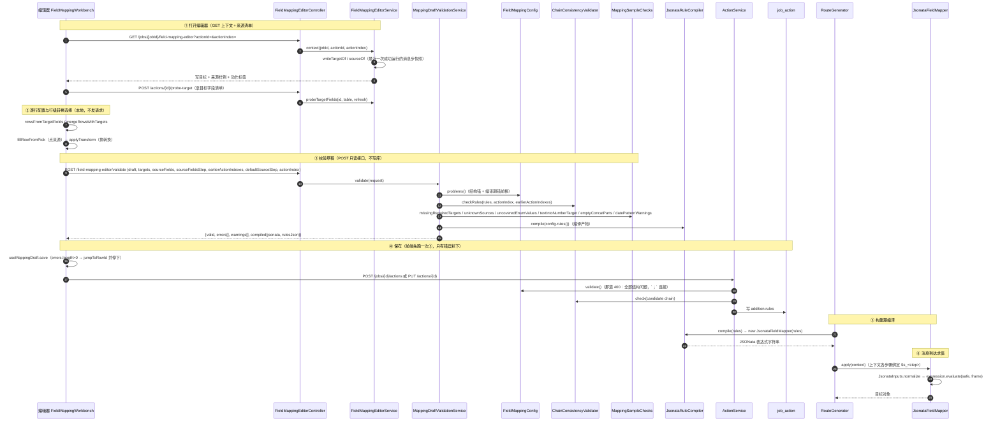

# 标量行映射：一行一个目标字段 → 行级转换 → JSONata 编译求值

> 本轮（#117 重构后）走查只读当前工作树代码，未运行任何测试或真机脚本；文中文件+行号取自本轮读到的版本。

## 场景说明

**业务是什么。** 一条任务的某个动作是字段映射（FIELD_MAP）。实施工程师要把上游动作的输出变成下游要的报文结构，**每个普通（标量）目标字段占编辑器里的一行**：在这一行上选一个来源路径，再挂一个**行级转换**（STRING / INT / DATE / ENUM / CONSTANT / INDEX），配上这个转换要的参数（常量值、格式串、枚举表、起始值），保存进这条动作的 `rules`。这份规则在**路由构建期**被编译成一段 JSONata 表达式，**消息到达时**用当前上下文求值，产出目标对象交给后面的动作。

这正是 `GLOSSARY.md` 的那条链：**字段映射规则**（一条「来源字段路径 → 目标字段 + 转换」的配置，唯一存储单元）→ **转换**（规则上的一次加工，共七种）→ **配置期校验**（保存/启用时把错误提前）→ **草稿**（编辑器里还没保存的那一份，交给只读接口判）。

**链路形态** = 入口 → 落点：

- **入口**：动作表上的「编辑映射」（`frontend/src/views/JobsView.vue:117`）打开全屏抽屉 `FieldMappingWorkbench.vue`；新建 FIELD_MAP 从同一个入口进（`JobsView.vue:322`）。
- **落点**：`job_action.addition` 这个 MySQL JSON 列里的 `rules`（`model/Action.java:30`、`config/action/FieldMappingConfig.toMap` :343）。编译产物与表达式**不落库**（`docs/features/field-mapping/README.md:124`）。

**不归本篇**：数组行 / 组节点 / 子行 → [数组 / 层级映射](array-mapping.md)；拼接片段 → [拼接片段映射](concat-part-mapping.md)；`mode=EXPRESSION` 手写 JSONata → [手写 JSONata 模式](expression-mode.md)；映射建议器 → [建议器](suggester.md)。本篇只在被交叉引用处各写一句。

### 交互清单

| 角色 | 动作 | 触发方式 | 期望结果 |
|---|---|---|---|
| 实施工程师 | 打开编辑器 | 动作表「编辑映射」（`JobsView.vue:117`）/ 新建 FIELD_MAP 时「去配字段映射」（`:322`） | 抽屉打开，行按目标清单铺开，左边常驻来源字段清单（`FieldMappingWorkbench.load` :262） |
| 实施工程师 | 选默认来源步骤 | 顶部「默认来源」下拉（`FieldMappingWorkbench.vue:22-27`） | 空行跟着换步骤，左边清单换成那一步的探测结果（`onDefaultStepChange` :394、`loadSourceFields` :412） |
| 实施工程师 | 一行选一个来源路径 | 点左边清单里的一项（`useWorkbenchState.pick` :383 → `source-picker.fillRowFromPick` :247） | 路径填进这一行；按来源类型猜一次转换（仅当这一行还是 STRING 时） |
| 实施工程师 | 挂一个行级转换 | 行里点「换转换」或按 `/`（`MappingRowList.vue:483`、`FieldMappingWorkbench.onKeydown` :436，`/` 那个分支 :454-455 → `openPanel` :496） | 参数面板就地展开；七种全在，不可用的置灰并写明原因（`transforms.transformOptions` :51） |
| 实施工程师 | 填转换参数 | 面板里就地改（日期 `MappingDateParams.vue` / 枚举 `MappingEnumParams.vue` / 常量 `MappingRowList.vue:621` / 起始值 `MappingIndexParams.vue`） | 参数写进行上的那一格（`row.extra` / `row.enumMap` / `row.startAt`），行摘要跟着变 |
| 实施工程师 | 校验草稿 | 顶部「校验配置」（`FieldMappingWorkbench.vue:57`）→ `POST /api/field-mapping-editor/validate` | `errors[]` / `warnings[]` + 编译产物；**不写库**；每条问题带 `target` / `parent`，挂回对应行 |
| 实施工程师 | 保存 | 顶部「保存」（`:59`）→ `useMappingDraft.save` :227 | 先跑一次校验，**只有错误**拦下并跳到第一条错误所在行；通过后把那份草稿交给工作台 emit（`onSaved` :378）→ `POST /api/jobs/{id}/actions` 或 `PUT /api/actions/{id}`（`JobsView.onWorkbenchSaved` :340） |
| 系统 | 构建期编译 | 启用/重建路由（`ActionFragment.append` :58-60） | 规则树 → JSONata 表达式字符串，执行器实例跨消息复用 |
| 系统 | 消息到达求值 | 消息流经 FIELD_MAP 动作（`JsonataFieldMapper.apply` :46） | 上下文各步骤绑定 `$s_<step>` → 目标对象，写回 context 供下游引用（`ActionFragment.java:70-73`） |

## 流程详解

### 时序图

一个箭头 = 一个环节。校验那条路与保存/执行那条路分开画，避免把「编辑器直接调 RouteGenerator」这种不存在的调用画进去。



### 逐环节代码走查

| 环节 | 业务动作 | 入口（文件+行号） | 关键类方法 | 数据形态变化 | 错误处理 |
|---|---|---|---|---|---|
| ① 打开编辑器 | 拿「目标清单 + 来源清单 + 动作标签」 | `FieldMappingEditorController.context`（`web/FieldMappingEditorController.java:39`） | `FieldMappingEditorService.context`（`service/FieldMappingEditorService.java:61`）；写目标 = 本动作之后最近的 WRITE_UPSERT（`:123`），来源 = 链上更早那个动作**最近一次成功运行**的输出快照（`:144`、`latestSnapshot` :181） | `job_action` × N → `FieldMappingEditorView`（写目标 / 来源样例 / 动作标签） | 任务下没有动作 → `NoSuchElementException`（`:64`）；样例列解析不出来当作「没有样例」，编辑器退化成手填（`:204`） |
| ① 附：目标字段清单 | 连库探测写目标那张表 | `POST /api/actions/{id}/probe-target`（`FieldMappingEditorController.java:54`） | `probeTargetFields`（`FieldMappingEditorService.java:81`） | 表结构 → `SourceStructure`（列名/类型/是否必填） | 没有数据源 → `IllegalArgumentException`（`:88`）；工作台侧探测失败只 warning 不阻塞，退化成手写目标字段（`FieldMappingWorkbench.loadTargets` :324） |
| ② 逐行配置 | 目标清单铺成行；一行一个来源 + 一个转换 | `FieldMappingWorkbench.load`（`FieldMappingWorkbench.vue:262`）→ `rowsFromTargetFields` / `mergeRowsWithTargets`（`mapping/editor-model.ts:51`、`:296`） | 行模型 `MapRow`（`mapping/rows.ts:41`）；来源类型 → 默认转换 `transformForType`（`editor-model.ts:63`） | 目标 `TargetField[]` → 行树 `MapRow[]` | 已存配置按目标字段对齐（`mergeRowsWithTargets` :296），清单里没有的行原样留在后面（:307） |
| ② 选来源 | 点左边清单一项填进当前行 | `useWorkbenchState.pick`（`mapping/useWorkbenchState.ts:383`）→ `fillRowFromPick`（`mapping/source-picker.ts:247`） | 形状挡三种接不上：数组行要数组、数组要进数组行、相对路径要进子行（`source-picker.ts:252-264`） | 点中的 `PickableItem` → `row.source`（+ 可能一次 `row.transform`） | 填不进去 → `PickResult.reason` + 一句中文（`emptyPickResult` :277），**这不判定对错**，只挡形状（:11-12） |
| ② 换转换 | `/` 或点「换转换」，七种全在、按层级置灰 | `FieldMappingWorkbench.openTransformPanel`（:496）→ `openPanel`（`useWorkbenchState.ts:308`）→ `chooseTransform`（`:325`）→ `applyTransform`（`mapping/transforms.ts:129`） | `transformOptions`（`transforms.ts:51`）：INDEX 在 `depth===0` 时置灰并写明原因 | `row.transform` + 参数（换回去时保留同一种转换的旧参数） | 置灰项直接 `return`（`useWorkbenchState.ts:326`）；后端另有同一条结构校验兜底（`FieldMappingConfig.java:239`） |
| ② 转换参数 | 就地编辑，不开弹窗 | 面板在 `MappingRowList.vue:583-720`：日期 `MappingDateParams.vue`、枚举 `MappingEnumParams`、常量 :621-632、起始值 `MappingIndexParams.vue`（「空 → 1」只在 `:22`） | 日期手输框清空 → `normalizeDatePattern`（`transforms.ts:180`）回落 `yyyy-MM-dd` | 面板输入 → `row.extra` / `row.enumMap` / `row.startAt`（行是唯一副本） | 界面上**不判对错**：格式串合不合法只在后端那个只读接口里判（`MappingDateParams.vue:6`） |
| ③ 校验草稿：装请求 | 草稿 = 「按现在这样保存会写出去的那一份」 | `useMappingDraft.validateConfig`（`mapping/useMappingDraft.ts:76`）→ `draftRequest`（`mapping/draft.ts:90`） | `configFromRows`（`editor-model.ts:334`）：**没配好的行不进规则**（`rows.ts` 的 `isRowConfigured` :185）；顶层规则显式写 `sourceStep`（`ruleFromRow` `rows.ts:141`） | 行树 → `DraftRequestBody`（`draft.ts:52`） | 网络/服务端错误只弹一句「校验没跑起来」，不拦保存（`useMappingDraft.ts:95-97`、`:256`） |
| ③ 校验草稿：判结构 | 结构错 + 编译期错前移 | `FieldMappingEditorController.validateDraft`（`FieldMappingEditorController.java:69`）→ `MappingDraftValidationService.validate`（`service/MappingDraftValidationService.java:60`） | `FieldMappingConfig.problems()`（`config/action/FieldMappingConfig.java:87`）：PER 规则的结构错走 `collectProblems`（:213），重复目标 / 前缀冲突 / 路径不合法走 `targetConflicts`（:126） | 草稿 Map → `FieldMappingConfig`（读不出来时只报一条、定位不到行，:67-73） | **errors 只有两类**：结构错与链问题（:75-82）；同一条问题 `addOnce` 去重（:100） |
| ③ 校验草稿：判链 | `sourceStep` 得指向链上更早的动作 | 同上 → `chainProblems`（`MappingDraftValidationService.java:133`） | `ChainConsistencyValidator.checkRules`（`service/ChainConsistencyValidator.java:82`）：`null` 跳过（= 任务输入 0，恒合法）、`step >= actionIndex` → 错、不在更早集合里 → 错 | 规则表 + 更早动作序号集合 → `SourceStepProblem[]` | 只查顶层规则；组内子规则继承组节点（`ChainConsistencyValidator.java:24`） |
| ③ 校验草稿：判样例 | 六条依赖目标清单 / 来源样例的**警告** | `sampleWarnings`（`MappingDraftValidationService.java:119-130`） | `MappingSampleChecks`：必填没配 :91、来源不在样例 :69、枚举没覆盖 :104、文本进数字 :117、拼接空片段 :138、日期格式串 :160 | 草稿 + `targets` + `sourceFields` → `RuleProblem[]`（全警告） | 清单一空就一条都不报（探不出结构不是配置的错，:40-42）；日期那条例外，试不了时反过来给一句提示（:44-47） |
| ③ 校验草稿：编译产物 | 顺手编一次，出两个标签页的文本 | `compile`（`MappingDraftValidationService.java:176`） | `JsonataRuleCompiler.compile`；`rulesJson` 是后端按现在的规则读出来的那份（`:197`） | `List<FieldMappingRule>` → `{"jsonata": ..., "rulesJson": ...}` | 编不出来时补一条错误（`CompileException` 带 `target`/`parent`，:185-189）；没规则时不重复报（:179-182） |
| ③ 校验草稿：结果回行 | 每条问题挂到「目标字段 + 所属数组行」 | `useMappingDraft.locatedIssues`（`useMappingDraft.ts:174`）→ `locateIssues`（`draft.ts:112`） | `issuesByRow`（`draft.ts:126`）、`rowIssueState`（`:136`）、`firstErrorRowId`（`:145`） | `DraftValidation` → 每行的问题列表 + 三档状态 | 定位不到行的（整份草稿级）`rowId=null`，跳行时跳过它接着找（:145） |
| ④ 保存 | 只有**错误**拦下；警告放行 | `FieldMappingWorkbench.save`（:59）→ `useMappingDraft.save`（`useMappingDraft.ts:227`） | 保存前一定再跑一次 `validateConfig`；`errors.length` → `jumpToRowId(firstErrorRowId(...))`（:257-262） | 行树 → `{rules}` → `onSaved` → emit | 没配好的行 / 自动填上的行各一个确认框（:264-282）；校验没跑起来时不拦，兜底是保存那道 400（:256） |
| ④ 保存：那道 400 | 写库前把整份配置的结构问题一次报全 | `JobsView.onWorkbenchSaved`（:340）→ `POST /jobs/{id}/actions`（`web/JobController.java:105`）/ `PUT /actions/{id}`（`web/ActionController.java:30`）→ `ActionService.validateChain`（`service/ActionService.java:169`） | `FieldMappingConfig.validate()`（`config/action/FieldMappingConfig.java:68`）：全部问题 `；` 连接（:70）；`checkMappingSourceSteps`（`ActionService.java:223`）→ `ChainConsistencyValidator.check` | 请求体 → `job_action.addition` | 任一问题 → `IllegalArgumentException` → 400（由 `ApiExceptionHandler` 统一映射）；前端抽屉不关，点「取消」放回来（`JobsView.vue:361-363`） |
| ⑤ 构建期编译 | 路由构建时把 rules 编一次，执行器跨消息复用 | `ActionFragment.append`（`service/ActionFragment.java:58-60`，FIELD_MAP 那段片段） | `new JsonataFieldMapper(rules)` → `JsonataRuleCompiler.compile`；EXPRESSION 走 `fromExpression`（:59） | `List<FieldMappingRule>` → 表达式字符串（构建期一次） | 抛 `CompileException`（`IllegalArgumentException`）→ 启用/重建失败并自动停用（见 `ChainConsistencyValidator.java:19-22` 那三处挂了同一套规则） |
| ⑥ 消息到达求值 | 上下文绑定各步骤求值 | `ActionFragment.java:61-75` | `JsonataFieldMapper.apply`（`mapping/JsonataFieldMapper.java:46`） | `Map<Integer,Object>` context → 目标对象；求值结果写回 context（`ActionFragment.java:70-73`） | 求值异常 → 那一步 FAILED（消息步，`recordSuccessStep` 不走）；`isResumeSkipped` 时不重复算（:62） |
| ⑦ 转换运行时 | 六种行级转换各自的运行时行为 | 见下段 | `leafExpr`（`JsonataRuleCompiler.java:175`）逐个分支 | 编译产物片段 | 见下段 |

**⑦ 转换运行时（行级）逐条：**

| 转换 | 编译产物（`JsonataRuleCompiler.leafExpr` :176-185） | 运行时行为 | 错误处理 |
|---|---|---|---|
| STRING（默认） | `$s_<step>.<path>`（`sourceExpr` :309） | 原值搬过去 | 路径不存在 → `undefined`；对象构造器不放 `undefined`，**目标字段整个消失**（`docs/features/field-mapping/README.md:40`） |
| INT | `$number(...)`（:179） | 数字转换 | **非数字输入抛 `NumberFormatException`，任务 FAILED**（0.9.10 实测更正，原 P8 写错了 → 见建议表 P8） |
| DATE | `$dateFormat(<src>, "<pattern>")`（:180） | 自定义函数（`JsonataFunctions.dateFormat` :26），四种输入形状各试一次（:62-85） | 解析不出来 → **原样透传**（`formatDate` :47-48），任务照样 SUCCESS；格式串本身非法 → `ofPattern` 在所有 try **之外**（:63）→ 抛，任务 FAILED（配置期已被 #111 拦下） |
| ENUM | `$lookup({...}, <src>)`（:182） | 查表替换 | 查不到键 → `undefined`，这个字段从目标报文里**整个消失**（不是 null） |
| CONSTANT | JSON 字符串字面量（:177） | 不取来源，写死的值 | `constant` 空着 → 结构校验报「常量转换需要 constant」（`FieldMappingConfig.java:252-253`） |
| INDEX | `$i<depth-1> + <startAt>`（:183、`indexExpr` :321） | 数组元素行号（0 基 + startAt） | 顶层用 → 「INDEX 转换只能在数组组内使用」（`:238-242`，消息在 `:240`）；`source` 不是 `$index` → 同处报错（`:242`）。**注意**：`startAt` 在 `indexExpr` 里与 depth 一起算（:324），详见表下 N3 |

## 关键实现

- **`$s_<step>` 绑定**：顶层来源统一编译成 `$s_<sourceStep>`（`JsonataRuleCompiler.compile` :42：`sourceStep` 为空时**缺省 0 = 任务输入**）；求值时按上下文逐个 bind（`JsonataFieldMapper.apply` :53 `frame.bind("s_" + entry.getKey(), normalized)`），上下文 Map 本身也作为求值根（`expression.evaluate(safe, frame)` :55）——规则模式只引用 `$s_<step>`，手写模式才能用 `$` / `$$`。
- **`JsonataInputs.normalize`**：进入引擎前递归规范化（`mapping/JsonataInputs.java:22`）：日期/时间 → ISO-8601 字符串（`Timestamp` :36、`java.sql.Date` :39、`TemporalAccessor` :42）、`byte[]` → Base64（:45）、其余 `toString`（:48）。不规范化会被引擎报 "Only JSON types ... allowed as input"（:12-14 的注释记了这条）。
- **jsonata 引擎版本与实例复用**：dashjoin jsonata 0.9.10（`docs/features/field-mapping/README.md:9`）；表达式在**路由构建期**编译一次（`ActionFragment.java:58-60`），`JsonataFieldMapper` 实例随之创建、**跨消息复用**，`DATE` 自定义函数在构造时注册一次（`JsonataFieldMapper.java:33-39`）；每次求值只新建一个 frame（`:47`），文档注明解析/求值线程安全（`:14`）。
- **模式判定「不是 EXPRESSION 就当 RULES」**：`MappingDraftValidationService.isRules`（:213-215）`!"EXPRESSION".equals(config.mode())`——**只有字面量 EXPRESSION 走手写**，`mode` 为 null / 空串 / 别的值一律按规则树。`FieldMappingConfig.problems()` 的同一口径在 :88（EXPRESSION 不校验规则树）。
- **缺省日期格式串只有一处定义**：`DatePatterns.DEFAULT = "yyyy-MM-dd"`（`mapping/DatePatterns.java:35`），编译器（`JsonataRuleCompiler.java:30`、`datePatternOf` :194）、运行时（`JsonataFunctions.java:16`）、校验（`MappingSampleChecks.datePatternOf` :368）三处都引用它；空串/空白按「没写」处理（`:196`）。
- **`$index` 的形状在三处归一**：前端选 INDEX 时把来源固定成 `$index` 并给起始值默认 1（`transforms.applyTransform` :158-163）；写规则时再强制一次（`rows.ruleFromRow` :155-159）；读回来时也归一（`rows.rowFromRule` :111-112），保证往返稳定。
- **编译期错的第二份实现**：`FieldMappingConfig.targetConflicts`（:126）与 `JsonataRuleCompiler.insert`（:86）是同一套判据的两份实现，约束它们的是 `JsonataRuleCompilerTest.savingGateAndCompilerReportTheSameConflicts`（`spike/src/test/java/com/example/edgegateway/mapping/JsonataRuleCompilerTest.java:585`），注释在 `FieldMappingConfig.java:117-119` 写明了「两处会走散」。

## 测试环境

- **后端**：Spring Boot，端口 `8080`（`spike/src/main/resources/application.yml:2`）。存配置要 **MySQL**：`jdbc:mysql://localhost:3306/edge_gateway`，用户名 `gateway`（`application.yml:11-12`），配置落在 `job_action.addition`（JSON 列，`model/Action.java:30`）。
- **前端开发态**：Vite，端口 `5173`，`/api` 代理到 `localhost:8080`（`frontend/vite.config.ts`）。生产态是同一个 Spring Boot 静态托管（同源），此时用 8080 一个端口。
- **要跑通「编译 + 求值」这一段，不需要任何外部服务**：`JsonataRuleCompilerTest` 与 `JsonataFieldMapper` 只吃内存里的规则与上下文。
- **要走通编辑器那一段，需要一份来源样例**：来源清单来自「链上更早那个动作**最近一次成功运行**的消息步快照」（`FieldMappingEditorService.latestSnapshot` :181，查 `message_step`），所以至少要有一次成功的上游运行；**MQ 消费动作不记成功步**，所以 MQ 打头的任务在编辑器里没有来源样例（`docs/features/field-mapping/README.md:107`）。
- **目标字段清单**要连库探测写目标那张表（`probeTargetFields` :81），故需要一个配好数据源的 `WRITE_UPSERT` 动作；HTTP / MQ 做目标时探不出结构（`docs/features/field-mapping/README.md:26`），此时行全部靠手输目标字段。
- **MQ**（`application.yml:22` `localhost:5672`）只在「投一条消息跑完整链路」时才需要；只想看编译产物与保存那道门不需要。
- **Ollama**（`application.yml:37` `localhost:11434`）属于建议器，与本篇无关。

## 测试数据与造数指导

设任务的链上有：动作 1 = READ_SQL（源），动作 2 = FIELD_MAP（要配的），动作 3 = WRITE_UPSERT（写目标）。`$s_1` 就是动作 1 的输出。

| 环节 | 入 | 出 | 验证 |
|---|---|---|---|
| 打开编辑器 | `GET /api/jobs/1/field-mapping-editor?actionId=2` | 写目标 + 来源样例 + 动作标签 | 响应里 `source.step=1`、`source.fields[]` 有字段与样例值；没有则先跑一次成功运行 |
| 结构错（必填目标字段没配） | 草稿里少写 `bom.productCode`（目标清单里它是 `required:true`） | 一条 warning | `errors` 空、`valid:true`，warning 文案 `必填的目标字段没有配置来源: bom.productCode` |
| 链问题（sourceStep 指到自己） | `{"sourceStep":2,...,"target":"bom.bomNo"}`，`actionIndex:2` | 一条 error | `errors[0].message` = `sourceStep=2 必须指向执行顺序更早的动作（当前序号 2）` |
| 编译产物 | 两条规则 | 表达式 + 规则 JSON | `compiled.jsonata` 与 `JsonataRuleCompilerTest` / `MappingDraftValidationServiceTest.compiledArtifactsAreTheTextsBackendStoresAndRuns`（:1054）钉住的两份逐字相同 |
| 求值 | 上下文 `{1:{productCode:"MAT-718H",qty:"12",unit:"PCS",createdTime:"2026-08-14T10:00:00Z"}}` | 目标对象 | `{"bom":{...}}`，`qty` 是数字、`unit` 查表换成「件」、`createdDate` 按格式串输出 |
| 保存成功 | 上述草稿 | 201/200 | `POST /api/jobs/1/actions` 返回动作；`GET /api/jobs/1/actions` 里 `addition.rules` 是那份规则 |

**可直接复制的 JSON。**

校验草稿（只读，不写库）：

```powershell
curl -X POST http://localhost:8080/api/field-mapping-editor/validate -H "Content-Type: application/json" -d '{
  "draft": {"rules": [
    {"sourceStep":1,"source":"productCode","target":"bom.bomNo","transform":"STRING"},
    {"sourceStep":1,"source":"qty","target":"bom.qty","transform":"INT"},
    {"sourceStep":1,"source":"unit","target":"bom.unit","transform":"ENUM","enumMap":{"PCS":"件","SET":"套"}},
    {"sourceStep":1,"source":"createdTime","target":"bom.createdDate","transform":"DATE","datePattern":"yyyyMMdd"},
    {"sourceStep":1,"source":null,"target":"bom.origin","transform":"CONSTANT","constant":"MES"}
  ]},
  "targets": [
    {"path":"bom","type":"OBJECT","required":true,"element":[
      {"path":"bomNo","type":"VARCHAR","required":true},
      {"path":"qty","type":"INT","required":true},
      {"path":"unit","type":"VARCHAR","required":false},
      {"path":"createdDate","type":"VARCHAR","required":false},
      {"path":"origin","type":"VARCHAR","required":false}
    ]}
  ],
  "sourceFields": [
    {"name":"productCode","type":"STRING","samples":["MAT-718H"]},
    {"name":"qty","type":"STRING","samples":["12"]},
    {"name":"unit","type":"STRING","samples":["PCS","SET"]},
    {"name":"createdTime","type":"TIMESTAMP","samples":["2026-08-14T10:00:00Z"]}
  ],
  "sourceFieldsStep": 1,
  "earlierActionIndexes": [1],
  "defaultSourceStep": 1,
  "actionIndex": 2
}'
```

保存（走那道 400）：

```powershell
curl -X POST http://localhost:8080/api/jobs/1/actions -H "Content-Type: application/json" -d '{
  "name":"字段映射","type":"FIELD_MAP","index":2,
  "addition": {"rules":[
    {"sourceStep":1,"source":"productCode","target":"bom.bomNo","transform":"STRING"}
  ]}
}'
```

按 job id 校验**已经存进数据库**的配置（与编辑器那条只读接口不是一回事，`docs/features/field-mapping/README.md:32`）：

```powershell
curl -X POST http://localhost:8080/api/jobs/1/validate
```

**失败样例（至少三条）。**

① **非法 `datePattern`** —— 校验期就是 error，保存被 400 拦下（#111 / ADR-0012 决策 2）：

```json
{"sourceStep":1,"source":"createdTime","target":"bom.createdDate","transform":"DATE","datePattern":"ISO-8601"}
```

预期：`POST /api/field-mapping-editor/validate` 返回 `valid:false`，`errors[0].message` 含「日期格式串不合法: ISO-8601（Unknown pattern letter: I）」（`MappingDraftValidationServiceTest.anIllegalDatePatternIsAnErrorThatBlocksSaving` :671、`FieldMappingEditorControllerTest.reportsAnIllegalDatePatternAsAnError` :77）。换成 `YYYY-MM-DD` 也拦（陷阱字母），文案里带「拿 2026-08-21 试一下会写成 2026-08-233」。

② **非数字进 INT** —— 配置期**不报错**，校验也**不试算**（#98 D9），只有消息真跑起来才炸：

```json
{"sourceStep":1,"source":"qty","target":"bom.qty","transform":"INT"}
```

上下文给 `{"qty":"abc"}` → `$number("abc")` 在 dashjoin 0.9.10 上**抛 `NumberFormatException`**，那一步 FAILED（P8 的实测更正，ADR-0012 决策 8；本轮未复跑）。注意：目标清单里 `bom.qty` 若是数字类型、来源字段在样例里是字符串，会先给一条**警告**「建议套一层数字转换」（`MappingSampleChecks.writesTextIntoNumber` :399）——那是提醒不是拦截。

③ **必填目标字段没配** —— 只警告、不拦（#113 / ADR-0012 决策 4）：在①的请求里把 `bom.bomNo` 那条规则删掉，预期 `valid:true`、`errors` 空，warning 里有一条 `必填的目标字段没有配置来源: bom.bomNo`。
把这一行**清除**掉再看：草稿里没有它了，但这条 warning 照样报得出来（它说的是目标清单的事实），而保存**不再被它拦下**（`docs/features/field-mapping/README.md:38`、`:71`）。

④ **目标字段重复映射** —— 编译期错前移成保存期的 error（#113）：

```json
{"rules":[
  {"sourceStep":1,"source":"productCode","target":"bom.bomNo","transform":"STRING"},
  {"sourceStep":1,"source":"productCode","target":"bom.bomNo","transform":"STRING"}
]}
```

预期：`errors` 里一条 `目标字段重复映射: bom.bomNo`，且**只报一条**（结构校验与编译器逐字相同，服务那边 `addOnce` 合成一条，`MappingDraftValidationService.java:100`）。界面上问题挂到**后加**的那一行（`docs/features/field-mapping/README.md:33`）。

⑤ **顶层 `sourceStep` 漏写**（提示，不是错误）：`{"source":"productCode","target":"bom.bomNo"}` → warning「顶层规则没写 sourceStep——后端会把「没写」当成任务输入（编号 0），不会报错」（`MappingDraftValidationServiceTest.missingSourceStepIsAHintNotAnError` :1040）。

## 验证操作

> 本轮未执行任何一条；下面只列命令。

```powershell
# 1) 编辑器只读校验（不写库）
curl -X POST http://localhost:8080/api/field-mapping-editor/validate -H "Content-Type: application/json" -d '{...}'

# 2) 保存 / 修改动作（那道 400）
curl -X POST http://localhost:8080/api/jobs/{id}/actions -H "Content-Type: application/json" -d '{...}'
curl -X PUT  http://localhost:8080/api/actions/{id}   -H "Content-Type: application/json" -d '{...}'

# 3) 按 job id 校验已存配置
curl -X POST http://localhost:8080/api/jobs/{id}/validate

# 4) 后端相关测试类（只跑相关的，别全量）
cd spike
mvn -Dtest=JsonataRuleCompilerTest test
mvn -Dtest=MappingDraftValidationServiceTest test
mvn -Dtest=FieldMappingEditorControllerTest test

# 5) 前端纯模块自检（不碰 DOM、不发请求）
node --experimental-strip-types frontend/src/mapping/checks.ts
```

`checks.ts` 锁住的组（见它文件头 :7-23 的清单）：①行与规则往返不丢字段 ②顶层规则显式 `sourceStep` ③人话标签（界面上不出现 `$`）④目标清单 → 行 ⑤七种转换的参数与人话 ⑥数组映射 ⑦手工新增行 ⑧依赖样例与目标清单的问题 ⑨配得快一点 ⑩校验两档与清掉的行。与本篇直接相关的是 ①④⑤⑦⑧⑩。

编辑器那一段的真机验收脚本在 `tools/ui/`（历史证据，本轮未跑）：`draft-validation-103.cjs`（校验配置那两个标签页与拦截）、`date-format-input-111.cjs`（日期格式手输与保存被拦）、`remove-old-editor-107.cjs`。本篇引用的历史结论均来自这些脚本与 ADR/测试注释，已逐条注明来源。

## 建议表

| 现象 | 建议 | 理由 | 类型 | 涉及功能 | 状态 |
|---|---|---|---|---|---|
| C6 旧 `mapping/FieldMapper.java` / `MappingRule.java` 残留 | 已删除两个旧类及旧测试 `FieldMapperTest`（全仓查证仅自引用 + 旧测试；行为覆盖已由 `JsonataRuleCompilerTest`（旧扁平规则一致用例）承接）；`RouteGenerator` 未用 import 已核实无残留 | 已被 `JsonataFieldMapper`/`mapping/TransformType` 替代 | 设计改进 | 字段映射 | 已闭环 |
| P7 DATE 转换对**无法解析的值静默原样透传**（`mapping/JsonataFunctions.java:53-57` 四次 parse 全失败 → `return raw`）：如 `"2026/08/14"` 会带着未格式化原值发出，任务仍 SUCCESS；pattern 非法倒是会抛（`ofPattern` 在 try 外 :35） | 已定方向（A）：保留宽容语义 + **加可见性**（解析失败记 warning/线索，便于排查）。**#111 已落地一半**：有来源字段样例时把实际取值过一遍运行时那份实现，跑不出来就在「校验配置」里报一条警告 | 错误只在目标端暴露、网关侧全绿；宽容本身合理但不该无痕 | 设计改进 | 字段映射 | **A 已落地（校验侧，#111）**：`MappingSampleChecks.datePatternWarnings` + `JsonataFunctions.canFormat`；运行期侧的可见性（日志/线索）仍待 |
| P8 INT 用 `$number()`（`mapping/JsonataRuleCompiler.java:139`）：**原文写错了**——非数字输入不是「静默 undefined、目标字段缺失」，引擎 0.9.10 实测**抛 `NumberFormatException`**（`$number("abc")` 与 `{"n": $number("abc")}` 都抛），那条转换一跑到任务就 FAILED | 保留原文的评估方向（加可见性 or 校验期/运行期显式失败），但判据要换成「任务直接失败」而不是「字段静默缺失」 | 记录与实测不符会误导排查（照原文会去目标端找缺失的字段，实际是网关侧那条动作失败） | 文档偏差 | 字段映射 | **已更正（ADR-0012 决策 8，实测复核）** |
| P6 顶层规则不写 `sourceStep` 时**缺省指向 `$s_0`**（`mapping/JsonataRuleCompiler.java:41`），而 config 校验不要求必填 → READ_SQL 链里静默映射全空（`context[0]` 是任务输入 `{}`） | 已并入 #89：链一致性校验需一并决定 0 的合法语义（严格必填 or 仅手动输入型链首放行） | 与 bodySourceStep 必填形成反差；缺省值把配置遗漏变成静默错 | 设计改进 | 字段映射 | 已定方向（#89） |
| **清除掉的行不再拦保存**（#113 / ADR-0012 决策 3，事实记录）：清掉的那一行不进草稿（`configFromRows` 只留配好的行），所以保存那道门看不到它；而「清单里写着必填、现在是空的」是**目标清单的事实**，后端照样报得出来，编辑器自己也出同一条提醒（`fast-config.clearedRequiredNotices` :674，措辞与后端逐字一致），点过校验之后以后端那份为准 | 保持现状（已在 `features/field-mapping` README 记载）；`checks.ts` 第 10 组把这条钉住 | 清除的语义与必填检查不打架：拦保存的只有结构错与链问题 | 文档偏差 | 字段映射 | 已闭环 |
| **N1 旧走查文档的代码行号大量失效**（`docs/flows/transform-flow.md`）：`JsonataRuleCompiler.compile` 标 `:35`（实为 `:36`）、`JsonataFieldMapper.apply` 标 `:46`（实为 `:46` ✓，但 `JsonataFunctions`「四次 parse」标 `:53-57` 实为 `:62-85`、`ofPattern` 标 `:35` 实为 `:63`、`$number` 标 `:139` 实为 `:179`）；文中「`MappingDraftValidation.Issue`」这个类型不存在（后端是 `Problem`，前端是 `draft.ts` 的 `DraftIssue`）；时序图把「保存动作」画成编辑器直接调 `RouteGenerator`，漏了 `POST/PUT` 这一跳与 `ActionService` | 本节已按当前工作树重核行号；`transform-flow.md` 及其行号引用在总览/收尾时统一处理（不要在旧文里零散改） | 行号失效会把排查带偏；调用链画错会让人以为前端直连路由层 | 文档偏差 | 字段映射 | 待评估 |
| **N2 本形态里 `MappingRowList.vue` 已是最大的编辑器文件**（含空行的整文件行数：`MappingRowList.vue` 775 行、`FieldMappingWorkbench.vue` 669 行装配层）；AGENTS.md「Token budget」一节仍写「`MappingRowList.vue`（约 755 行）」「`FieldMappingWorkbench.vue` 只剩 655 行」——那是用 `Measure-Object -Line`（漏空行）数的 | 把 AGENTS.md 里这两处「约 N 行」改成 `read` 口径的真实行数（775 / 669），或去掉行数只留文件名 | 行数是用来说服人「该拆哪个文件」的判据，偏小会让人以为还能再塞 | 文档偏差 | 字段映射 / 文档 | 待评估 |
| **N3 `MappingIndexParams.vue` 的起始值输入框没有下限**（`MappingIndexParams.vue:27` 的 `el-input-number` 没给 `min`），「空 → 1」只保证空值回落（:22）；后端也没有 `startAt >= 1` 的校验（`FieldMappingConfig.collectProblems` :238-244 只查 INDEX 的位置与 `source` 恒等 `$index`），编译期直接 `$i + startAt`（`JsonataRuleCompiler.indexExpr` :321-325） | 待评估：要么给输入框加 `min=1`，要么在后端补一条 `startAt < 1` 的结构校验（两边选一处，别各写一条） | 起始值填 0 或负数能存下去，行号从 0 / 负数起算——不报错，只是结果不是用户想要的 | 缺陷 | 字段映射 | 待评估 |
| **N4 建议器给出的 `datePattern` 至今仍是 `ISO-8601`**：`TransformInferrer` 那个候选名不是合法格式串，所以**采用了也存不下去**（#111 那条配置期校验会拒）；它不属于本形态（建议器见 [建议器](suggester.md)），这里只记一条交叉引用——与 `transform-flow.md` 建议表 F1 的建议 A 同一条 | 接回建议器之前把它改成合法 pattern（如 `yyyy-MM-dd'T'HH:mm:ss`） | 现在比原来「存下去、跑起来炸」好，但只要接回界面，第一天就会重演 | 缺陷 | 字段映射 / 建议器 | 待评估 |
