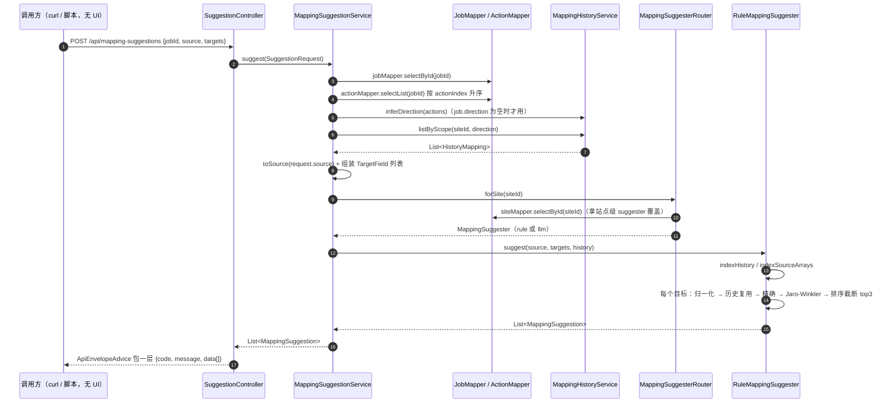

# 映射建议器：结构探测 → 同名归一化 → 相似度 → 历史复用 → 转换推断

> 本轮（#117 重构后）走查只读当前工作树代码，未运行任何测试或真机脚本；行号取自本轮读到的版本。
> 建议器原来的正文在单份 `docs/flows/transform-flow.md` 里。本轮开始时读到的是**尚未改写**的那一版（101 行，
> 含建议表 F1–F9 与 DS-10.4），下面的 F 条目就是从那一版原样搬迁的；随后同一轮拆份把该文件改成了 35 行的导航壳
> （只留导航与旧编号对照），其中第 31 行已把 F1/F2/F6/F3/F4/F5/F7/F8/F9 的落点指向本文。
>
> **本轮未实测**：所有代码断言都来自读取，不是运行；历史结论一律注明来源。术语用 `CONTEXT.md`
> （映射建议器 / 映射建议 / 映射历史 / 结构探测 / 来源字段样例 / 自动填充率）。
> 逐行规则树、数组映射、拼接片段、手写表达式不归本文，见 [标量行映射](scalar-row-mapping.md) 与 [总览](README.md)。

## 场景说明

**业务故事**：实施工程师要为一条任务配「字段映射」——把上游动作的输出（客户 MySQL 的某张表，或 MQ 报文）
按规则折成写目标的结构。真实客户的字段名是 `order_no` / `sheet_no` / `vendor_no` / `V001` 这种各写各的，
全手填既慢又容易错。建议器就是替他把这一步先猜一遍：**它拿到源结构（字段清单 + 样本值）和目标字段清单，
给出「哪个源字段 → 哪个目标字段 + 哪种转换」的候选**，每条候选带得分与来源标签（同名 / 相似 / 历史复用 /
转换推断，`MatchSource`），由实施工程师确认后才写进规则。

建议器**不是保存路径上的一环**：它只产出候选（`MappingSuggestion` 的类注释写明「仅作候选，需实施工程师
确认后才生效」，`mapping/suggest/MappingSuggestion.java:6-8`）。真正让历史沉淀下来的是**另一个方向**的动作——
保存 FIELD_MAP 动作时 `MappingHistoryService.recordFromAction` 把确认过的规则 upsert 进 `mapping_history`
（`service/MappingHistoryService.java:59-74`），那次以后同类任务的同名映射就能被历史复用命中。

**当前入口状况（必须写清）**：`POST /api/mapping-suggestions` 是**唯一的**调用入口，端点仍在、仍可用 curl 调。
但 **#107 把旧三栏编辑器连同建议面板一起删了**（`frontend/src/components/MappingEditor.vue` 已不在仓库里，
本轮 glob `**/MappingEditor.vue` 无结果；决策见 `docs/features/field-mapping/README.md:14、95`），
前端全仓检索 `suggest` 只剩三处与建议器无关的东西——站点列表的「建议器覆盖」列、数据源的
「推断表名」按钮、以及元素补全下拉（`frontend/src/views/SitesView.vue:14-15`、
`DataSourcesView.vue:246`、`MappingRowList.vue:142-163`）。
所以现状是：**后端能力 + 无 UI 入口**，#98 D8 明确这一轮不接回界面。
**不要把它读成「界面上有建议面板」**——旧文档里凡是描述「建议面板 / 采用按钮」的段落描述的都是一份已删除的组件。

| 角色 | 动作 | 触发方式 | 期望结果 |
|---|---|---|---|
| 实施工程师 | 取源结构（字段清单 + 样本值） | 有连库权限：`POST /api/data-sources/{id}/probe`；无权限：`POST /api/probe/sample` 贴一段样例 JSON | `{sourceKey, fields[]}`，字段带 name/type/nullable/samples |
| 实施工程师 | 取映射候选 | `POST /api/mapping-suggestions`（**当前无 UI 入口**，只有 curl / 脚本） | 每个**必填**目标字段最多 3 条候选，按得分降序；数组目标出组建议（带 children） |
| 实施工程师 | 确认后落库 | 保存 FIELD_MAP 动作（`POST /jobs/{id}/actions` 或 PUT） | 规则写进动作配置，同时 upsert 进 `mapping_history` |
| 站点管理员 | 该站点改用 LLM 建议器 | 站点记录 `suggester = llm`（站点表那一列：`V1__init_schema.sql:37`、`model/Site.java:22-23`） | 该站点请求走 LLM，失败回退规则引擎 |
| 运维 | 全局改用 LLM 建议器 | `edge.mapping.suggester=llm`（`config/EdgeMappingProperties.java:13`） | 未单独覆盖的站点全走 LLM |
| 实施工程师 | 复用上次确认过的映射 | 同站点 + 同方向 + 同源结构指纹的请求自动命中历史 | 候选带 `matchSource=HISTORY`，且**带出上次确认的转换与参数** |

## 流程详解

### 时序图

这条路当前**没有前端参与者**（无 UI 入口），调用方是 curl / 脚本；图中「调用方」就是它。



### 逐环节代码走查

| 环节 | 业务动作 | 入口（文件+行号） | 关键类/方法 | 数据形态变化 | 错误处理 |
|---|---|---|---|---|---|
| 1 请求形状 | 调用方提交任务 + 源结构 + 目标字段清单 | `web/SuggestionController.java:24-27`、`web/dto/SuggestionRequest.java:6-19` | `SuggestionController.suggest` | JSON → `SuggestionRequest{jobId, Source{sourceKey, fields[]}, targets[]}`；`Field{name,type,nullable,samples}`、`Target{name,required,array}` | 请求体不是合法 JSON → 400（`ApiExceptionHandler:38-41`） |
| 2 任务与动作链加载 | 校验任务存在，取链上动作（方向推断要用） | `service/MappingSuggestionService.java:46-52` | `jobMapper.selectById`、`actionMapper.selectList`（按 `actionIndex` 升序） | `jobId` → `Job` + `List<Action>` | 任务不存在 → `NoSuchElementException` → 404 `NOT_FOUND`（`ApiExceptionHandler:28-31`） |
| 3 方向与历史加载 | 按「站点 + 方向」取回已确认的映射资产 | `MappingSuggestionService.java:53-56`、`service/MappingHistoryService.java:77-95、98-108` | `inferDirection`（首动作 MQ_CONSUME → SOUTH，否则 NORTH）、`listByScope` | `(siteId, direction)` → `List<MappingHistory>`（源结构指纹 + 源路径 + 目标 + 转换/参数 + 命中次数 + 最近确认时间） | 无历史 → 空列表，不影响主流程；方向为空且链为空 → NORTH |
| 4 源结构入参组装 | 把请求里的源字段转成建议器契约 | `MappingSuggestionService.java:58、69-81` | `toSource` | `Source{sourceKey, fields[]}` → `SourceStructure(key, List<SourceField>)`；`type` 缺省 `STRING`、`nullable` 缺省 true、`samples` 缺省空表 | `source` 为 null → 空 key + 空字段表（不报错）；**`sourceKey` 原样透传，后端不校验也不推导** |
| 5 目标字段入参组装 | 目标清单转成建议器契约 | `MappingSuggestionService.java:59-65` | 循环构造 `TargetField` | `Target{name, required, array}` → `TargetField(name, required, array)`；`required` 缺省 **true**、`array` 缺省 false | `targets` 为 null → `NullPointerException` → 500 `INTERNAL_ERROR`（`ApiExceptionHandler:43-46`），无入参校验 |
| 6 源结构探测（DB） | 连客户 MySQL 读列结构 + 前 20 行样本值 | `service/StructureProbeService.java:69-85、113-143`；端点 `web/StructureProbeController.java:29-45` | `probeFromDb` → `probeDb` | `(数据源, 表名)` → `SourceStructure("db:"+表名, fields[])`；每列样本值来自真实结果集（`rs.getObject`，`:126-130`），类型取 JDBC `getColumnTypeName`（如 VARCHAR/INT） | 非 MySQL → 400「该数据源类型不支持结构探测（当前仅 MySQL）」；表名非法（非 `[A-Za-z0-9_]+`）→ 400；连库/SQL 失败 → `IllegalStateException` → 500；**控制器层有兜底**：请求带 `sample` 时改走样例探测（`StructureProbeController.java:38-43`） |
| 7 源结构探测（HTTP / MQ） | 这两种数据源**没有连库探测**，只能用样例兜底 | `StructureProbeService.java:88-92、145-162`；端点 `web/StructureProbeController.java:53-57` | `probeSample` → `walk`（递归展开 Map/List，数组取 `[0]` 元素并写成 `items[0].x`） | 任意 JSON → `SourceStructure("sample", fields[])`；叶子类型粗判 `NUMBER/BOOLEAN/STRING`（`:164-172`），样本值只有**那一个**值 | 不需要数据源、不报错；`sample` 为 null → 空字段表 |
| 8 来源样例的另一条来路 | 编辑器打开时的源清单来自「链上更早动作最近一次成功运行的输出快照」 | `service/FieldMappingEditorService.java:164-179` | `latestOutput` → `probeSample(snapshot)` | 快照 JSON → `structure.key()` 恒为 `"sample"` | 没有快照/步骤 → 空字段表；**MQ 消费动作不记成功步**，所以 MQ 打头的任务在编辑器里没有来源样例（`docs/features/field-mapping/README.md:107`） |
| 9 路由到站点级实现 | 决定这个站点用规则引擎还是 LLM | `service/MappingSuggesterRouter.java:33-41` | `forSite(siteId)` | `siteId` → `MappingSuggester` 实例；站点 `suggester` 非空即覆盖全局，大小写不敏感比较 `"llm"` | 站点不存在/字段空 → 回落全局 `edge.mapping.suggester`；未知值（如 `"foo"`）→ 静默按 `rule` 处理 |
| 10 规则引擎入口 + 数组分流 | 逐个目标字段做建议；数组目标走另一条分支 | `mapping/suggest/RuleMappingSuggester.java:44-74` | `suggest`、`indexHistory`（`:212-227`）、`indexSourceArrays`（`:132-148`） | `(source, targets, history)` → `List<MappingSuggestion>`；历史先按 `(源结构指纹, 归一化源字段, 归一化目标字段)` 建索引，同键取最近确认 | 无异常路径（纯函数、无 IO） |
| 11 同名归一化 | 字段名折成「紧凑串 + token 集合」再比 | `mapping/suggest/NameNormalizer.java:30-40` | `NameNormalizer.normalize` | `order_no` → `compact="ordernumber"`, `tokens={order,number}`；别名词典 5 条参与替换（`:16-22`） | 无异常；空名 → 空 token 集（精确匹配那一步会跳过） |
| 12 历史复用 | 命中历史即整条套用上次确认的转换与参数 | `RuleMappingSuggester.java:85-99` | `match` 的历史分支 | 历史行 → `MappingSuggestion(score=1.0, transform/datePattern/constant/enumMap 全取历史, MatchSource.HISTORY)` | 无异常；**不看样本值也不看目标类型**（见 F9） |
| 13 精确匹配 | token 集合相等即判 1.0 | `RuleMappingSuggester.java:100-103` | `match` 的 EXACT 分支 | 源样本 → `TransformInferrer.infer(samples)` 得到转换；候选 `score=1.0, MatchSource.EXACT` | 源名归一化后 token 集为空 → 跳过精确，直接进相似度 |
| 14 相似度兜底 | Jaro-Winkler 比紧凑串，过阈值才留 | `RuleMappingSuggester.java:104-108` | `JaroWinklerSimilarity.apply`（commons-text） | `(compact_s, compact_t)` → `score`；`score >= 0.85` 才产出 `MatchSource.SIMILAR`，否则丢弃 | 低于阈值 → 该源字段无候选（**不强猜**） |
| 15 转换推断 | 由样本值定转换类型与参数 | `mapping/suggest/TransformInferrer.java:44-79` | `TransformInferrer.infer` | `List<Object> samples` → `Inference(kind, datePattern, constant)`；顺序：全布尔 → 全整数 → 全数字 → 全日期（记 pattern）→ 封闭枚举 → 全相同（常量）→ STRING | 样本空/全 null → STRING；异常值不抛，落到 STRING |
| 16 组建议（数组目标） | 目标数组 → 源数组按**数组名**相似配对，子字段同名启发 | `RuleMappingSuggester.java:50-57、154-200` | `suggestArrayGroup`、`lastSegment` | 数组路径（去 `[0]`）→ 父建议 `MatchSource.ARRAY` + `children[]`（相对路径、score 恒 1.0、子转换由各自样本推断）；父建议 `transform=STRING, datePattern=null` | 无相似源数组（阈值 0.85）→ 返回 null，该目标无候选（不回退「唯一数组」） |
| 17 排序与截断 | 同目标候选按得分降序取前 3 | `RuleMappingSuggester.java:70-71、229-235`、常量 `:25` | `candidateComparator` + `limit(TOP_N)` | 候选列表 → 每目标 ≤3 条；排序键 = 得分 ↓ → 复用次数 ↓ → 最近确认 ↓ | 无异常 |
| 18 响应字段 | 返回候选并自动包业务码信封 | `mapping/suggest/MappingSuggestion.java:15-25`、`web/ApiEnvelopeAdvice.java:35-38` | `ApiResponse.ok` | `MappingSuggestion{sourcePath,targetName,score,transform,datePattern,constant,enumMap,matchSource,children}` → `{code:"OK",message:"ok",data:[...]}` | `/mock/**` 不打信封；其他异常由 `ApiExceptionHandler` 出信封 |
| 19 站点覆盖为 LLM | 同接口换实现，异常一律回退规则引擎 | `mapping/suggest/LlmMappingSuggester.java:44-55、82-127`；客户端 `service/LangChain4jLlmClient.java:31-49` | `LlmMappingSuggester.suggest` / `parse` / `top3PerTarget` | 源结构 + 目标 + 历史 → 提示词 JSON（样本每字段只带前 3 个，`:67`）→ LLM JSON → `List<MappingSuggestion>`（`matchSource=LLM`）；目标不在必填清单里、transform 非法 → 跳过/降为 STRING（`:94-100`） | 解析失败、非 JSON、超时、异常 → **整体回退 `RuleMappingSuggester`**（`:52-54`）；LLM 给出的日期格式串同样不受校验 |

## 关键实现

以下每条都带本轮读到的文件与行号。括号里是**旧文档引用**的复核结果。

1. **阈值 0.85 与 TOP_N=3 硬编码、且不可配**。`RuleMappingSuggester.java:25`（`TOP_N = 3`）、
   `:34-36`（无参构造器写死 `this(0.85)`）。旧文 F5 说「只有无参 `@Component`」——**复核后需要修正**：
   类上确实只有 `@Component`（`:22`），但**存在**一个带参构造器 `RuleMappingSuggester(double threshold)`（`:30-32`），
   只是 Spring 在多构造器且无 `@Autowired` 时走无参那个，全仓也没有 Bean 定义或 `edge.mapping.*` 配置项把它接出来
   （`config/EdgeMappingProperties.java:11-23` 只有 `suggester` 一个字段）。结论（0.85 与 3 不可配）不变。
2. **只有必填的「标量」目标字段出建议**。`RuleMappingSuggester.java:58-60`（`if (!target.required()) continue;`）。
   **但数组目标不受这条约束**：数组分流在 `:50-57`，位于必填检查**之前**，所以 `required=false` 的数组目标照样出组建议
   ——`RuleMappingSuggesterGroupTest.java:27` 用的正是 `new TargetField("bom.bomLines", false, true)` 并断言拿到 1 条建议。
   旧文 F3 说「可选字段永远没有候选」，对数组目标不成立（见建议表 N3）。
3. **数组组建议只看数组名相似**。`RuleMappingSuggester.java:159-175`：源数组路径取最后一段（`:202-205`）后与目标数组名
   比 tokens 相等或 Jaro ≥ 阈值，取**分数最高的一条**；数组名不相似就没有任何组建议（`:173-175` 直接 `return null`，
   不回退「源里唯一那个数组」）。children 一律同名启发：`field.name → field.name`、score 写死 1.0（`:177-189`）。
4. **历史命中不校验样本值与目标类型**。`RuleMappingSuggester.java:85-99`：只要 `(源结构指纹, 归一化源字段, 归一化目标字段)`
   这个键命中，就直接把历史那条的 `transform/datePattern/constant/enumMap` 原样带出，**不再按样例推断**，也不比对
   目标字段的类型/是否必填。这是有意为之（类注释 `:18-20` 写明「不重新按样例推断」），代价是源语义漂移时静默沿用旧转换（F9）。
5. **`TransformKind` 的 `BOOLEAN` / `NUMBER` 在应用层不存在**。推断层枚举有 7 个值，含 `BOOLEAN`、`NUMBER`
   （`mapping/suggest/TransformKind.java:4-12`），而落库/编译用的 `mapping/TransformType.java:4-13` 只有
   STRING / INT / DATE / ENUM / CONSTANT / INDEX / CONCAT。旧编辑器当年把这两种建议**静默降级成 STRING**
   （旧文指的 `MappingEditor.vue:465-466`，**该文件已随 #107 删除，本轮 glob 无此文件**）；现在界面上没有任何地方消费建议，
   所以降级这件事没有落点，接回界面时得重新决定 `BOOLEAN/NUMBER` 落成什么（F2/F6）。
6. **`NameNormalizer` 注释与实现有两处偏差**。注释称「小写 → 去分隔符/数字 → camelCase 拆词 → 别名词典归一」
   （`NameNormalizer.java:8`），但 ① `TOKEN_SPLIT = [^a-z0-9]+`（`:25`）**保留数字**，并不「去数字」；
   ② camelCase 拆词**实际不生效**——`:31-32` 先把名字 `toLowerCase()`，再拿 `([a-z0-9])([A-Z])`（`:24`）去匹配已全小写的串，
   永远匹配不到。后果：`vendorCode` 是一个 token（不会被别名词典折成 `supplier`），`productCode` 与 `product_code`
   只会走相似度（紧凑串恰好相同，得 1.0 但标签是 SIMILAR 而不是 EXACT）。旧文 F2/F6 只提了①，②是本轮新发现（见建议表 N2）。
7. **别名词典 5 条**。`NameNormalizer.java:16-22`：`qty→quantity`、`no→number`、`dt→date`、`amt→amount`、`vendor→supplier`。
   （旧文 F7/F8 引的是 `:18-22`，本轮复核词条实际在 `:17-21`，`Map.of(` 与收尾括号在 `:16` 与 `:22`——见建议表 N5。）
8. **`TransformInferrer` 的 `ISO-8601` 不是合法 pattern**。`TransformInferrer.java:34-35`：候选名写作 `"ISO-8601"`，
   `Inference.datePattern` 会经 `MappingSuggestion.datePattern`（`MappingSuggestion.java:20`）带回调用方。
   它**不是** `DateTimeFormatter` 能认的 pattern，运行时 `ofPattern` 直接抛（`mapping/JsonataFunctions.java:63`，
   写在所有 try 之外）；编译期则把它拼成 `$dateFormat(x, "ISO-8601")`（`mapping/JsonataRuleCompiler.java:180-181`）。
   **现在这条路径的终点变了**：`#111` 起配置期校验 `datePattern` 合法性是**错误**（`config/action/FieldMappingConfig.java:258-265`
   → `mapping/DatePatterns.java:44-62`），所以「采用了也存不下去」——保存直接被 400 拒掉。完整结论见建议表 F1。
9. **`ISO-8601` 触发条件**：样本值形如 `2026-08-14T10:00:00Z` / 带毫秒 / 带偏移（正则 `TransformInferrer.java:35`），
   且**全部**样本都匹配才判 DATE（`:60-66`，`allMatch`）。
10. **枚举判定上限 20 且要少于行数一半**。`TransformInferrer.java:39`（`MAX_ENUM_DISTINCT = 20`）、`:69-72`
    （`distinct.size() >= 2 && <= 20 && < values.size() * 0.5`）。所以 20 行以内的小样本基本判不出 ENUM；
    反向地，40 行里出现 19 个不同值也只差分毫。
11. **单值样例不推 CONSTANT（DS-10.4）**。`TransformInferrer.java:74-77`：只有「去重后 1 个值 **且** 样本条数 > 1」才给
    `CONSTANT`，单值样例按 STRING 直映射；`TransformInferrerTest.java:12-17` 与
    `RuleMappingSuggesterGroupTest.java:59-70` 两条测试把这条锁住。
12. **历史同键取「最近确认」**。`RuleMappingSuggester.java:212-227`：`updatedAt` 大者优先，同时间取 `hitCount` 大者；
    排序在同分时也吃这两个字段（`:229-235`）；`RuleMappingSuggesterHistoryTest.java:34-47、63-74` 锁住。
13. **`probeSample` 的结构指纹恒为 `"sample"`**。`StructureProbeService.java:91`；而历史表里的指纹是
    `db:<表名>` / `mq:<队列名>`（`MappingHistoryService.java:111-128`）。两边的口径必须由**调用方**对齐
    ——建议器自己不推导指纹（`MappingSuggestionService.java:80` 原样透传请求里的 `sourceKey`），见建议表 N4。
14. **结构探测缓存 5 分钟、键为「数据源 + 表」**。`StructureProbeService.java:42-46、76-85`；
    `refresh=true` 跳过缓存；`StructureProbeServiceTest.java:86-108` 用「连了几次库」锁住「不能只按数据源缓存」。
15. **探测只发只读 SQL**。`StructureProbeService.java:36-37、116`：`SELECT * FROM <table> LIMIT 20`，
    表名先过 `SAFE_TABLE`（`:44、73-75`），不做 DDL/DML。
16. **LLM 实现的 TOP_N 与规则层不是同一份常量**。`LlmMappingSuggester.java:124` 写死 `.limit(3)`，
    与 `RuleMappingSuggester.java:25` 的 `TOP_N` 各写各的；SS 一侧同分排序也只有分数（`:123`），
    没有历史复用次数与时间的次级键。
17. **LLM 提示词固定「只给必填目标」，且样本只带前 3 个值**。`LlmMappingSuggester.java:26-29`（系统提示词）、
    `:67`（`samples().stream().limit(3)`）、`:94-96`（返回里非必填目标一律丢弃）。
18. **`MappingHistoryService` 的 `DataSourceMapper` 构造参数完全没用上**（`:48-56` 只做赋值以外的零引用，
    字段列表里也没有它）。历史指纹是从动作配置的 SQL / 队列名推的，不需要 `DataSourceMapper`。
19. **来源指纹与方向解耦但方向可为空**：`MappingHistoryService` 的类注释 `:35-36` 与实现 `:111-128` 说明指纹从
    **实际源动作**推导，与 `direction` 无关；而 `MappingSuggestionService.java:53-55` 在 `job.direction` 为空时
    用 `inferDirection`（首动作 MQ_CONSUME → SOUTH）兜底，`:98-108`。两条路径都读同一份任务方向，口径一致。

## 测试环境

- **应用本体**：Spring Boot（`spike/`）+ 平台库 MySQL（`mapping_history`、站点、任务、动作等表；
  建表见 `spike/src/main/resources/db/migration/V1__init_schema.sql:120-134`）。建议端点本身需要任务、动作、
  站点三张表有数据（否则 404 或站点级覆盖读不出来）。
  测试用内存库 schema 在 `spike/src/test/resources/schema.sql:95-109`（同样含 `mapping_history` 与唯一键
  `uk_mapping_history`）。
- **数据源探测（DB 分支）**：还需要一个**配置好且可达的 MySQL 数据源**（`DataSourceType.MYSQL`，带 address/用户名/密码），
  且那张表真实存在。非 MySQL 数据源会直接被拒（`StructureProbeService.java:70-72`，
  `StructureProbeServiceTest.java:51-58` 锁住）。
- **数据源探测（HTTP / MQ 分支）**：**不需要任何外部服务**，贴一段 JSON 即可
  （`POST /api/probe/sample`）。代价是样本值只有一个值/字段，判 CONSTANT、ENUM 这类「靠多行分布」的推断会失真。
- **`/api/data-sources/{id}/probe` 的兜底**：连库失败 + 请求里带 `sample` → 自动转样例模式（`StructureProbeController.java:38-43`）；
  不带 `sample` → 500。`StructureProbeControllerTest.java:51-64` 锁住这条兜底。
- **LLM 分支（可选）**：需要 OpenAI 兼容端点，默认 `http://localhost:11434/v1` + `qwen2.5:7b`
  （`EdgeMappingProperties.java:29-34`），Ollama 即可。**不启也不影响**：LLM 抛异常/超时/输出非 JSON 时
  自动回退规则引擎（`LlmMappingSuggester.java:52-54`，`LlmMappingSuggesterTest.java:46-69` 锁住）。
  客户端是懒加载的，端点不可用不会拖垮启动（`service/LangChain4jLlmClient.java:10-15`）。
- **评测集**：规则引擎的验收基线用 `tools/evaluation/eval-set.json`（18 个必填目标），
  测试会把它读进来跑冷启动与带历史两轮（`RuleMappingSuggesterEvalTest.java:39-129`）。

## 测试数据与造数指导

前置：`jobId` 指向一个**有 READ_SQL 或 MQ_CONSUME 动作**的任务（方向与历史指纹都从动作链来）。
下面 1 号样例直接用请求里带的源结构，不依赖探测接口，用来验证规则引擎本身。

| 环节 | 入 | 出 | 验证 |
|---|---|---|---|
| 1 规则引擎（成功样例） | 见 curl ①：源 `order_no`/`order_date`/`vendor_no`，目标 `order_no`(必填)/`sheet_no`(必填)/`memo`(可选) | `data[]` 含 `order_no→order_no`（`matchSource=EXACT`）、`vendor_no→vendor_no`（EXACT）；`memo` 一条都没有 | 逐条看 `matchSource` 与 `score`；`memo` 缺席即验证「可选标量无候选」（F3） |
| 2 相似度分支 | curl ②：目标换成 `orderNumber`（源 `order_no`） | `matchSource=SIMILAR`、`score≈0.9+` | 分数 < 0.85 时应整条消失——把目标改成 `totally_unrelated` 复验 |
| 3 历史复用 | 先造历史（SQL ③），再重放 curl ① 且目标含 `sheet_no` | `order_no→sheet_no` 出现，`matchSource=HISTORY`、`score=1.0`，`transform`/`datePattern` **取历史那条**而不是按样例推 | 与不带历史的同一请求对比（② vs ①）：`sheet_no` 只在带历史时出现 |
| 4 转换推断（DATE） | curl ④：源字段 samples 给 `["2026-08-14 10:00:00","2026-08-15 11:00:00"]`，目标同名 | `transform=DATE`、`datePattern="yyyy-MM-dd HH:mm:ss"` | 换一组 ISO 样例（curl ⑤）应得到 `"ISO-8601"`——这就是 F1 |
| 5 数组组建议 | curl ⑥：源含 `product.bomItems[0].materialCode`/`qty`，目标 `bom.bomLines`(array=true，必填可为 false) | 一条 `MatchSource.ARRAY` 建议，`sourcePath="product.bomItems"`，`children[]` 里 `materialCode→materialCode`(STRING)、`qty→qty`(INT) | children 数量 = 源数组叶子数（样例里 4 个）；父建议的 `transform` 恒为 STRING |
| 6 结构探测（样例分支） | curl ⑦ 的 `sample` | `data.sourceKey="sample"`、`data.fields[]` 含 `data.items[0].qty` 且 samples 里有 3 | 与 `StructureProbeServiceTest.java:31-48` 期望的路径形状一致 |
| 7 结构探测（连库分支） | curl ⑧：真实 MySQL 数据源 id + 表名 | `data.sourceKey="db:po_order"`、字段类型是 JDBC 类型名、samples 是**多行**真实值 | 第二次同请求应命中缓存（看不到第二次连库）；`refresh:true` 应重新连 |
| **失败样例 A：业务重命名 + 无历史** | curl ② 变体：目标 `sheet_no`，源 `order_no`，**不带历史** | `data=[]` | 冷启动不该强猜（与 `RuleMappingSuggesterEvalTest.java:116` 的断言同口径） |
| **失败样例 B：任务不存在** | curl ① 把 `jobId` 改成 `999999` | HTTP 404，`{code:"NOT_FOUND", message:"任务不存在: 999999"}` | 走 `MappingSuggestionService.java:46-49` → `ApiExceptionHandler:28-31` |
| **失败样例 C：`targets` 缺失** | curl ① 删掉 `targets` 字段 | HTTP 500，`{code:"INTERNAL_ERROR", ...}` —— **这是缺陷不是设计**（`MappingSuggestionService.java:60` NPE，见 N6） | 同一请求带 `"targets":[]` 则正常返回 `data=[]` |
| **失败样例 D：数组名不相似** | curl ⑥ 把目标数组改成 `totally.unrelated.list` | `data=[]`（没有任何组建议） | 与 `RuleMappingSuggesterGroupTest.java:49-57` 一致；验证「不回退唯一数组」 |
| **失败样例 E：ISO-8601 落到保存** | curl ⑤ 拿到 `datePattern="ISO-8601"`，把它写进一条 DATE 规则的 `datePattern` 后保存 | HTTP 400，错误里含「日期格式串不合法: ISO-8601（Unknown pattern letter: I）」 | `FieldMappingConfig.java:258-265` + `DatePatterns.java:49-59`（#111）；**这就是 F1「采用了也存不下去」** |

可复制的 curl（`①`，其余同上替换字段）：

```bash
curl -X POST http://localhost:8080/api/mapping-suggestions -H "Content-Type: application/json" -d '{
  "jobId": 1,
  "source": {"sourceKey": "db:po_order", "fields": [
    {"name": "order_no", "type": "VARCHAR", "nullable": false, "samples": ["PO-1", "PO-2"]},
    {"name": "vendor_no", "type": "VARCHAR", "nullable": true, "samples": ["V001", "V002"]}
  ]},
  "targets": [
    {"name": "order_no", "required": true},
    {"name": "sheet_no", "required": true},
    {"name": "memo", "required": false}
  ]
}'
```

```bash
# ③ 造历史：让 sheet_no 这条「上次确认过」（site_id 取任务的站点，direction 与任务方向一致）
INSERT INTO mapping_history
  (site_id, direction, source_key, source_path, target_name, transform, date_pattern, hit_count, updated_at)
VALUES (1, 'NORTH', 'db:po_order', 'order_no', 'sheet_no', 'DATE', 'yyyy-MM-dd', 3, NOW());
```

```bash
# ⑦ 样例探测（HTTP/MQ 也能用，不需要数据源）
curl -X POST http://localhost:8080/api/probe/sample -H "Content-Type: application/json" \
  -d '{"sample": {"order_no": "PO-1", "data": {"items": [{"name": "x", "qty": 3}]}}}'
# ⑧ 连库探测（表名可用 GET /api/data-sources/1/suggest-table 从任务 SQL 里推）
curl -X POST http://localhost:8080/api/data-sources/1/probe -H "Content-Type: application/json" \
  -d '{"table": "po_order", "refresh": true}'
```

## 验证操作

> 本轮**一条都没执行**，以下只是命令。跑之前先确认应用与平台库在跑（`spike/` 下 `mvn spring-boot:run`）。

```bash
# 建议端点（唯一入口，无 UI）
curl -X POST http://localhost:8080/api/mapping-suggestions -H "Content-Type: application/json" -d @/tmp/suggest.json

# 结构探测：样例分支 / 连库分支 / 表名推断
curl -X POST http://localhost:8080/api/probe/sample -H "Content-Type: application/json" -d '{"sample":{"order_no":"PO-1"}}'
curl -X POST http://localhost:8080/api/data-sources/1/probe -H "Content-Type: application/json" -d '{"table":"po_order"}'
curl      http://localhost:8080/api/data-sources/1/suggest-table
```

```bash
# 相关测试类（只读列表，本轮未运行）
cd spike
mvn -Dtest=SuggestionControllerTest test                                  # 端点路径 + 信封形状
mvn -Dtest=StructureProbeControllerTest,StructureProbeServiceTest test     # 探测与兜底、缓存键
mvn -Dtest=RuleMappingSuggesterHistoryTest,RuleMappingSuggesterGroupTest test  # 历史复用与组建议
mvn -Dtest=RuleMappingSuggesterEvalTest test                              # 评测集基线（冷启动 12/18、带历史 18/18）
mvn -Dtest=TransformInferrerTest,LlmMappingSuggesterTest,MappingSuggesterRouterTest test
```

```bash
# 评测集自身与 Python 原型口径
python tools/evaluation/validate_eval_set.py
python tools/evaluation/auto_fill_rate.py
```

**这些测试类锁住了什么**：`SuggestionControllerTest`（路径必须是 `/api/mapping-suggestions`、响应要带 `data[]` 信封）；
`StructureProbeServiceTest`（样例递归路径 `data.items[0].x`、非 MySQL 拒绝、表名注入拒绝、缓存按「数据源+表」、
表名缺失报错）；`StructureProbeControllerTest`（样例分支、连库失败 + sample 的兜底、suggest-table）；
`RuleMappingSuggesterHistoryTest`（同键最近确认优先、历史带出确认参数、同目标多源按复用次数排序、
**跨源结构不串用历史且冷启动不强猜**）；`RuleMappingSuggesterGroupTest`（组建议相对路径 children、
数组名不相似则无建议、单值样例 STRING 回归）；`TransformInferrerTest`（单值 STRING、重复值 CONSTANT）；
`RuleMappingSuggesterEvalTest`（冷启动 12/18 配对、带历史 18/18 完整、`sheet_no` 业务重命名冷启动不猜）；
`LlmMappingSuggesterTest`（LLM 输出解析与 top3、异常/非 JSON 回退规则引擎）；`MappingSuggesterRouterTest`
（全局 rule 默认、全局 llm、站点覆盖优先、空白覆盖回落全局）。

## 建议表

`F*` 编号沿用旧 `transform-flow.md`（编号与结论保持不变，行号已按本轮复核更正）；`N*` 是本轮新发现。

| 现象 | 建议 | 理由 | 类型 | 涉及功能 | 状态 |
|---|---|---|---|---|---|
| **F1** 推断产出的 `"ISO-8601"` **不是合法的 `DateTimeFormatter` pattern**：`TransformInferrer.java:34`（旧文引 `TransformInferrer:34`，**复核一致**）的候选名会被 `MappingSuggestion.datePattern` 带出（`MappingSuggestion.java:20`），编译成 `$dateFormat(x, "ISO-8601")`（`JsonataRuleCompiler.java:180-181`，旧文引 `:140` **已漂移**）→ 运行时 `ofPattern("ISO-8601")` 抛 `Unknown pattern letter: I`（`JsonataFunctions.java:63`，旧文引 `:35` **已漂移**）→ FAILED。**原来的触发路径是旧编辑器建议面板上那个「采用」按钮（旧文引 `MappingEditor.vue:472`，该文件已随 #107 删除）**，界面上再没有地方把建议的 `datePattern` 写进规则；要恢复它得先把建议器接回界面（#98 D8 明确这一轮不接）。注意旧文那句「旧编辑器删掉之后无 UI 可达」在 **#111 之后不再成立**：日期格式有了**手输框**，手输一个非法 pattern 可达（`docs/features/field-mapping/README.md:57-60`） | 保留建议 **A（把该候选名改为合法目标 pattern，如 `yyyy-MM-dd'T'HH:mm:ss`）+ C（校验期校验 `datePattern` 合法性，兜住所有非法 pattern）**：接回建议器之前先把后端这两处修掉，否则接回来的第一天就会重演 | 样例含时区/毫秒的时间戳（如 `2026-08-14T10:00:00Z`）即触发 | 缺陷 | 字段映射 | **建议 C 已落地**（#111 / ADR-0012 决策 2：`config/action/FieldMappingConfig.java:258-265` + `mapping/DatePatterns.java:44-62` 把非法 `datePattern` 判成配置期**错误**，`Y`/`D` 这类陷阱字母也拦；有来源字段样例时再按样例值真跑一遍给警告）；**建议 A 仍待**——`TransformInferrer.java:34` 那个候选名至今还是 `ISO-8601`，而且**现在采用了也存不下去**（会被 C 那条校验在保存时以 400 拒掉，见造数表失败样例 E） |
| **F3** 建议器**只为必填目标字段出建议**（`RuleMappingSuggester.java:58-60`，旧文引 `:58-60` **复核一致**），可选字段没有候选 | 待评估：可选字段也给建议（低分候选）或由前端 `required` 语义决定 | 与「建议覆盖全部目标字段」的使用直觉不符 | 业务改进 | 字段映射 | 待评估（补正：**数组目标不受此限**，见 N3） |
| **F4** 数组组建议只看**数组名相似**（`RuleMappingSuggester.java:159-175`，旧文引 `:154-175` 覆盖整个方法，**基本一致**）：数组名不相似就完全没有组建议（不回退「唯一数组」）；children 一律同名启发（`field.name→field.name`，score 1.0，`:177-189`） | 待评估：数组名无匹配时回退「源中唯一数组」候选；children 附加相似度评分 | 组建议是层级映射的主要入口，漏检即回到手工配 | 业务改进 | 字段映射 | 待评估 |
| **F5** 建议器**阈值 0.85 与 TOP_N=3 均不可配**（`RuleMappingSuggester.java:25、34-36`；旧文引 `:25,30-36` 并称「只有无参 `@Component`」——**复核后修正**：存在带参构造器 `:30-32`，但 Spring 走无参那个、全仓无 Bean 定义，结论不变） | 待评估：抽到配置（`edge.mapping.threshold` / `topN`） | 不同客户字段命名差异大，硬编码阈值无法调优 | 设计改进 | 字段映射 | 待评估 |
| **F2/F6** 建议器细则与注释偏差：`TransformKind` 的 `BOOLEAN/NUMBER` 在应用层 `TransformType` 不存在（`TransformKind.java:5-11` vs `TransformType.java:4-13`；旧编辑器把这两种建议静默降级成 STRING——`MappingEditor.vue:465-466`，**该文件已随 #107 删除**，本轮 glob 确认不存在，现在没有地方消费建议）；`NameNormalizer` 注释称「去分隔符/数字」但 `TOKEN_SPLIT=[^a-z0-9]+` **保留数字**（`NameNormalizer.java:8、25`，旧文引 `:8-25` **复核一致**） | 待评估：文档写明降级语义（建议器接回界面时得重新决定 `BOOLEAN/NUMBER` 落成什么）；修注释（或按注释真的去数字） | 推断结果与实际落库转换不一致时无提示，易误解 | 文档偏差 | 字段映射 | 待评估（另有一处更严重的注释/实现偏差见 N2） |
| **F7/F8** 匹配细节：精确匹配用 tokens **集合相等**（无序）→ `order_no` 与 `no_order` 判 1.0（`RuleMappingSuggester.java:101`，旧文引 `:101` **复核一致**）；别名词典仅 5 条（`NameNormalizer.java:17-21`，旧文引 `:18-22` **偏一行**） | 待评估：精确匹配改有序比较；别名词典可扩充（按客户字段命名习惯） | 误判为「精确」会掩盖真实相似度；词典小则归一化收益有限 | 设计改进 | 字段映射 | 待评估 |
| **F9** 历史命中**不校验样例与目标类型**（`RuleMappingSuggester.java:85-99`，旧文引 `:86-99`，**一致**）：结构指纹相同即套用上次确认的转换/参数，即使值域已变 | 待评估：文档写明「历史复用优先于推断」的取舍（现状为有意设计，类注释 `:18-20` 已写明） | 复用省事，但源语义漂移时会静默沿用旧转换 | 文档偏差 | 字段映射 | 待评估 |
| 单值样例不推 CONSTANT（DS-10.4） | 已实现（`TransformInferrer.java:74-77`；`TransformInferrerTest.java:12-17`、`RuleMappingSuggesterGroupTest.java:59-70` 锁住） | — | 设计改进 | 字段映射 | 已闭环（旧表把「已闭环」填在类型列，本轮按语义归位） |
| **N1**（文档偏差）建议端点的真实路径是 `POST /api/mapping-suggestions`（`web/SuggestionController.java:15、24`；`SuggestionControllerTest.java:38` 也按这个路径断言），而旧 `transform-flow.md` 的交互清单/造数/验证三处和 `docs/flows/README.md:22` 都写成 `POST /api/suggestions`；探测端点也不是 `/api/structure-probe`，而是 `POST /api/data-sources/{id}/probe`、`POST /api/probe/sample`、`GET /api/data-sources/{id}/suggest-table`（`web/StructureProbeController.java:29、48、54`） | 把三处文档改成真实路径；本文已按真实路径写 | 照旧文档敲 curl 会 404，排查成本白花 | 文档偏差 | 字段映射 / 走查地图 | 待评估 |
| **N2**（缺陷）`NameNormalizer` 的 camelCase 拆词**从未生效**：`NameNormalizer.java:31-32` 先 `toLowerCase()` 再拿 `([a-z0-9])([A-Z])`（`:24`）匹配，下划线/连字符之外的驼峰边界全都拆不开。后果：`vendorCode` 是一个 token（别名词典折不到 `supplier`）、`outOrderNo` 与 `out_no` 走相似度而非精确匹配；`RuleMappingSuggesterHistoryTest.java:77-91` 那条「冷启动不应有建议」正是照着这个行为钉住的 | 先按原串做 camel 拆分再转小写（或直接对小写串用 `(?<=[a-z0-9])(?=[a-z])` 一类判据前先保留边界信息）；改完要重跑评测集基线（冷启动 12/18 可能变化） | 注释承诺的能力缺失，且让别名词典对驼峰字段完全失效 | 缺陷 | 字段映射 | 待评估 |
| **N3**（文档偏差）F3 说「可选字段永远没有候选」不准确：数组分流位于必填检查之前（`RuleMappingSuggester.java:50-57` vs `:58-60`），所以 `required=false` 的**数组**目标照样出组建议——`RuleMappingSuggesterGroupTest.java:27` 用的就是 `new TargetField("bom.bomLines", false, true)` 并断言拿到建议 | 把 F3 的措辞限定为「必填的**标量**目标」；是否也给可选数组建议另行评估 | 结论写宽了会让人以为可选数组也没候选，反向排查 | 文档偏差 | 字段映射 | 待评估 |
| **N4**（缺陷/设计）源结构指纹两边口径靠调用方对齐，容易静默错位：建议请求里的 `sourceKey` 由调用方原样传给建议器（`SuggestionRequest.java:12`、`MappingSuggestionService.java:80`，后端不推导也不校验），而**样例探测的指纹恒为 `"sample"`**（`StructureProbeService.java:91`）——历史表里存的却是 `db:<表名>` / `mq:<队列名>`（`MappingHistoryService.java:111-128`）。于是「用样例/快照得到的源结构」去查历史**永远命中不了**；反过来所有样例来源共用同一个 `"sample"` 指纹，一旦真按它写历史就会互相串用 | 在契约层固定指纹来源：或由服务端按任务源动作推导（复用 `inferSourceKey`），或在 `probeSample` 支持传入来源标识；至少在接口文档里写明「`sourceKey` 必须与历史指纹同口径」 | 历史复用是建议器最主要的价值来源（评测带历史 18/18 vs 冷启动 12/18），指纹错位会让它整条失效且毫无提示 | 缺陷 | 字段映射 | 待评估 |
| **N5**（文档偏差）旧 F 行引用的跨文件行号已漂移：`JsonataRuleCompiler:140` → 现 `:180-181`（DATE 编译处）；`JsonataFunctions:35` → 现 `:63`（`ofPattern` 所在行，`:35` 现在是一句注释）；别名词典 `:18-22` → 现 `:16-22`（词条 `:17-21`）。`TransformInferrer:34`、`RuleMappingSuggester:25/58-60/86-99/101/154-175`、`NameNormalizer:8-25` 复核**仍然对得上** | 以上漂移行号已在本表逐条更正；后续旧文档统一按本表读 | 行号是走查文档的唯一抓手，漂了就等于指错地方 | 文档偏差 | 字段映射 | 采纳（本文已更正） |
| **N6**（缺陷）`POST /api/mapping-suggestions` 缺输入校验：`targets` 为 null 时 `MappingSuggestionService.java:60` 直接 NPE → 被兜底处理器包成 500 `INTERNAL_ERROR`（`ApiExceptionHandler.java:43-46`），而不是 400 参数错误；`jobId` 为 null 也没有显式拒绝 | 在 `SuggestionRequest` 或 service 入口加必填校验（`jobId`、`targets` 非空），缺失时抛 `IllegalArgumentException` 走 400 | 调用方自己的请求写错却收到 500，会被当成服务端故障排查 | 缺陷 | 字段映射 | 待评估 |
| **N7**（设计改进）LLM 实现的 top3 与规则引擎各写各的：`LlmMappingSuggester.java:124` 硬编码 `.limit(3)`，与 `RuleMappingSuggester.java:25` 的 `TOP_N` 不共用；LLM 侧同分排序只看分数（`:123`），缺历史复用次数/最近确认这两个次级键 | 把 TOP_N 提到共享常量或配置项；LLM 侧排序补上同样的次级键（或在文档里写明两侧口径不同） | 换实现时行为悄悄变了，评测对比（`LlmMappingSuggesterTest.java:72-88` 那套口径）容易得出错误结论 | 设计改进 | 字段映射 | 待评估 |
| **N8**（设计改进）`MappingHistoryService` 构造器注入的 `DataSourceMapper`（`MappingHistoryService.java:52`）从未使用：字段列表里没有它，方法体里也不引用 | 删掉这个参数（连同 import） | 死参数会让人以为历史指纹依赖数据源配置，实际它只从动作 SQL / 队列名推 | 设计改进 | 字段映射 | 待评估 |
