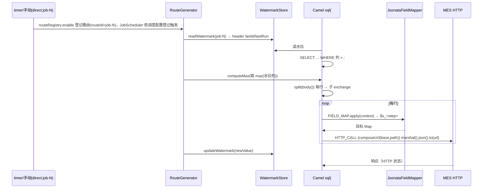

# 北向同步（客户 MySQL → 字段映射 → 推送 MES HTTP）

## 场景说明

把客户侧 MySQL（`po_order`）增量同步到云上 MES：**读取（增量水位）→ 字段映射 → 出站 HTTP 推送**。
入口 = READ_SQL 动作（自动调度 / 手动 `direct`）；落点 = MES HTTP 接口。链路可手动触发或由自动调度周期触发。

### 交互清单

| 角色 | 动作 | 触发方式 | 期望结果 |
|---|---|---|---|
| 自动调度 / 实施工程师 | 触发读取 | 自动调度 / `POST /api/jobs/{id}/execute` | 增量读取 `po_order` |
| 系统 | 水位读库并按行投影 | 自动 | 每行进入映射 |
| 系统 | 字段映射 | 自动（FIELD_MAP） | 产出 MES 目标结构 |
| 系统 | 推送 MES | 自动（HTTP_CALL） | MES 收到数据；成功推进水位 |

## 流程详解

### 时序图



### 逐环节代码走查

| 环节 | 业务动作 | 入口（文件+行号） | 关键类方法 | 数据形态变化 | 错误处理 |
|---|---|---|---|---|---|
| 触发 | 自动调度/手动进主路由 | `buildPollingEntry`（`service/RouteGenerator.java:84`） | `from("direct:job-N")`（自动触发由 `JobScheduler` 投递） | — | 路由级 `onException` |
| 读水位 | 取上次位置 | `readWatermark`（:311） | `WatermarkStore.get("job:N")` → header `lastId/lastRun` | 无 | SEQUENCE/TIMESTAMP 两种占位 |
| 增量读 | 查库 | `appendChain`（:147） | `read.sql().replace("{watermark}",...)` → `.to("sql:...?dataSource=#dataSource&outputType=SelectList")`（:162） | `List<Map>` | 只读 SQL 校验（jobId 校验期） |
| 算新水位 | 取 max | `computeMax`（:320） | SEQUENCE 取 max(水位列)；TIMESTAMP 用当前时间 | — | — |
| 拆分 | 每行一子交换 | `split(bodyExpression())` | Camel split | `List<Map>` → `Map` | — |
| 映射 | 源→目标 | FIELD_MAP（`appendFragment`） | `JsonataRuleCompiler.compile`（`mapping/JsonataRuleCompiler.java:35`）+ `JsonataFieldMapper.apply`（`mapping/JsonataFieldMapper.java:46`） | 上下文 → 目标对象 | 编译失败→400；求值异常→FAILED 消息步 |
| 推送 | HTTP 出站 | HTTP_CALL（`appendFragment`） | `composeUrl`（:360）+ `marshal().json()` + `.to(url)`（:162 之后的片段） | `Map`→JSON→HTTP | 非 2xx→抛异常→重试/FAILED 消息步 |
| 水位回写 | 成功后推进 | `updateWatermark`（:338） | `WatermarkStore.put` | — | 失败即停（成功后才更新） |

> 水位首跑语义：`watermark` 表无记录时按初始值 0 处理——SEQUENCE 读 `id > 0` 即**首次全量**（不会跳过首行），
> 成功后推进到本批 `max(id)`，之后按序前进；TIMESTAMP 同理（无记录按窗口起点）。

## 测试环境

- 客户 MySQL `po_order`（`:3306`/`edge_gateway`）＋增量列 `id`；MES mock `node tools/mock-9099.cjs`（9099）；
- 应用后端（8080）在跑。

## 测试数据与造数指导

| 环节 | 入 | 出 | 验证 |
|---|---|---|---|
| 读库 | `po_order` 一行（`db/migration/V1__init_schema.sql` 种子） | 每行 `Map` | `GET /mock/mes/received` 看到映射结果 |
| 映射 | 规则 `{"sheet_no":$s_1.order_no,...}` | 目标 JSON | MES 收到 `{"sheet_no":"PO-2026-001",...}` |
| 推送 | — | HTTP 请求体 | `%TEMP%\edge-mock\bom-mock.log` |
| 失败样例 | 令 `HTTP_CALL` 指向不可达地址 | 消息步 `FAILED` | `GET /api/history/steps?status=FAILED` |

映射后期望体（`docs/mock-contract.md`）：

```json
{ "sheet_no": "PO-2026-001", "vendor_code": "V001", "sheet_date": "2026-08-14", "status": 1 }
```

## 验证操作

```powershell
node tools/mock-9099.cjs
curl -X POST http://localhost:8080/api/jobs/{id}/execute -H "Content-Type: application/json" -d '{}'
curl http://localhost:8080/mock/mes/received
```

## 建议表

| 现象 | 建议 | 理由 | 类型 | 涉及功能 | 状态 |
|---|---|---|---|---|---|
| C8（重要，已闭环）`READ_SQL` 已按动作 `dataSourceId` 路由到客户库（端点 `#edge-ds-<id>`，连接池由 `DataSourceManager` 管理） | 已由 #65/#66 实现消除（见 ADR-0008） | 端点不再硬编码 `#dataSource`；客户库 ≠ 配置库也不会读错 | 缺陷 | 数据源/北向 | 已闭环 |
| C1 轮询链重投/死信入参与契约不符 | 已由 #70 断点续跑路由（`direct:job-<id>-resume` + `RESUME_FROM`）解决：不再整链重跑、不再依赖 `edge.originalInput` | ADR-0003 修正与 reliability 页承诺"按原始输入从首动作之后重跑"，轮询链实际重跑 READ_SQL | 缺陷 | 可靠性 | 已解决（#70） |
| C3 `crontab` 存而未用，轮询硬编码 `period=60000` | 已改为结构化调度（不自动/间隔/每天/每周），内部编译 fixedRate/cron 并结合 timezone | 由 #78 闭环 | 缺陷修复 | job-action-chain | 已闭环 |
| 水位首跑语义（SEQUENCE 初始 0）未在文档说明 | 已注明（本页"水位首跑语义"：无记录按 0 → 首跑全量，成功后按 id 前进） | 避免误以为跳过首行 | 文档偏差 | 可靠性 | 已闭环 |
| 水位策略重构 + 分批：两种模式——增量（id，`> last` + 每批 max(id)）与刷量（按 `updated_at` 窗口 + 业务键 upsert，幂等，不用墙钟 now）；支持 `batchSize` + keyset 分页（`where {watermark} order by 列 limit n`）、**每批推进水位**，供**首次全量/大增量**；`job.timezone` 用于刷量窗口 | 已定方向，见对应 ticket | 务实收敛：不做侵入式强绑定；更新为主走刷量 upsert；首跑大表必须分批 | 设计改进 | 北向/可靠性 | 采纳 |
| 删除同步：拉取模型感知不到物理删除 | 逻辑删除靠刷量 upsert 覆盖；物理删除由用户按需触发任务（manual/external trigger）；自动删除检测需新动作，单列增强 | 无法自动感知删除 | 业务改进 | 北向/可靠性 | 待评估 |
