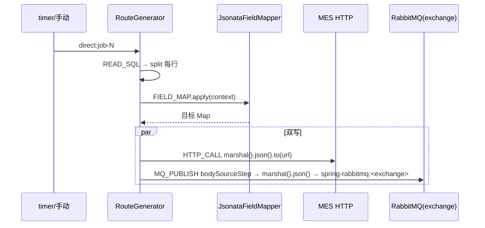

# 同步 + 通知（读库 → 映射 → HTTP 推送 + MQ 发布）

## 场景说明

DS-8 的目标场景：一条任务内"同步并同时发消息"。链路 = **READ_SQL → FIELD_MAP → HTTP_CALL + MQ_PUBLISH**，
即北向同步（见 [northbound-sync.md](northbound-sync.md)）再叠加一次 `MQ_PUBLISH` 把同一份映射结果发到通知队列。
入口 = READ_SQL（timer/手动）；落点 = 双目标：MES HTTP + MQ 队列。

### 交互清单

| 角色 | 动作 | 触发方式 | 期望结果 |
|---|---|---|---|
| 定时器 / 实施工程师 | 触发 | timer / `POST /api/jobs/{id}/execute` | 读库并映射 |
| 系统 | 推送 MES | 自动（HTTP_CALL） | MES 收到 |
| 系统 | 发布通知 | 自动（MQ_PUBLISH） | 通知队列收到同一份映射结果 |

## 流程详解

### 时序图



### 逐环节代码走查

| 环节 | 业务动作 | 入口（文件+行号） | 关键类方法 | 数据形态变化 | 错误处理 |
|---|---|---|---|---|---|
| 读库 | 增量读 | READ_SQL（`service/RouteGenerator.java:306` `appendChain`） | 同北向 | 行 `Map` | — |
| 映射 | 字段映射 | FIELD_MAP（`service/ActionFragment.java:55`） | `JsonataRuleCompiler.compile` + `JsonataFieldMapper.apply` | 上下文 → 目标对象 | 失败→FAILED 消息步 |
| HTTP 推送 | 推 MES | HTTP_CALL（`service/ActionFragment.java:95`） | `marshal().json().to(url)` + `captureResponse`（`service/ReadWriteFragments.java:166`，先过成功条件断言（#148）再解析响应进 `context[本动作序号]`、消息体还原为请求体，#123/#126） | `Map`→JSON→HTTP；响应 → `context[序号]` | 非 2xx→FAILED 消息步；成功条件不满足→同上 |
| MQ 发布 | 发通知 | MQ_PUBLISH（`service/ActionFragment.java:133`） | `bodySourceStep` **必填**（发布哪一步的输出，通常 FIELD_MAP 序号）；`marshal().json()` → `spring-rabbitmq:<exchange>?routingKey=..&disableReplyTo=true` | `Map`→JSON→MQ | 失败→FAILED 消息步 |

`bodySourceStep`（`service/ActionFragment.java:133` MQ_PUBLISH 片段）显式取 `context[step]`——**不再有缺省推断**：
`MqPublishConfig.validate` 要求必填（>0），`ActionService.validateChain` 要求指向链中**存在的、序号更早**的动作；
片段内 `context[step]` 无输出（步骤未执行或被断点跳过）时**抛错中止**，宁可 FAILED 也不静默发布旧 body。
`MqPublishConfig.validate` 要求显式 `exchange`；`routingKey` 缺省回落 `queue`。

> 双写非原子：HTTP_CALL 与 MQ_PUBLISH 各自独立执行，**无分布式补偿/事务**（与 ADR-0003 一致）。
> 部分成功（如 HTTP 已发、MQ 发布失败）时，按失败消息步定位并断点重投，不会自动回滚已成功的推送。

## 测试环境

- 客户 MySQL `po_order` + MES HTTP mock（9099）＋ RabbitMQ（5672）；应用后端（8080）在跑；
- 目标通知队列（如 `edge.notify`）需先声明。

## 测试数据与造数指导

| 环节 | 入 | 出 | 验证 |
|---|---|---|---|
| 读库+映射 | `po_order` 源行 | 目标 `Map` | `GET /mock/mes/received` |
| HTTP 推送 | — | HTTP 请求体 | `%TEMP%\edge-mock\bom-mock.log` |
| MQ 发布 | — | `edge.notify` 消息 | 消费该队列看消息体与 MES 一致 |
| 失败样例 | `MQ_PUBLISH` exchange 不存在 | 消息步 `FAILED` | `GET /api/history/steps?status=FAILED` |

## 验证操作

```powershell
node tools/mock-9099.cjs
curl -X POST http://localhost:8080/api/jobs/{id}/execute -d '{}'
# 检查 MES 收到 + MQ 队列收到同一份映射结果
```

## 建议表

| 现象 | 建议 | 理由 | 类型 | 涉及功能 | 状态 |
|---|---|---|---|---|---|
| 动作重排时 `FIELD_MAP.sourceStep` / `bodySourceStep` 依赖可能静默错位 | 已闭环（#89 T1+T3）：`ChainConsistencyValidator` 一套规则挂三处——写时（`ActionService` 新增/修改 FIELD_MAP → 400）、`/validate`（errors 阻断启用）、`RouteRegistry.enable` 前置（显式启用/变更后重建/启动重载统一闸口）；失败经 `RouteLifecycle` 自动停用 + 摘除路由/调度 + 写 `job.lastError`（启动重载仅对这类配置不一致停用，其余失败只记日志保留启用）。不拦删除（避免死胡同）。`bodySourceStep` 侧写时闭环 ed50f35（链级悬空仍未覆盖，留后续） | `action-chain-design` 已约定；闭环前：`FieldMappingConfig.validateRule` 不校验 sourceStep、`JsonataFieldMapper.apply` 缺步骤静默 undefined、`ActionService.delete` 无依赖检查 | 设计改进 | job-action-chain | 已闭环（#89） |
| `MQ_PUBLISH` 缺 `bodySourceStep` 且上下文为空时可能发布旧 body | 已改为**显式必填**：`MqPublishConfig.validate` 要求 `bodySourceStep>0`；`ActionService.validateChain` 要求指向链中存在且序号更早的动作；RouteGenerator 片段无输出即抛错（断点跳过不再静默发旧 body） | 防误发 | 缺陷 | job-action-chain | 已闭环 |
| 双写（HTTP+MQ）无原子性 | 已在文档注明"非事务，部分成功靠失败消息步定位重投"（本页流程详解注 + ADR-0003） | 与 ADR-0003 一致（不承诺分布式补偿） | 文档偏差 | 可靠性 | 已闭环 |
