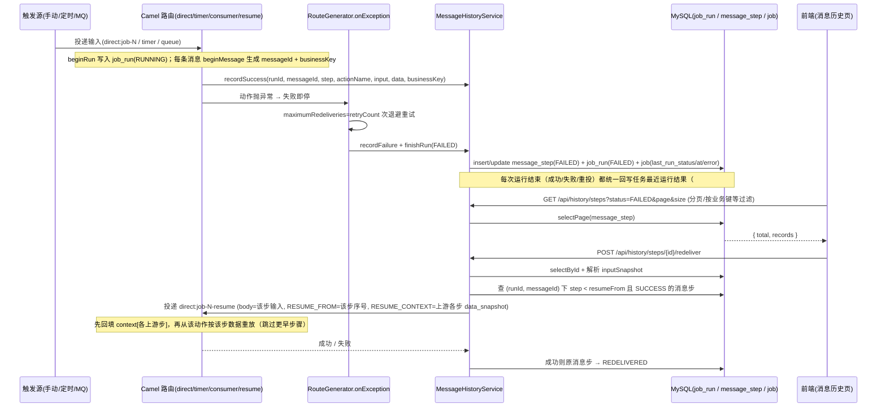

# 可靠性流（失败即停 / 重试退避 / 消息历史 / 断点重投）

## 场景说明

一条已启用的任务在动作链执行中失败时，系统**立即停止后续动作**，按任务配置的 `retryCount`/`backoffMs`
**重试退避**；反复失败后记录一条 `FAILED` 的**消息步**并把**运行**标为 `FAILED`。全程（成功/失败）都写进
`job_run`/`message_step`，供实施工程师在**消息历史**页按运行/消息/业务键查看，并从失败消息步**精确断点续跑**。
链路形态：**执行 → 记录运行与消息步 → 历史检索 → 断点重投**。
决策依据：ADR-0003（失败即停 + 重试，不承诺跨系统补偿事务）与 ADR-0009（死信升维为消息历史）。

### 交互清单

| 角色 | 动作 | 触发方式 | 期望结果 |
|---|---|---|---|
| 外部系统 / 定时器 / 手动 | 投递输入并触发任务 | MQ 消息 / timer / `POST /jobs/{id}/execute` / 外部 API | 任务按动作链执行，产生 `job_run` + `message_step` |
| 系统 | 动作失败即停、重试、记录消息步 | 自动（Camel `onException`） | 一条 `FAILED` 消息步 + 运行 `FAILED` |
| 实施工程师 | 查看运行/消息步 | 前端"消息历史"页 / `GET /api/history/runs`、`/api/history/steps` | 分页看到记录，按任务/运行/业务键/状态过滤 |
| 实施工程师 | 修复原因后断点重投 | 前端"重投" / `POST /api/history/steps/{id}/redeliver` | 用该步数据从该动作重放，成功后原步 `REDELIVERED` |

## 流程详解

### 时序图



### 逐环节代码走查

**① 触发执行（任务入口）**

- 入口：`RouteGenerator.build` 按链首分派——`MQ_CONSUME` → `buildConsumerEntry`；其余 → `buildPollingEntry`；
  手动执行/重放 → `buildReplay`；断点重投 → `buildResumeRoute`（每条任务都会生成 `direct:job-<id>-resume`）；
- 每个入口在 route 首部 `beginRun`（写 `job_run`，状态 `RUNNING`）并置 `edge.runId`；`MQ_CONSUME`/重放/断点入口
  再 `beginMessage`（生成 `messageId`、提取 `businessKey`、置 `edge.stepInput`）；
- 手动执行走 `JobExecutionService.execute`（`direct:job-<id>` 同步等待），执行完**回读**任务返回给调用方；
  最近运行结果不再由它自己计算，而是由链路尾部 `finishRun` 统一回写（见下）。

**② 失败即停 + 重试退避**

- 入口：`RouteGenerator.configureErrorHandling` 对全链 `onException(Exception.class)`，
  `maximumRedeliveries=job.retryCount`、`redeliveryDelay=job.backoffMs`；
- `handled(handled)` —— MQ 消费主路由 `handled=true`（失败后不重投队列）；重放/轮询/断点路由 `handled=false`
  （异常抛回调用方）；
- 最终失败进入 `recordFailure`：`finishRun(FAILED)` + 若已生成消息则记一条 `FAILED` 消息步。

**③ 消息历史记录（成功/失败全程）**

- `MessageHistoryService`：`startRun`/`finishRun`（job_run）、`recordSuccess`/`recordFailure`（message_step，按
  `(run_id, message_id, step)` 幂等 upsert）、`redeliver`；`toJson` 处理 `StreamCache`/`InputStream`/`byte[]`。
- 统一回写（#88）：`finishRun` 结束运行后经 `JobLastRunWriter` 把该次运行的 status/error/finished_at 写回任务
  `last_run_status/last_run_at/last_error`（成功清空 `last_error`），覆盖 MQ 消费、自动调度、手动执行与断点重投；
  手动路径只**回读**任务返回，仅当触发层失败（未创建运行、失败 exchange 上没有 `edge.runId`）才兜底写
  FAILED + 根因。`last_error` 是「最近一次失败原因」，启用/重建失败自动停用时也由 `RouteLifecycle` 写入
  （#89，如 `sourceStep` 引用不一致），下一次成功运行清空。
- 路由内：`recordSuccessStep` 在每个动作片段成功尾部调用（`input`=进入该步数据，`data`=动作后数据，
  `businessKey`=`edge.businessKey`）；`READ_SQL` 为源动作，在 `split` 内首部 `beginMessage` 生成消息（不记消息步）。
- 数据形态：`dataSnapshot`/`inputSnapshot` 为 JSON 字符串；`status ∈ SUCCESS/FAILED/REDELIVERED`；
  `attempt` 的**意图**是"总尝试次数"（`RouteGenerator.attempt()` 写的是 `redeliveryCounter + 1`），但**实测恒为 1**：
  它读 exchange property `CamelRedeliveryCounter`，而 Camel 4 把它写进 message header（`in.setHeader`），
  且 `handled=true` 的路由在进失败处理器前 `removeHeader`、`handled=false` 的路由先 `decrementRedeliveryCounter` → 表达式恒为 `null + 1`（见建议表）。

**④ 历史列表（分页/检索）**

- 入口：`HistoryController` → `MessageHistoryService.listRuns`/`listSteps`；
  `listSteps` 支持 `jobId`（先取该任务 runId 再 in）、`runId`、`messageId`、`businessKey`（like）、`status`；
- 关键类方法：MyBatis-Plus `selectPage`（需 `MybatisPlusConfig` 注册 `PaginationInnerInterceptor`），返回 `{total, records}`；
  数据形态：`Page<JobRun/MessageStep>` → `Map{total, records}`；过滤 `status`（前端默认 `FAILED`）、分页 `page/size`；
- 错误处理：`page`≥1、`size` 钳制 `[1,100]`。

**⑤ 断点重投（精确续跑）**

- 入口：`HistoryController.redeliver` → `MessageHistoryService.redeliver` → 投递 `direct:job-<id>-resume`，
  body = 该步 `inputSnapshot`、property `edge.resumeFromStep` = 该步序号；同时按 `(runId, messageId)` 查
  `step < resumeFrom` 且 `status = SUCCESS` 的消息步，把各自 `data_snapshot` 解析后放进 property
  `edge.resumeContext`（`Map<Integer step, Object data>`，#90）；
- 断点路由：`beginRun` + `beginMessage`（沿用 `edge.businessKey`）→ `appendChain(actions[1..])`，
  入口先把 `edge.resumeContext` 回填进 `context[step]`（`context[0]` 仍是本次重投的 body，语义不变），
  每个片段再判 `isResumeSkipped`（序号 < resumeFromStep 则跳过），从该动作按该步数据重放；
- 为什么必须回填：被跳过步骤不写 `context[index]`，而 FIELD_MAP 的**唯一输入是整份 context**（`fieldMapper.apply(context)`）
  ——规则 `sourceStep` 指向被跳过步骤时 `$s_N` 未定义，会**静默映射出空**（任务仍 SUCCESS）。上游步骤的输出并未丢失：
  它就在同一 `message_id` 的上游 `message_step.data_snapshot` 里；
- 边界：上游步骤无快照（源行、失败步、被跳步）→ 该步骤不进上下文（`edge.resumeContext` 照常投递，值为空 Map），
  行为与现状一致（下游引用仍是空，但不造成"部分可引用"的困惑）；`edge.resumeContext` 常驻投递（不做空值短路），
  断点路由对空 Map 是安全的无操作；
- **入口步骤是这条边界的硬缺口（2026-09-15 实测）**：`MQ_CONSUME`/重放入口的源步骤**从不写 `message_step`**，
  所以规则 `sourceStep=1` 的 MQ 链在重投时 `context[1]` 必缺 → 重投后的映射步**成功但 `data_snapshot = {}`**，
  直到下游写库才因空数据失败（实测 run 301/302：映射步 SUCCESS + `{}`，紧接着 upsert 报
  `Field 'order_no' doesn't have a default value`）。即 MQ 链的失败映射步"重投可用性"实质为零，见建议表；
- 错误处理：成功 → 原消息步 `status='REDELIVERED'`；失败**应**保持 `FAILED` 并抛"重投失败：<原因>"（**实测不成立**：
  `redeliver` 用 `producer.request("direct:…-resume", processor)` 并指望它抛异常，但该重载不重抛 exchange 上的异常
  ——兄弟类 `JobTrigger:26` 用的是会抛的 `requestBody`，所以失败的重投照样返回成功、原步被标 `REDELIVERED`，
  而新 run 实为 `FAILED`；根因待实现会话确认，见建议表）；
  任务未启用抛 `JOB_NOT_ENABLED`（此路正常）。

## 测试环境

- 应用后端（8080）与 MySQL（`:3306`/`edge_gateway`）在跑；RabbitMQ（5672）与 MES mock（9099）按需；
- 需能制造可控失败：令 `HTTP_CALL`/`WRITE_UPSERT` 的目标不可达、或投递非法消息；
- 消息历史页（前端）或 REST 可触发断点重投；`job_run`/`message_step` 表可查。

## 测试数据与造数指导

| 环节 | 入（怎么造） | 出（产物） | 验证（在哪看/看什么） |
|---|---|---|---|
| 触发失败 | 造一条含不可达 `HTTP_CALL` 的任务，手动执行：`curl -X POST /api/jobs/{id}/execute -d '{}'`；或向 MQ 发非法字段消息 | 一条 `FAILED` 消息步 + `job_run` 为 `FAILED` | `GET /api/history/steps?status=FAILED` 或 `select * from message_step where status='FAILED' order by id desc limit 1` |
| 重试退避 | 任务 `retryCount=2`、`backoffMs=300`，手动执行一个必然失败的步（如 FIELD_MAP 的 `INT` 规则喂非数字） | 同一 run 内投递 3 次（首跑 + 2 次重投），再记一条 `FAILED` 消息步 | 观察日志：每次失败一行 `Failed delivery ... On delivery attempt: N`，耗尽一行 `Exhausted after delivery attempt: N`；或看 `POST /api/jobs/{id}/execute` 耗时 ≈ `retryCount × backoffMs`。**不要用消息步 `attempt` 判断**（实测恒为 1，见建议表） |
| 历史列表分页 | 多次触发产生多条消息步 | `{total, records}` | 前端分页器 / `curl '...?page=2&size=20'` |
| 断点重投成功 | 先修复外部依赖，再 `POST /api/history/steps/{id}/redeliver` | 新 `job_run` 为 `SUCCESS`；原消息步 `status='REDELIVERED'` | 再次查询该消息步；目标端收到数据 |
| 映射链断点重投（#90） | 造 `READ_SQL(1) → FIELD_MAP(2, sourceStep=1) → HTTP_CALL(3)`，令 3 失败后修复依赖再重投 | 新运行 SUCCESS，**步骤 2 的 `data_snapshot` 非空且与首次执行一致**（上游步骤 1 的 `data_snapshot` 经 `edge.resumeContext` 回填） | 查新运行的 `message_step`：`select data_snapshot from message_step where run_id=<新> and step=2`；为空说明上游快照未回填 |
| 重投失败（失败样例） | 依赖仍未恢复时重投（如失败步的输入本身非法） | **预期**：保持 `FAILED` + 返回"重投失败：<原因>"；**实测**：接口返回成功、原步被标 `REDELIVERED`，而新 run 是 `FAILED` | 对照 `GET /api/history/runs?jobId=<id>`（新 run 的状态）与 `GET /api/history/steps/{id}`（原步状态）——两者矛盾即复现（run 301/302 证据） |
| 按业务键检索 | 源动作配 `businessKey`，触发含该业务键的消息 | 可按业务键过滤到该消息的全部消息步 | `GET /api/history/steps?businessKey=<键>` |

常用直接 SQL（`db/migration/V1__init_schema.sql` 已含表定义）：

```sql
SELECT id, run_id, message_id, step, action_name, status, business_key, error
FROM message_step ORDER BY id DESC LIMIT 10;
SELECT id, job_id, status, started_at, finished_at, error FROM job_run ORDER BY id DESC LIMIT 10;
```

## 验证操作

```powershell
# 状态过滤 + 分页
curl "http://localhost:8080/api/history/steps?status=FAILED&page=1&size=20"
# 运行列表
curl "http://localhost:8080/api/history/runs?jobId=7&status=SUCCESS"
# 断点重投
curl -X POST http://localhost:8080/api/history/steps/{id}/redeliver
# #90 验证重投后的映射结果（非空 = 上游快照已回填 context）
# select step, status, data_snapshot from message_step where run_id = <重投产生的新 run_id> order by step;
# 重投失败必须"看起来也失败"（对照新 run 与原步状态，两者应一致）
curl "http://localhost:8080/api/history/runs?jobId={id}&size=3"
curl "http://localhost:8080/api/history/steps?businessKey={键}&size=5"
```

**判断"重试到底有没有发生"**（`attempt` 恒为 1，别用它）：把任务 `retryCount=2`、`backoffMs=300` 后手动执行一个必失败的步，
`POST /api/jobs/{id}/execute` 的**耗时 ≈ `retryCount × backoffMs`**（实测 699ms）即证明重投发生了；日志里对应"每次失败一行 + 耗尽一行"。

## 建议表

| 现象 | 建议 | 理由 | 类型 | 涉及功能 | 状态 |
|---|---|---|---|---|---|
| 断点续跑对「下游 FIELD_MAP 引用被跳过步骤上下文」不保证语义 | 已实现（#90，方案 B）：`redeliver` 把同一 `message_id` 下 `step < resumeFrom` 的成功步骤 `data_snapshot` 注入 context（经 property `edge.resumeContext` 传给 resume 入口），引用上游输出的 FIELD_MAP 也能续跑 | 现状：只投 `inputSnapshot` 当 body、被跳步骤不写 context，而 FIELD_MAP 唯一输入是整份 context → 静默出空 | 设计改进 | 可靠性 | 已闭环（#90） |
| 任务 `lastRunStatus` 仅在手动/外部执行回写，MQ 消费链路完成不更新 | 已实现（#88）：`finishRun` 统一回写 `job.last_run_status/at/error`（错误取 `job_run.error`），覆盖消费/调度/手动/重投；手动路径改为回读 + 触发层失败兜底 | 任务列表状态与真实执行不一致 | 设计改进 | 可靠性 | 已闭环（#88） |
| 水位仅整批成功才推进，失败整批重读（at-least-once）；HTTP 推送可能重复 | 已写入文档（`features/reliability` 当前设计"交付语义"：至少一次、南向按幂等键/北向按业务键去重；推送链建议 SEQUENCE + 目标端幂等键） | 与 ADR-0003 一致，但需明示避免误认为不再重复 | 文档偏差 | 可靠性 | 已闭环 |
| `message_step.attempt` 恒为 1：历史页「尝试次数」列与实际重试次数不符 | **保留 run 内重投**（`retryCount`/`backoffMs`，本次决策），把 `attempt` 修为真实总尝试数：`FAILED` 行取 `job.retryCount + 1`（失败处理器只在重投耗尽后执行一次，恒等）或按 `onExceptionOccurred`/`onRedelivery` 在 exchange property 上**自计数**；`SUCCESS` 行（重试后成功）读 header `CamelRedeliveryCounter + 1`。同步改 `HistoryView` 的列标签与本文档的验证口径 | `RouteGenerator.attempt()` 读的是 exchange property，而 Camel 4 把计数写进 message header（`handled=true` 路由进失败处理器前 remove、`handled=false` 路由先 -1）→ 该表达式恒为 `null + 1`（实测：`retryCount=2` 执行 699ms 即确实投递 3 次，落库仍是 1）。历史页最常见的排查问题"这条是第一次就成功还是重试才成功"无法回答；ADR-0009 预留的 `RETRYING` 也依赖该计数 | 缺陷 | 可靠性 | 待修（2026-09-15 实测确认；决策：保留自动重投） |
| 重投失败仍被当成成功：原消息步标 `REDELIVERED`、接口返回成功，而新 run 实为 `FAILED`（"重投失败"分支不可达） | `MessageHistoryService.redeliver` 改用会重抛的 `producer.requestBody(...)`（或取 `request(...)` 返回的 exchange 并检查 `getException()`），失败时抛"重投失败：<原因>"且**不改**原步状态；补一条"重投失败"用例（沿用 `RouteGeneratorRetryTest` 的 Camel 直连风格） | 实测 run 301/302：`job_run=FAILED`（错误 `Field 'order_no' doesn't have a default value`）而原步 `REDELIVERED`、HTTP `{"code":"OK"}`；与 `user-guide.md:102`、本文档 ⑤ 的承诺不符——把"没修好"误报成"已修复"，运维据此收工 | 缺陷（高危） | 可靠性 | 待修（2026-09-15 实测复现） |
| `MQ_CONSUME` 入口链的映射步重投会静默出空：规则 `sourceStep=1`（入口步）时 `context[1]` 必缺 → 映射步 SUCCESS 但 `data_snapshot = {}`，下游写库才因空数据失败 | 二选一：① 入口步骤（`MQ_CONSUME`/重放入口的源步）也记一份快照，使 #90 的回填有数据可用；② 重投时把该步 `inputSnapshot` 回填到 `context[源步骤]`（重投 body 已有这份数据，只是被放进 `context[0]`）。无论选哪条，都建议"源步骤无快照"时**显式失败**而不是静默出空 | #90 的边界（上游无快照 → 不进上下文，"行为与现状一致"）在入口步骤上退化为"静默出空 + 下游背锅"：MQ 链失败映射步的重投实际不可用，与 #90"不再静默映射出空"的目标冲突；实测 run 301：step 2 SUCCESS + `{}` → step 3 报 `Field 'order_no' doesn't have a default value` | 缺陷 / 设计改进 | 可靠性 | 待评估（牵涉 #90 边界定义，建议与 #90 的图一起定） |
