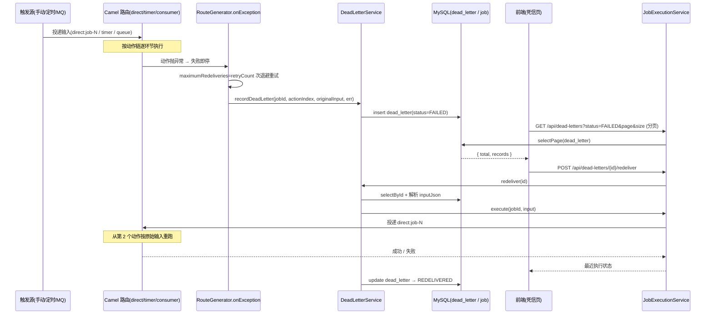

# 可靠性流（失败即停 / 重试退避 / 死信 / 重投）

## 场景说明

一条已启用的任务在动作链执行中失败时，系统**立即停止后续动作**，按任务配置的 `retryCount`/`backoffMs`
**重试退避**；反复失败后把**动作上下文、原始输入、错误信息**写进死信（`dead_letter`），供实施工程师在
"死信"页查看并**人工重投**。链路形态：**执行失败 → 死信记录 → 列表查看 → 重投恢复**。
决策依据：ADR-0003（失败即停 + 重试 + 死信，不承诺跨系统补偿事务）。

### 交互清单

| 角色 | 动作 | 触发方式 | 期望结果 |
|---|---|---|---|
| 外部系统 / 定时器 / 手动 | 投递输入并触发任务 | MQ 消息 / timer / `POST /jobs/{id}/execute` / 外部 API | 任务按动作链执行 |
| 系统 | 动作失败即停、重试、最终写死信 | 自动（Camel `onException`） | `dead_letter` 出现一条 `FAILED` 记录，字段可定位 |
| 实施工程师 | 查看死信列表 | 前端"死信"页 / `GET /api/dead-letters` | 分页看到失败记录，按任务/状态过滤 |
| 实施工程师 | 修复原因后重投 | 前端"重投" / `POST /api/dead-letters/{id}/redeliver` | 用原始输入重跑，成功后状态 `REDELIVERED` |

## 流程详解

### 时序图



### 逐环节代码走查

**① 触发执行（任务入口）**

- 业务动作：把输入投递到任务路由并执行；
- 入口：`RouteGenerator.build`（`spike/src/main/java/com/example/edgegateway/service/RouteGenerator.java:78`）按链首分派——
  `MQ_CONSUME` → `buildConsumerEntry:100`；其余 → `buildPollingEntry:84`；手动/重投 → `buildReplay:128`；
- 关键类方法：`JobExecutionService.execute`（`JobExecutionService.java`，`direct:job-<id>` 同步等待）；
- 数据形态：输入 `Map`/消息体 → 上下文 `edge.context`（序号→输出）+ `edge.originalInput`；
- 错误处理：任务未启用抛 `JOB_NOT_ENABLED`。

**② 失败即停 + 重试退避**

- 业务动作：任一动作失败即停止后续，按配置重试；
- 入口：`RouteGenerator.configureErrorHandling`（`RouteGenerator.java:267`）对全链 `onException(Exception.class)`，
  `maximumRedeliveries=job.retryCount`、`redeliveryDelay=job.backoffMs`；
- 关键类方法：`handled(handled)` —— MQ 消费主路由 `handled=true`（死信后不重投队列）；重放/轮询 `handled=false`
  （异常抛回调用方，手动执行记 `FAILED`）；
- 数据形态：异常在 Camel 处理链中传播；
- 错误处理：最终失败进入 `recordDeadLetter`。

**③ 死信记录**

- 业务动作：把失败上下文、原始输入、错误写入死信；
- 入口：`RouteGenerator.recordDeadLetter`（`RouteGenerator.java:289`）→ `DeadLetterService.record`
  （`DeadLetterService.java:39`）；
- 关键类方法：`input = exchange.getProperty("edge.originalInput")`；无则回落失败时刻 body；`DeadLetterService.toJson`
  处理 `StreamCache`/`InputStream`/`byte[]`（读成 JSON 字符串）后 `insert`；
- 数据形态：`input`（Map/StreamCache）→ `input_json` 字符串；`status='FAILED'`；`action_index` 由 `edge.actionIndex` 定位；
- 错误处理：写入失败会包裹在失败处理中；旧数据（`input_json` 为 Java toString）无法重投。

**④ 死信列表（分页）**

- 业务动作：实施工程师按任务/状态过滤查看失败记录；
- 入口：`DeadLetterController.list`（`DeadLetterController.java:27`）→ `DeadLetterService.list`
  （`DeadLetterService.java:49`）；
- 关键类方法：MyBatis-Plus `selectPage`（需 `MybatisPlusConfig` 注册 `PaginationInnerInterceptor`），返回 `{total, records}`；
- 数据形态：`List<DeadLetter>` → `Map{total, records}`；过滤 `status`（默认前端 `FAILED`）、分页 `page/size`；
- 错误处理：`size` 钳制到 `[1,100]`、`page`≥1。

**⑤ 重投恢复**

- 业务动作：用原始输入从失败动作之后重跑；
- 入口：`DeadLetterController.redeliver`（`DeadLetterController.java:43`）→ `DeadLetterService.redeliver`
  （`DeadLetterService.java:73`）→ `JobExecutionService.execute`；
- 关键类方法：`parseInput(inputJson)` → 输送到 `direct:job-<id>`（MQ/手动链为 `buildReplay:128`，从第 2 个动作重跑）；
- 数据形态：`input_json` 字符串 → `Map` → 请求体；
- 错误处理：成功 → `dead_letter.status='REDELIVERED'`；失败保持 `FAILED` 并抛"重投失败：<原因>"；
  输入非 JSON 对象（旧死信）抛 `IllegalArgumentException`。

## 测试环境

- 应用后端（8080）与 MySQL（`:3306`/`edge_gateway`）在跑；RabbitMQ（5672）与 MES mock（9099）按需；
- 需能制造可控失败：令 `HTTP_CALL`/`WRITE_UPSERT` 的目标不可达、或投递非法消息；
- 死信页（前端）或 REST 可触发重投；`dead_letter` 表可查。

## 测试数据与造数指导

| 环节 | 入（怎么造） | 出（产物） | 验证（在哪看/看什么） |
|---|---|---|---|
| 触发失败 | 造一条含不可达 `HTTP_CALL` 的任务，手动执行：`curl -X POST /api/jobs/{id}/execute -d '{}'`；或向 MQ 发非法字段消息 | 一条 `dead_letter`（`status='FAILED'`，`error` 含连接拒绝/解析失败） | `GET /api/dead-letters?status=FAILED` 或 `select * from dead_letter order by id desc limit 1` |
| 重试退避 | 任务 `retryCount=2`、`backoffMs=1000` | 失败前重复投递日志 2 次 | 观察日志 `Failed delivery ... attempt: N` / 死信时间戳 |
| 死信列表分页 | 批量造死信（可脚本逐条 `insert` 或多次触发失败） | `{total, records}` | 前端分页器 / `curl '...?page=2&size=20'` |
| 重投成功 | 先修复外部依赖，再 `POST /api/dead-letters/{id}/redeliver` | `lastRunStatus='SUCCESS'`；死信 `status='REDELIVERED'` | 再次查询该死信；目标端收到数据 |
| 重投失败（失败样例） | 依赖仍未恢复时重投 | 保持 `FAILED`，返回"重投失败：<原因>" | `GET /api/dead-letters/{id}` 仍 `FAILED` |
| 重投非法输入（边界） | 手工把 `input_json` 改成 `org.apache.camel...@123`（旧死信） | 报"不是 JSON 对象" | `POST /api/dead-letters/{id}/redeliver` 返回 400 |

常用直接 SQL（`spike/db/init.sql` 已含表定义）：

```sql
SELECT id, job_id, action_index, input_json, status, error FROM dead_letter ORDER BY id DESC LIMIT 10;
-- 清理旧死信（Java toString 无法重投）
DELETE FROM dead_letter WHERE input_json LIKE 'org.apache.camel%';
```

## 验证操作

```powershell
# 状态过滤 + 分页
curl "http://localhost:8080/api/dead-letters?status=FAILED&page=1&size=20"
# 重投
curl -X POST http://localhost:8080/api/dead-letters/{id}/redeliver
```

## 建议表

| 现象 | 建议 | 理由 | 类型 | 涉及功能 | 状态 |
|---|---|---|---|---|---|
| C1 轮询链（北向，链首 `READ_SQL`）`buildPollingEntry` 未设 `edge.originalInput`，且该路由兼作重放路由 | 轮询入口同样设置 `edge.originalInput`；并为轮询链补"跳首动作"重放路由（或明确"北向重投=整体重跑"并同步文档）+ 加测试 | ADR-0003 修正与 `reliability` 页声明"重投按原始输入从首动作之后重跑"，但轮询链实际重跑 `READ_SQL`（读库）且死信入参回落失败时刻 body | 缺陷 | 可靠性 | 待评估 |
| 任务 `lastRunStatus` 仅在手动/外部执行回写，MQ 消费链路完成不更新 | 观察项；若需在任务列表反映消费结果，在消费 route 尾回写 | 任务列表状态与真实执行不一致 | 设计改进 | 可靠性 | 待评估 |
| 旧死信（`input_json` 为 Java toString）无法重投 | 启动/后台清理任务或提供清理接口 | 历史测试残留 | 文档偏差 | 可靠性 | 待评估 |
| 水位仅整批成功才推进，失败整批重读（at-least-once）；HTTP 推送可能重复 | 明确"至少一次、靠写幂等/MES 按业务键去重"，写进文档与死信；推送链建议 SEQUENCE + 目标端幂等键 | 与 ADR-0003 一致，但需明示避免误认为不再重复 | 文档偏差 | 可靠性 | 待评估 |
