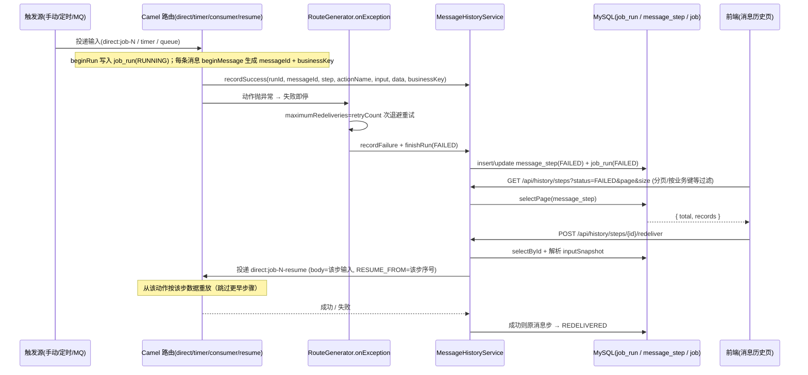

# 可靠性流（失败即停 / 重试退避 / 消息历史 / 断点重投）

## 场景说明

一条已启用的任务在动作链执行中失败时，系统**立即停止后续动作**，按任务配置的 `retryCount`/`backoffMs`
**重试退避**；反复失败后记录一条 `FAILED` 的**消息步**并把**运行**标为 `FAILED`。全程（成功/失败）都写进
`job_run`/`message_step`，供实施工程师在**消息历史**页按运行/消息/业务键查看，并从失败消息步**精确断点续跑**。
链路形态：**执行 → 记录运行与消息步 → 历史检索 → 断点重投**。
决策依据：ADR-0003（失败即停 + 重试，不承诺跨系统补偿事务）与 ADR-0009（死信升维为消息历史）。

### 交互清单

| 角色 | 动作 | 触发方式 | 期望结果 |
|---|---|---|---|
| 外部系统 / 定时器 / 手动 | 投递输入并触发任务 | MQ 消息 / timer / `POST /jobs/{id}/execute` / 外部 API | 任务按动作链执行，产生 `job_run` + `message_step` |
| 系统 | 动作失败即停、重试、记录消息步 | 自动（Camel `onException`） | 一条 `FAILED` 消息步 + 运行 `FAILED` |
| 实施工程师 | 查看运行/消息步 | 前端"消息历史"页 / `GET /api/history/runs`、`/api/history/steps` | 分页看到记录，按任务/运行/业务键/状态过滤 |
| 实施工程师 | 修复原因后断点重投 | 前端"重投" / `POST /api/history/steps/{id}/redeliver` | 用该步数据从该动作重放，成功后原步 `REDELIVERED` |

## 流程详解

### 时序图



### 逐环节代码走查

**① 触发执行（任务入口）**

- 入口：`RouteGenerator.build` 按链首分派——`MQ_CONSUME` → `buildConsumerEntry`；其余 → `buildPollingEntry`；
  手动执行/重放 → `buildReplay`；断点重投 → `buildResumeRoute`（每条任务都会生成 `direct:job-<id>-resume`）；
- 每个入口在 route 首部 `beginRun`（写 `job_run`，状态 `RUNNING`）并置 `edge.runId`；`MQ_CONSUME`/重放/断点入口
  再 `beginMessage`（生成 `messageId`、提取 `businessKey`、置 `edge.stepInput`）；
- 手动执行走 `JobExecutionService.execute`（`direct:job-<id>` 同步等待），同步回写任务 `lastRunStatus`。

**② 失败即停 + 重试退避**

- 入口：`RouteGenerator.configureErrorHandling` 对全链 `onException(Exception.class)`，
  `maximumRedeliveries=job.retryCount`、`redeliveryDelay=job.backoffMs`；
- `handled(handled)` —— MQ 消费主路由 `handled=true`（失败后不重投队列）；重放/轮询/断点路由 `handled=false`
  （异常抛回调用方）；
- 最终失败进入 `recordFailure`：`finishRun(FAILED)` + 若已生成消息则记一条 `FAILED` 消息步。

**③ 消息历史记录（成功/失败全程）**

- `MessageHistoryService`：`startRun`/`finishRun`（job_run）、`recordSuccess`/`recordFailure`（message_step，按
  `(run_id, message_id, step)` 幂等 upsert）、`redeliver`；`toJson` 处理 `StreamCache`/`InputStream`/`byte[]`。
- 路由内：`recordSuccessStep` 在每个动作片段成功尾部调用（`input`=进入该步数据，`data`=动作后数据，
  `businessKey`=`edge.businessKey`）；`READ_SQL` 为源动作，在 `split` 内首部 `beginMessage` 生成消息（不记消息步）。
- 数据形态：`dataSnapshot`/`inputSnapshot` 为 JSON 字符串；`status ∈ SUCCESS/FAILED/REDELIVERED`；
  `attempt = redeliveryCounter + 1`。

**④ 历史列表（分页/检索）**

- 入口：`HistoryController` → `MessageHistoryService.listRuns`/`listSteps`；
  `listSteps` 支持 `jobId`（先取该任务 runId 再 in）、`runId`、`messageId`、`businessKey`（like）、`status`；
- 关键类方法：MyBatis-Plus `selectPage`（需 `MybatisPlusConfig` 注册 `PaginationInnerInterceptor`），返回 `{total, records}`；
  数据形态：`Page<JobRun/MessageStep>` → `Map{total, records}`；过滤 `status`（前端默认 `FAILED`）、分页 `page/size`；
- 错误处理：`page`≥1、`size` 钳制 `[1,100]`。

**⑤ 断点重投（精确续跑）**

- 入口：`HistoryController.redeliver` → `MessageHistoryService.redeliver` → 投递 `direct:job-<id>-resume`，
  body = 该步 `inputSnapshot`、property `edge.resumeFromStep` = 该步序号；
- 断点路由：`beginRun` + `beginMessage`（沿用 `edge.businessKey`）→ `appendChain(actions[1..])`，
  每个片段先判 `isResumeSkipped`（序号 < resumeFromStep 则跳过），从该动作按该步数据重放；
- 错误处理：成功 → 原消息步 `status='REDELIVERED'`；失败保持 `FAILED` 并抛"重投失败：<原因>"；
  任务未启用抛 `JOB_NOT_ENABLED`。

## 测试环境

- 应用后端（8080）与 MySQL（`:3306`/`edge_gateway`）在跑；RabbitMQ（5672）与 MES mock（9099）按需；
- 需能制造可控失败：令 `HTTP_CALL`/`WRITE_UPSERT` 的目标不可达、或投递非法消息；
- 消息历史页（前端）或 REST 可触发断点重投；`job_run`/`message_step` 表可查。

## 测试数据与造数指导

| 环节 | 入（怎么造） | 出（产物） | 验证（在哪看/看什么） |
|---|---|---|---|
| 触发失败 | 造一条含不可达 `HTTP_CALL` 的任务，手动执行：`curl -X POST /api/jobs/{id}/execute -d '{}'`；或向 MQ 发非法字段消息 | 一条 `FAILED` 消息步 + `job_run` 为 `FAILED` | `GET /api/history/steps?status=FAILED` 或 `select * from message_step where status='FAILED' order by id desc limit 1` |
| 重试退避 | 任务 `retryCount=2`、`backoffMs=1000` | 失败前重复投递日志 2 次（`attempt` 递增） | 观察日志 `Failed delivery ... attempt: N` / 消息步 `attempt` |
| 历史列表分页 | 多次触发产生多条消息步 | `{total, records}` | 前端分页器 / `curl '...?page=2&size=20'` |
| 断点重投成功 | 先修复外部依赖，再 `POST /api/history/steps/{id}/redeliver` | 新 `job_run` 为 `SUCCESS`；原消息步 `status='REDELIVERED'` | 再次查询该消息步；目标端收到数据 |
| 重投失败（失败样例） | 依赖仍未恢复时重投 | 保持 `FAILED`，返回"重投失败：<原因>" | `GET /api/history/steps/{id}` 仍 `FAILED` |
| 按业务键检索 | 源动作配 `businessKey`，触发含该业务键的消息 | 可按业务键过滤到该消息的全部消息步 | `GET /api/history/steps?businessKey=<键>` |

常用直接 SQL（`db/migration/V1__init_schema.sql` 已含表定义）：

```sql
SELECT id, run_id, message_id, step, action_name, status, business_key, error
FROM message_step ORDER BY id DESC LIMIT 10;
SELECT id, job_id, status, started_at, finished_at, error FROM job_run ORDER BY id DESC LIMIT 10;
```

## 验证操作

```powershell
# 状态过滤 + 分页
curl "http://localhost:8080/api/history/steps?status=FAILED&page=1&size=20"
# 运行列表
curl "http://localhost:8080/api/history/runs?jobId=7&status=SUCCESS"
# 断点重投
curl -X POST http://localhost:8080/api/history/steps/{id}/redeliver
```

## 建议表

| 现象 | 建议 | 理由 | 类型 | 涉及功能 | 状态 |
|---|---|---|---|---|---|
| 断点续跑对「下游 FIELD_MAP 引用被跳过步骤上下文」不保证语义 | 在文档/消息步说明；常见写/发动作走 body 不受影响 | 精确断点的上下文约束 | 已知限制 | 可靠性 | 本期接受 |
| 任务 `lastRunStatus` 仅在手动/外部执行回写，MQ 消费链路完成不更新 | 已定方向（#88）：`finishRun` 统一回写 job（覆盖消费/调度/手动），实现另会话 | 任务列表状态与真实执行不一致 | 设计改进 | 可靠性 | 已定方向（#88） |
| 水位仅整批成功才推进，失败整批重读（at-least-once）；HTTP 推送可能重复 | 已写入文档（`features/reliability` 当前设计"交付语义"：至少一次、南向按幂等键/北向按业务键去重；推送链建议 SEQUENCE + 目标端幂等键） | 与 ADR-0003 一致，但需明示避免误认为不再重复 | 文档偏差 | 可靠性 | 已闭环 |
