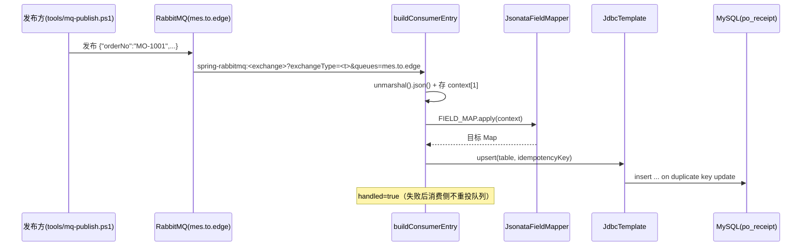

# 南向同步（RabbitMQ 订阅 → 字段映射 → 幂等 upsert 客户 MySQL）

## 场景说明

把云上 MES 下发的消息（`mes.to.edge`）同步到客户侧：**MQ 订阅 → 字段映射 → MySQL 幂等 upsert**。
入口 = MQ_CONSUME 动作（链首，只能序号 1）；落点 = 客户表 `po_receipt`（键 `order_no`）。

### 交互清单

| 角色 | 动作 | 触发方式 | 期望结果 |
|---|---|---|---|
| 云上 MES | 投递业务消息 | 向 `mes.to.edge` 发布 | 网关消费到 |
| 系统 | 消费并把消息体落入上下文 | 自动（MQ_CONSUME） | 消息体入上下文 `context[1]` |
| 系统 | 字段映射 | 自动（FIELD_MAP） | 产出目标结构 |
| 系统 | 幂等写库 | 自动（WRITE_UPSERT） | `po_receipt` 按 `order_no` upsert；重复消息不产生重复行 |

## 流程详解

### 时序图



### 逐环节代码走查

| 环节 | 业务动作 | 入口（文件+行号） | 关键类方法 | 数据形态变化 | 错误处理 |
|---|---|---|---|---|---|
| 消费 | 订阅队列 | `buildConsumerEntry`（`service/RouteGenerator.java:108`） | `from("spring-rabbitmq:<exchange>?exchangeType=<t>&queues=..&routingKey=<rk>&autoDeclare=true")`（缺省=数据源名/direct/queue，ADR-0010） | JSON 串 → `unmarshal().json()` → `Map` | `handled=true`（失败后不重投队列） |
| 保真 | 存消息体 | 入口 process（:119） | `context[1]` | 消息体 → 上下文 | — |
| 映射 | 字段映射 | FIELD_MAP（`appendFragment`） | `JsonataRuleCompiler.compile` + `JsonataFieldMapper.apply` | `Map` → 目标对象 | 求值失败→FAILED 消息步 |
| 写库 | 幂等 upsert | WRITE_UPSERT（`appendFragment`，`upsert` 在 `service/RouteGenerator.java:345`） | `insert into <table> (...) values (?) on duplicate key update ...`（`jdbcTemplate.update`，:357） | `Map` → JDBC | 失败→重试/FAILED 消息步 |

约束：一条链最多一个 `MQ_CONSUME`（链首）+ 最多一个带水位的 `READ_SQL`（配置期拦截，`ActionService.validateChain`）。
`sourceKey`（映射历史隔离）按实际源动作推导：`MQ_CONSUME → mq:<queue>`、`READ_SQL → db:<table>`
（`MappingHistoryService.inferSourceKey`，`service/MappingHistoryService.java:111`）。

## 测试环境

- RabbitMQ（`:5672`，`guest/guest`），消费队列 `mes.to.edge`；客户 MySQL `po_receipt`（`order_no` 唯一）；
- 应用后端（8080）在跑；发消息用 `tools/mq-publish.ps1`。

## 测试数据与造数指导

| 环节 | 入 | 出 | 验证 |
|---|---|---|---|
| 消费 | `tools/mq-publish.ps1 -Queue mes.to.edge -PayloadFile <json>`，消息 `{"orderNo":"MO-1001","material":"M-9","qty":10}` | 消费日志 | 日志显示消费到 |
| 写库 | 上一条消息 | `po_receipt` 一行（`order_no='MO-1001'`） | `select * from po_receipt` |
| 幂等（失败/重复） | 重复发布同 `orderNo` 消息 | 仍一行 | 无重复行 |
| 失败样例 | 发布缺 `order_no`/`qty` 非法枚举的消息 | 消息步 `FAILED` | `select * from message_step where status='FAILED' order by id desc limit 1` |

## 验证操作

```powershell
tools/mq-publish.ps1 -Queue mes.to.edge -PayloadFile <json文件>
mysql -ugateway -pgateway edge_gateway -e "select * from po_receipt;"
```

## 建议表

| 现象 | 建议 | 理由 | 类型 | 涉及功能 | 状态 |
|---|---|---|---|---|---|
| C8（已闭环）`WRITE_UPSERT` 已按动作 `dataSourceId` 用客户库 `JdbcTemplate` 执行 | 已由 #67 实现消除（见 ADR-0008） | 不再写网关配置库；客户库 ≠ 配置库也不会写错 | 缺陷 | 数据源/南向 | 已闭环 |
| 消费者 exchange 未暴露，固定用数据源名当直连 exchange | 已实现：#81（配置模型）/ #82（路由生成）/ #83（本文档闭环），exchange 名称/类型/binding key 归动作（ADR-0010），缺省兼容（数据源名 + direct + routingKey=queue），存量任务零影响 | ADR-0010 + 事实研究 `docs/research/camel-spring-rabbitmq-declaration-facts.md`；边界见 `features/transport` 已知限制 | 业务改进 | 通信模型 | 已闭环（#80-83 / ADR-0010） |
| `MQ_PUBLISH` 要求显式 exchange（amq.default 不可靠） | 保持现状，已在文档注明（`features/transport` 已知限制，实测结论 `d7790b1`） | 实测结论 `d7790b1` | 文档偏差 | 通信模型 | 已闭环 |
| 消费成功但 `job.lastRunStatus` 不更新 | 观察项；若需反映则在消费 route 尾回写 | 任务列表状态与真实执行不一致 | 设计改进 | 可靠性 | 待评估 |
