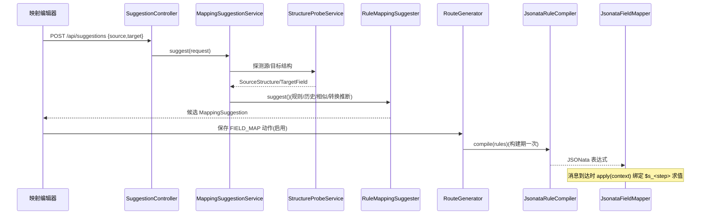

# 字段映射（转换流）：规则树 → JSONata 编译 → 求值 + 建议器

## 场景说明

把上一步动作输出按规则映射成目标结构。**规则模型（递归组）→ 路由构建期编译为 JSONata 表达式 → 消息到达时按
上下文求值**；配套**映射建议器**（默认规则引擎，可站点级覆盖为 LLM）与逐行编辑器（每个目标字段一行）。
入口 = FIELD_MAP 动作 / 动作表上的「编辑映射」；落点 = 目标对象（Map），供后续 HTTP/MQ/写库消费。

### 交互清单

| 角色 | 动作 | 触发方式 | 期望结果 |
|---|---|---|---|
| 实施工程师 | 配映射规则 | 动作表上的「编辑映射」（全屏编辑器，每个目标字段一行） | 规则树落库 |
| 实施工程师 | 校验草稿 | 编辑器里的「校验配置」/ `POST /api/field-mapping-editor/validate` | 问题列表（定位到行）+ 编译产物；不写库 |
| 实施工程师 | 获取推荐 | `POST /api/suggestions`（建议器仍在后端，界面上这一轮没有入口，见 #98 D8） | 候选映射 |
| 系统 | 编译+求值 | 路由构建期 + 消息执行期 | 产出目标结构 |

## 流程详解

### 时序图



### 逐环节代码走查

| 环节 | 业务动作 | 入口（文件+行号） | 关键类方法 | 数据形态变化 | 错误处理 |
|---|---|---|---|---|---|
| 规则模型 | 结构化规则树（叶子 + 组节点） | `config/FieldMappingConfig.from` | `validate()` 递归校验（组内子规则禁 sourceStep、INDEX 仅组内、CONSTANT 需 constant 等） | JSON → 递归 record | 未知键/缺 target/前缀冲突→400；sourceStep 悬空/错位→400 且 `/validate` 报错（#89 `ChainConsistencyValidator`） |
| 编译 | 规则树 → JSONata | 路由构建期 | `JsonataRuleCompiler.compile`（`mapping/JsonataRuleCompiler.java:35`） | `List<FieldMappingRule>` → 字符串表达式 | 目标前缀/重复冲突→400 |
| 求值 | 上下文绑定各步骤求值 | 消息到达 | `JsonataFieldMapper.apply`（`mapping/JsonataFieldMapper.java:46`）；dashjoin jsonata 0.9.10，实例跨消息复用 | 上下文 `Map<Integer,Object>` → 目标对象 | 编译失败→400；求值异常→FAILED 消息步 |
| 建议器 | 结构探测 + 同名归一化 + 相似度 + 历史复用 + 转换推断 | `MappingSuggestionService.suggest`（`service/MappingSuggestionService.java:45`）→ `MappingSuggesterRouter.forSite`（`service/MappingSuggesterRouter.java:33`）→ `RuleMappingSuggester.suggest`（`mapping/suggest/RuleMappingSuggester.java:39`） | 探测字段对（`StructureProbeService.probeFromDb` :53）→ 候选 | 组建议 `MatchSource.ARRAY`；单值样例不再推 CONSTANT（DS-10.4） |
| 编辑器 | 每个目标字段一行 + 常驻来源字段清单 + 校验交给后端只读接口 | `frontend/src/components/FieldMappingWorkbench.vue`（入口：动作表上的「编辑映射」） | 保存/回填递归 rules（`mapping/rows.ts` 那一层，格式与旧编辑器同一个） | — | 保存校验 `validate`、`mode:EXPRESSION` 逃生通道、点「校验配置」走 `POST /api/field-mapping-editor/validate` |

关键实现：`JsonataInputs.normalize` 先规范化 JDBC 非 JSON 类型；`$s_<step>` 绑定上下文步骤；`$root` 跨层级引用；
组 `$map(...)` 包 `[ ]` 保证恒为数组；`$index`（`startAt`）、`$lookup`（ENUM）、`$dateFormat`（DATE）、`&`（CONCAT）。

## 测试环境

- 有源/目标样例 JSON（`spike/src/test/resources/json/*.json`）；后端（8080）在跑 + 结构探测/建议 API 可用；
- 编译/求值无需外部服务（`JsonataRuleCompilerTest` / `JsonataS0SpikeTest` 覆盖）。

## 测试数据与造数指导

| 环节 | 入 | 出 | 验证 |
|---|---|---|---|
| 编译 | `{"rules":[{"sourceStep":1,"source":"order_no","target":"sheet_no"}]}` | 表达式 | `POST /api/jobs/{id}/actions` 无 400 |
| 求值 | 上下文 `{1:{order_no:"PO-1"}}` | `{"sheet_no":"PO-1"}` | MES 收到/日志 |
| 建议 | 源/目标样例 | 候选列表 | `POST /api/suggestions` 返回 `sourcePath,targetName,score,matchSource` |
| 失败样例 | 组合路径 `a.b.c` 与 `a.b` 冲突 | 400 | `目标字段前缀冲突/重复映射` |
| 失败样例 | `sourceStep` 指向已删除/更晚的动作 | 400 或 `/validate` errors | `动作 2（map）映射规则 sheet_no 的 sourceStep=1 在动作链中不存在` |
| 边界 | 组内 INDEX 出现在顶层 | 400 | `INDEX 转换只能在数组组内使用` |

覆盖样例：STRING / INT / DATE / ENUM / CONSTANT / CONCAT / INDEX；组节点（制品→BOM 两级）与 `$root` 跨层。

## 验证操作

```powershell
curl -X POST http://localhost:8080/api/structure-probe -H "Content-Type: application/json" -d '{...}'
curl -X POST http://localhost:8080/api/suggestions -H "Content-Type: application/json" -d '{...}'
```

## 建议表

| 现象 | 建议 | 理由 | 类型 | 涉及功能 | 状态 |
|---|---|---|---|---|---|
| C6 旧 `mapping/FieldMapper.java` / `MappingRule.java` 残留 | 已删除两个旧类及旧测试 `FieldMapperTest`（全仓查证仅自引用 + 旧测试；行为覆盖已由 `JsonataRuleCompilerTest`（旧扁平规则一致用例）承接）；`RouteGenerator` 未用 import 已核实无残留 | 已被 `JsonataFieldMapper`/`mapping/TransformType` 替代 | 设计改进 | 字段映射 | 已闭环 |
| 映射历史对组规则：INDEX 子规则不入库 | 保持现状，已在文档注明（`features/field-mapping` 已知限制，T37 约定） | T37 约定 | 文档偏差 | 字段映射 | 已闭环 |
| 深层数组任意重排仍建议走 `mode:EXPRESSION` | 已在文档注明（`features/field-mapping` 已知限制："数组迭代段 + 相对路径"边界） | 层级路径支持有限 | 业务改进 | 字段映射 | 已闭环 |
| 单值样例不推 CONSTANT（DS-10.4） | 已实现 | — | 已闭环 | 字段映射 | 采纳 |
| P7 DATE 转换对**无法解析的值静默原样透传**（`mapping/JsonataFunctions.java:53-57` 四次 parse 全失败 → `return raw`）：如 `"2026/08/14"` 会带着未格式化原值发出，任务仍 SUCCESS；pattern 非法倒是会抛（`ofPattern` 在 try 外 :35） | 已定方向（A）：保留宽容语义 + **加可见性**（解析失败记 warning/线索，便于排查）。**#111 已落地一半**：有来源字段样例时把实际取值过一遍运行时那份实现，跑不出来就在「校验配置」里报一条警告 | 错误只在目标端暴露、网关侧全绿；宽容本身合理但不该无痕 | 设计改进 | 字段映射 | **A 已落地（校验侧，#111）**：`MappingSampleChecks.datePatternWarnings` + `JsonataFunctions.canFormat`；运行期侧的可见性（日志/线索）仍待 |
| P8 INT 用 `$number()`（`mapping/JsonataRuleCompiler.java:139`）：**原文写错了**——非数字输入不是「静默 undefined、目标字段缺失」，引擎 0.9.10 实测**抛 `NumberFormatException`**（`$number("abc")` 与 `{"n": $number("abc")}` 都抛），那条转换一跑到任务就 FAILED | 保留原文的评估方向（加可见性 or 校验期/运行期显式失败），但判据要换成「任务直接失败」而不是「字段静默缺失」 | 记录与实测不符会误导排查（照原文会去目标端找缺失的字段，实际是网关侧那条动作失败） | 文档偏差 | 字段映射 | **已更正（ADR-0012 决策 8，实测复核）** |
| P9 组内只能引用当前层 `$g<depth-1>` 或 `$root`（顶层根）——**中间层组的元素无法被更内层引用**（`mapping/JsonataRuleCompiler.java:169-179`） | 待评估：精确化文档边界（"深层任意重排"的确切成因）或扩展变量绑定 | 与 `features/field-mapping` 已知限制对应，但现有描述不够精确 | 文档偏差 | 字段映射 | 待评估 |
| P6 顶层规则不写 `sourceStep` 时**缺省指向 `$s_0`**（`mapping/JsonataRuleCompiler.java:41`），而 config 校验不要求必填 → READ_SQL 链里静默映射全空（`context[0]` 是任务输入 `{}`） | 已并入 #89：链一致性校验需一并决定 0 的合法语义（严格必填 or 仅手动输入型链首放行） | 与 bodySourceStep 必填形成反差；缺省值把配置遗漏变成静默错 | 设计改进 | 字段映射 | 已定方向（#89） |
| **F1（→ 已降级）** 推断产出的 `"ISO-8601"` **不是合法的 `DateTimeFormatter` pattern**：`TransformInferrer:34` 的候选名会被 `MappingSuggestion.datePattern` 带回，编译成 `$dateFormat(x, "ISO-8601")`（`JsonataRuleCompiler:140`）→ 运行时 `ofPattern("ISO-8601")` 抛 `Unknown pattern letter: I`（`JsonataFunctions:35`）→ FAILED；编译/校验期均不校验 pattern（见 P3/P7）。**原来的触发路径是旧编辑器建议面板上那个「采用」按钮（`MappingEditor.vue:472`）**——#107 把建议面板连同旧编辑器一起删了，界面上再没有地方把建议的 `datePattern` 写进规则，所以「系统建议自己造出必炸配置」这条**当前不可达**（#111 起另一条路可达：手输框，见右）；要恢复它得先把建议器接回界面（#98 明确这一轮不接） | 保留建议 **A（把该候选名改为合法目标 pattern，如 `yyyy-MM-dd'T'HH:mm:ss`）+ C（校验期校验 `datePattern` 合法性，兜住所有非法 pattern）**：接回建议器之前先把后端这两处修掉，否则接回来的第一天就会重演；界面上手输一个非法 pattern 原本会炸——**C 落地之后（#111）改成保存前拦下**，与界面无关 | 样例含时区/毫秒的时间戳（如 `2026-08-14T10:00:00Z`）即触发；**#111 起界面上手输一个非法 pattern 可达**（日期格式串那个手输框），点「校验配置」或保存都会被那条错误拦下——所以旧编辑器删掉之后「无 UI 可达」这句话不再成立 | 缺陷 | 字段映射 | **建议 C 已落地**（#111 / ADR-0012 决策 2：配置期校验 `datePattern` 合法性，非法即错误——平台解析器不认的、以及 `Y`/`D` 这类「长得像含义却不是」的陷阱字母都拦；有来源字段样例时再按样例值真跑一遍，跑不出来给警告）；**建议 A 仍待**（`TransformInferrer` 那个候选名至今还是 `ISO-8601`，接回建议器之前要改；现在采用了也存不下去，会被 C 那条拒掉） |
| F3 建议器**只为必填目标字段出建议**（`mapping/suggest/RuleMappingSuggester.java:58-60` `if (!target.required()) continue;`），可选字段永远没有候选 | 待评估：可选字段也给建议（低分候选）或由前端 `required` 语义决定 | 与"建议面板覆盖全部目标字段"的使用直觉不符 | 业务改进 | 字段映射 | 待评估 |
| F4 数组组建议只看**数组名相似**（最后一段 Jaro/tokens，:154-175）：数组名不相似就完全没有组建议（不回退"唯一数组"）；children 一律同名启发（`field.name→field.name`，1.0） | 待评估：数组名无匹配时回退"源中唯一数组"候选；children 附加相似度评分 | 组建议是层级映射的主要入口，漏检即回到手工配 | 业务改进 | 字段映射 | 待评估 |
| F5 建议器**阈值 0.85 与 TOP_N=3 均不可配**（`RuleMappingSuggester:25,30-36` 只有无参 `@Component`，全仓无带参注入/Bean 定义） | 待评估：抽到配置（`edge.mapping.threshold` / `topN`） | 不同客户字段命名差异大，硬编码阈值无法调优 | 设计改进 | 字段映射 | 待评估 |
| F2/F6 建议器细则与注释偏差：`TransformKind` 的 `BOOLEAN/NUMBER` 在规则层不存在（旧编辑器把这两种建议静默降级成 STRING，`MappingEditor.vue:465-466`——**该文件已随 #107 删除**，现在界面上没有地方消费建议）；`NameNormalizer` 注释称"去分隔符/数字"但 `TOKEN_SPLIT=[^a-z0-9]+` **保留数字**（:8-25） | 待评估：文档写明降级语义（建议器接回界面时得重新决定 `BOOLEAN/NUMBER` 落成什么）；修注释（或按注释真的去数字） | 推断结果与实际落库转换不一致时无提示，易误解 | 文档偏差 | 字段映射 | 待评估 |
| F7/F8 匹配细节：精确匹配用 tokens **集合相等**（无序）→ `order_no` 与 `no_order` 判 1.0（:101）；别名词典仅 5 条（qty/no/dt/amt/vendor，:18-22） | 待评估：精确匹配改有序比较；别名词典可扩充（按客户字段命名习惯） | 误判为"精确"会掩盖真实相似度；词典小则归一化收益有限 | 设计改进 | 字段映射 | 待评估 |
| F9 历史命中**不校验样例与目标类型**（:86-99）：结构指纹（`sourceKey`）相同即套用上次确认的转换/参数，即使值域已变 | 待评估：文档写明"历史复用优先于推断"的取舍（现状为有意设计） | 复用省事，但源语义漂移时会静默沿用旧转换 | 文档偏差 | 字段映射 | 待评估 |
