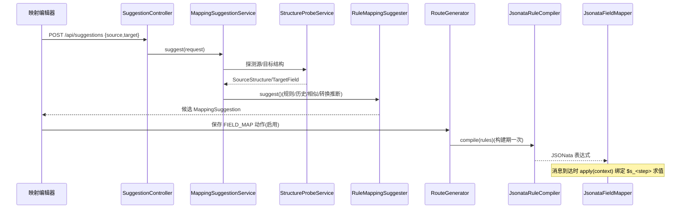

# 字段映射（转换流）：规则树 → JSONata 编译 → 求值 + 建议器

## 场景说明

把上一步动作输出按规则映射成目标结构。**规则模型（递归组）→ 路由构建期编译为 JSONata 表达式 → 消息到达时按
上下文求值**；配套**映射建议器**（默认规则引擎，可站点级覆盖为 LLM）与三栏编辑器。
入口 = FIELD_MAP 动作 / 映射编辑器；落点 = 目标对象（Map），供后续 HTTP/MQ/写库消费。

### 交互清单

| 角色 | 动作 | 触发方式 | 期望结果 |
|---|---|---|---|
| 实施工程师 | 配映射规则 | 映射编辑器（三栏 + 多级表格） | 规则树落库 |
| 实施工程师 | 获取推荐 | 编辑器"获取推荐" / `POST /api/suggestions` | 候选映射（可采纳/一键填充） |
| 系统 | 编译+求值 | 路由构建期 + 消息执行期 | 产出目标结构 |

## 流程详解

### 时序图



### 逐环节代码走查

| 环节 | 业务动作 | 入口（文件+行号） | 关键类方法 | 数据形态变化 | 错误处理 |
|---|---|---|---|---|---|
| 规则模型 | 结构化规则树（叶子 + 组节点） | `config/FieldMappingConfig.from` | `validate()` 递归校验（组内子规则禁 sourceStep、INDEX 仅组内、CONSTANT 需 constant 等） | JSON → 递归 record | 未知键/缺 target/前缀冲突→400 |
| 编译 | 规则树 → JSONata | 路由构建期 | `JsonataRuleCompiler.compile`（`mapping/JsonataRuleCompiler.java:35`） | `List<FieldMappingRule>` → 字符串表达式 | 目标前缀/重复冲突→400 |
| 求值 | 上下文绑定各步骤求值 | 消息到达 | `JsonataFieldMapper.apply`（`mapping/JsonataFieldMapper.java:46`）；dashjoin jsonata 0.9.10，实例跨消息复用 | 上下文 `Map<Integer,Object>` → 目标对象 | 编译失败→400；求值异常→死信 |
| 建议器 | 结构探测 + 同名归一化 + 相似度 + 历史复用 + 转换推断 | `MappingSuggestionService.suggest`（`service/MappingSuggestionService.java:45`）→ `MappingSuggesterRouter.forSite`（`service/MappingSuggesterRouter.java:33`）→ `RuleMappingSuggester.suggest`（`mapping/suggest/RuleMappingSuggester.java:39`） | 探测字段对（`StructureProbeService.probeFromDb` :53）→ 候选 | 组建议 `MatchSource.ARRAY`；单值样例不再推 CONSTANT（DS-10.4） |
| 编辑器 | 三栏点选 + 组行子表 + ENUM/CONCAT 弹窗 | `frontend/src/components/MappingEditor.vue` | 保存/回填递归 rules | — | 保存校验 `validate`、`mode:EXPRESSION` 逃生通道 |

关键实现：`JsonataInputs.normalize` 先规范化 JDBC 非 JSON 类型；`$s_<step>` 绑定上下文步骤；`$root` 跨层级引用；
组 `$map(...)` 包 `[ ]` 保证恒为数组；`$index`（`startAt`）、`$lookup`（ENUM）、`$dateFormat`（DATE）、`&`（CONCAT）。

## 测试环境

- 有源/目标样例 JSON（`spike/src/test/resources/json/*.json`）；后端（8080）在跑 + 结构探测/建议 API 可用；
- 编译/求值无需外部服务（`JsonataRuleCompilerTest` / `JsonataS0SpikeTest` 覆盖）。

## 测试数据与造数指导

| 环节 | 入 | 出 | 验证 |
|---|---|---|---|
| 编译 | `{"rules":[{"sourceStep":1,"source":"order_no","target":"sheet_no"}]}` | 表达式 | `POST /api/jobs/{id}/actions` 无 400 |
| 求值 | 上下文 `{1:{order_no:"PO-1"}}` | `{"sheet_no":"PO-1"}` | MES 收到/日志 |
| 建议 | 源/目标样例 | 候选列表 | `POST /api/suggestions` 返回 `sourcePath,targetName,score,matchSource` |
| 失败样例 | 组合路径 `a.b.c` 与 `a.b` 冲突 | 400 | `目标字段前缀冲突/重复映射` |
| 边界 | 组内 INDEX 出现在顶层 | 400 | `INDEX 转换只能在数组组内使用` |

覆盖样例：STRING / INT / DATE / ENUM / CONSTANT / CONCAT / INDEX；组节点（制品→BOM 两级）与 `$root` 跨层。

## 验证操作

```powershell
curl -X POST http://localhost:8080/api/structure-probe -H "Content-Type: application/json" -d '{...}'
curl -X POST http://localhost:8080/api/suggestions -H "Content-Type: application/json" -d '{...}'
```

## 建议表

| 现象 | 建议 | 理由 | 类型 | 涉及功能 | 状态 |
|---|---|---|---|---|---|
| C6 旧 `mapping/FieldMapper.java` / `MappingRule.java` 残留 | 确认无引用后删除，并清 `RouteGenerator` 未用 import | 已被 `JsonataFieldMapper`/`mapping/TransformType` 替代 | 设计改进 | 字段映射 | 待评估 |
| 映射历史对组规则：INDEX 子规则不入库 | 保持现状并写入文档 | T37 约定 | 文档偏差 | 字段映射 | 待评估 |
| 深层数组任意重排仍建议走 `mode:EXPRESSION` | 文档说明"数组迭代段 + 相对路径"边界 | 层级路径支持有限 | 业务改进 | 字段映射 | 待评估 |
| 单值样例不推 CONSTANT（DS-10.4） | 已实现 | — | 已闭环 | 字段映射 | 采纳 |
