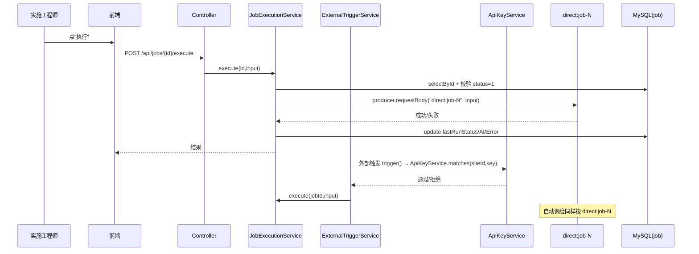

# 触发流（手动执行 / 自动调度 / 外部 API 触发）

## 场景说明

任务如何被启动：**手动执行（界面/接口）、自动调度（不自动/间隔/每天/每周，友好配置）、外部调用（API Key 鉴权）**。
入口 = 前端按钮 / REST / 自动调度 / `POST /api/external/jobs/{id}/trigger`；落点 = `direct:job-<id>` 路由执行并回写
最近执行状态。

### 交互清单

| 角色 | 动作 | 触发方式 | 期望结果 |
|---|---|---|---|
| 实施工程师 | 手动执行 | 任务页"执行" / `POST /api/jobs/{id}/execute` | `direct:job-N` 执行，`lastRunStatus` 回写 |
| 自动调度 | 周期触发 | Spring TaskScheduler 依调度配置注册 | 按配置投递 `direct:job-N`；`不自动` 则不投递 |
| 外部系统 | 触发任务 | `POST /api/external/jobs/{id}/trigger` + `X-API-Key` | 鉴权通过则执行，否则 `UNAUTHORIZED` |

## 流程详解

### 时序图



### 逐环节代码走查

| 触发方式 | 程序入口 | 关键类/方法 | 数据形态 | 鉴权 | 同步/异步 |
|---|---|---|---|---|---|
| 手动执行 | `POST /api/jobs/{id}/execute` | `JobExecutionService.execute`（`service/JobExecutionService.java:32`） | `Map` 入参 → `direct:job-N` | 无 | 同步等待 + 回写 `lastRunStatus/At/Error` |
| 自动调度 | `JobScheduler.reconcile`（`service/JobScheduler.java`）按调度配置注册 | `reconcile` | 无入参 | 无 | Spring TaskScheduler 投递 `direct:job-N` |
| 外部触发 | `POST /api/external/jobs/{id}/trigger` | `ExternalTriggerService.trigger`（`service/ExternalTriggerService.java:31`）→ `ApiKeyService.matches`（`service/ApiKeyService.java:45`） | `Map` 入参体 | `X-API-Key` 与任务站点匹配 | 同步等待 |

`JobExecutionService.execute`：未启用抛 `JOB_NOT_ENABLED`；成功写 `SUCCESS`、失败写 `FAILED` + 最深异常信息
（`rootMessage` 跳过 Camel 包装）。`ExternalTriggerService` 校验失败抛 `UNAUTHORIZED`。

> 外部触发链首边界：外部触发复用手动执行 `direct:job-<id>` 入口（`JobTrigger`），与链首动作种类无关——
> - **MQ_CONSUME 链首**：请求体充当一条**已解析消息**，从动作 2 开始执行（buildReplay 语义，不经过消息队列）；
> - **READ_SQL 链首**：与手动执行一致触发一次增量读（请求体不参与）；
> - **其他链首**（如 FIELD_MAP）：请求体作为链首输入进入动作链。
> 先决条件：任务已启用（status=1）+ `X-API-Key` 与任务站点匹配。边界 = 外部触发只驱动"一次执行"，不改变
> 链首的消费/读库形态。

## 测试环境

- 应用后端（8080）在跑；任务已启用；站点已建且已生成 API Key；
- 自动调度验证需观察日志或任务最近执行时间按调度频率更新。

## 测试数据与造数指导

| 触发方式 | 入 | 出 | 验证 |
|---|---|---|---|
| 手动 | `POST /api/jobs/{id}/execute {}` | `lastRunStatus=SUCCESS/FAILED` | 响应 `jobView` + 任务列表状态 |
| 未启用（失败） | 停用后 execute | `JOB_NOT_ENABLED` | 400 |
| 外部（成功） | `curl -X POST /api/external/jobs/1/trigger -H "X-API-Key: <key>" -d '{"字段":"值"}'` | 执行并回写 | 目标端收到 |
| 外部（鉴权失败） | 错/缺 API Key | `UNAUTHORIZED` | 401 |
| 自动调度 | 启用任务（配置间隔/每天/每周） | 按调度配置投递 `direct:job-N` | 日志 |

## 验证操作

```powershell
curl -X POST http://localhost:8080/api/jobs/{id}/execute -H "Content-Type: application/json" -d '{}'
curl -X POST http://localhost:8080/api/external/jobs/<id>/trigger -H "X-API-Key: <key>" -H "Content-Type: application/json" -d '{"字段":"值"}'
```

## 建议表

| 现象 | 建议 | 理由 | 类型 | 涉及功能 | 状态 |
|---|---|---|---|---|---|
| C3 `crontab` 存而未用，定时仅固定 60s | 已改为结构化调度（不自动/间隔/每天/每周），内部编译 fixedRate/cron 并结合 timezone | 由 #78 闭环 | 缺陷修复 | job-action-chain | 已闭环 |
| 外部触发对无 MQ_CONSUME/READ_SQL 链首的任务语义不清 | 已注明边界（本页"外部触发链首边界"：复用 `direct:job-N` 手动执行，请求体按链首形态进入） | 反例场景（MQ 消费 + 北向）已支持 | 业务改进 | 触发 | 已闭环 |
| API Key 仅站点级，无轮换/过期 | 观察项 | 现状单站点单 Key | 业务改进 | 站点 | 待评估 |
