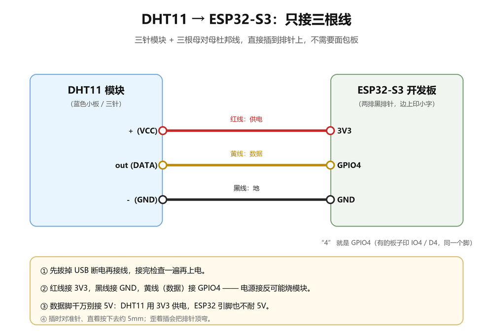

# ESP32 上真机：接线、烧录、接网关

这份手册是给**第一次碰硬件**的人写的：从「板子插上电脑」到「网关里有数据」，按顺序做，每一步都有验收标准。
整条链是这样，ESP32 和电脑之间**不用拉线**：

```text
传感器 ──杜邦线──> ESP32 ──Wi-Fi / Modbus TCP(502)──> 采集桥 modbus-bridge.cjs ──HTTP──> 网关 8080
```

产品没有 Modbus 连接器，所以中间那层「采集桥」是必然的（现场那层就是设备网关 / DTU）。
先做**不接传感器**的里程碑 0 和 1，链路通了再插传感器——一次全接完，出错时你分不清是线的问题还是代码的问题。

## 0. 物料

| 要有 | 说明 |
|---|---|
| ESP32 开发板 | 30 针 / 38 针都行，GPIO 编号一样 |
| USB **数据**线 | 最常见的坑：充电线只有电源没有数据，插上不会有 COM 口 |
| DHT11 模块 | 三针带小板的那种最省事（板载 10k 上拉）；四针裸探头要自己加 10k 电阻 |
| 杜邦线若干 | 母对母，插模块用 |

不需要：电烙铁、面包板、RS485 转换器。DHT11 三根线插上去就能用。

## 1. 里程碑 0：让板子活过来（不接线）

1. 装 **Arduino IDE 2.x**。
2. 文件 → 首选项 → 「其他开发板管理器地址」填：
   `https://espressif.github.io/arduino-esp32/package_esp32_index.json`
3. 开发板管理器搜 `esp32`，装 **Espressif 的 2.0.x**（别装 3.x，Modbus 库在 3.x 上容易编不过）。
4. USB 线插上板子，设备管理器里应该多出一个 COM 口（没有就装 CH340 / CP2102 驱动，或者换线）。
5. 工具 → 开发板选对**芯片型号**：老款 ESP32 选 **ESP32 Dev Module**，**ESP32-S3 选 ESP32S3 Dev Module**（选错一定烧不进去）。
6. 端口选板子那个 COM 口（见下面「选哪个 COM 口」），上传速度先设 **115200**。
7. 打开 `文件 → 示例 → 01.Basic → Blink`，点上传。

### 选哪个 COM 口

一块 S3 开发板常常有**两个 USB 口**，设备管理器里会冒出两个串口：

| 设备管理器里的名字 | 是什么 | 烧录用哪个 |
|---|---|---|
| `USB-Enhanced-SERIAL CH343 (COMx)` / `CP210x` | 板上的 USB 转串口芯片（UART 口） | **首选这个**，最稳 |
| `USB 串行设备 (COMy)` | S3 自带的原生 USB（USB-Serial-JTAG） | 备用；要它输出串口日志得把 `USB CDC On Boot` 设成 Enabled |
| `蓝牙链接上的标准串行 (COMz)` | Windows 的蓝牙虚拟串口 | **永远别选**，烧录必失败 |


**验收**：上传成功（出现 `Writing at 0x...` 然后 `Hard resetting`），板子上的小灯闪。
上传卡在 `Connecting........_____` 不动：按住板上 `BOOT` 键再点上传，出现 `Writing` 后松手。

## 2. 里程碑 1：不接传感器，先把链路跑通

这一版**一根传感器线都不用接**，测的是「板子 → Wi-Fi → 采集桥」这段。

1. 打开 `modbus_device.ino`，只改三处：
   ```cpp
   const char* WIFI_SSID = "你的Wi-Fi名";
   const char* WIFI_PASS = "你的Wi-Fi密码";
   #define HAS_DHT11 0       // 先关掉（三个 HAS_* 都是 0/1 开关）
   ```
2. 库管理器只装 `ModbusIP_ESP8266`（作者 emelianov）——传感器开关是 0 时对应的 `#include` 根本不编译，DHT/OneWire/INA219 的库这步不用装。
3. 上传，打开串口监视器（**115200**，换行符选「两个都行」）。

**验收**：串口出现

```text
[esp32] wifi ok, ip=192.168.1.23
[esp32] modbus tcp server on 192.168.1.23:502 (unit 1)
```

没出现就是 Wi-Fi 没连上（见第 7 节）。**把那个 IP 记下来。**

> ESP32 只认 **2.4G** 频段，5G 的 Wi-Fi 连不上。公司 Wi-Fi 常开「客户端隔离」，板子和电脑互相 ping 不通——最稳的办法是电脑和板子都连**手机热点**。

## 3. 里程碑 2：接 DHT11



| DHT11 引脚 | 接到 ESP32 |
|---|---|
| VCC（+） | `3V3` |
| DATA（S / OUT） | `GPIO4`（丝印可能写 D4 / IO4） |
| GND（-） | `GND` |

四针裸探头（从左到右：VCC / DATA / NC / GND）：VCC 和 DATA 之间加一个 **10k 电阻**；三针模块板载已有，不用加。
**别接 5V**：数据脚会被拉到 5V，超过 ESP32 引脚耐压。

> **S3 的引脚和老板不一样**：`GPIO26~32` 在 S3 上接的是板载 Flash，**碰不得**；S3 也**没有** `GPIO22~25`。所以固件里 I2C 用的是 `GPIO8/9` 而不是老板的 `21/22`。只接 DHT11 的话就用 `GPIO4`，两代板子都安全。

改回 `#define HAS_DHT11 1`（并在库管理器装 `DHT sensor library`，会提示一并装 Adafruit Unified Sensor），重新上传。

**验收**：串口每 5 秒一行，`temp=` 是温度 ×100（`temp=2530` 就是 25.30℃），`hum=` 是湿度 ×100（`hum=4500` 就是 45%RH），`status=1` 表示一切正常。

```text
[esp32] counter=7 status=1 temp=2530 hum=4500 curr=0 volt=0
```

`status=3` = 传感器故障（bit1），`status=5` = 刚上电 5 秒内（bit2）。DHT11 读数偶尔跳一下是正常的（±2℃，1 度分辨率）。

## 4. 里程碑 3：接采集桥，把数据推进网关

前提：网关在 `8080` 起着，并且有一个 **B1 设备任务**（`SH-B1-DEVICE-UP` 之类，链首是 `FIELD_MAP`）。
没有的话先跑 `tools/shadow-site/seed-scenario.ps1`，或在界面上照 `README.md` 建一条。

`JOB_ID` 在任务列表 / 任务详情里，`API_KEY` 在「站点」页生成（只显示一次）。

```powershell
$env:DEVICE_HOST='192.168.1.23'   # 串口日志里那个 IP，不是 127.0.0.1
$env:DEVICE_PORT='502'            # 真机是 502；软替身才是 1502
$env:DEVICE_UNITS='1'
$env:POLL_MS='5000'
$env:JOB_ID='<任务 id>'
$env:API_KEY='<站点 API Key>'
node tools/shadow-site/modbus-bridge.cjs
```

**验收**：

1. 桥日志里 `posted` 每 5 秒 +4（一台设备 4 个点位），`lastError` 为空；
2. 网关「消息历史 / 运行记录」里每 5 秒出现一条运行；
3. 看板库里 `dev_metric` 的行数一直在涨。

桥的另一个口 `http://localhost:9202/` 能看实时计数：`cycles` / `posted` / `buffered` / `lastError`。
`buffered` 一直不归零 = 网关那头拒收（任务没启用 / API Key 错），看 `lastError`。

## 5. 看到什么算「这条链真的通了」

| 现象 | 含义 |
|---|---|
| 串口 `counter` 每 5 秒 +1、`status=1` | 板子在跑、传感器正常 |
| 桥 `posted` 持续增长、`lastError` 为空 | 板子的寄存器被读到了 |
| 网关运行记录连续出现、看板库行数涨 | 数据真的进了产品 |

想验断网续传：把桥停掉 1 分钟再起，`buffered` 会先涨后归零，看板库把缺的补齐（`metric_key` 里带时间戳，重复补发只会 upsert 同一行）。

## 6. 已经知道的两个坑

1. **电压点位会显示 BAD**。桥的量程是按 380V 工业场景写的（电压 100~400V、电流 0~100A），用 5V 的 INA219 测出来必然越界。不是接线错，改桥的 `POINTS` 量程或先不接 INA219 即可。
2. **这份固件没在真机上验证过**（写的时候手边没有板子）。第一次烧录大概率会遇到小问题（库版本、引脚名），把串口/编译器的报错原文贴出来就能定位。

## 7. 常见故障

| 现象 | 先查什么 |
|---|---|
| 设备管理器没有 COM 口 | 换**数据线**；装 CH340 / CP2102 驱动 |
| 上传一直 `Connecting...` | 按住 `BOOT` 再点上传；确认端口没被串口监视器占用（先关掉它） |
| `Invalid head of packet (0xEE)` / `Failed to connect` | 没进下载模式或端口选错，按下面「烧录进不去」三步走 |
| 串口一直打印 `....` | Wi-Fi 密码错、或连了 5G；改 2.4G 或手机热点 |
| 编译报找不到 `ModbusIP_ESP8266.h` | 库没装；或核心装成了 3.x，换 2.0.x |
| 编译报找不到 `DHT.h` | 装 Adafruit 的 `DHT sensor library`（会提示一并装 Adafruit Unified Sensor） |
| 串口 `temp=-100`、`status=3` | DHT11 没接好 / 没上拉 / 引脚号不对 |
| 桥 `modbus timeout` | IP 错、板子和电脑不同网段、公司 Wi-Fi 开了客户端隔离；先 `ping <IP>` |
| 桥 `http 401` | `API_KEY` 不对或不属于该站点 |
| 桥 `http 400` | 目标任务没启用，或链首不是 `FIELD_MAP`（外部触发要求 `sourceStep=0`） |

## 8. 烧录进不去：`Invalid head of packet (0xEE)` / `Failed to connect`

先理解报错：esptool 要在串口上跟芯片"对暗号"进**下载模式**。收到 `0xEE` 说明对面吐的是正常运行的程序的日志（乱码），不是它要的应答——**板子没进下载模式，或者烧的根本不是这块板子的串口**。

按顺序试，基本三步解决：

1. **端口选对**。烧录口要选 USB 转串口芯片那个（`CH343` / `CP210x`），不是 `USB 串行设备`（那是 S3 自带的原生 USB），更不是蓝牙的 `COM3/COM4`。两个 USB 口都插着的时候先拔掉原生那个，只留 UART 口。
2. **上传速度降到 115200**（工具 → Upload Speed）。
3. **手动进下载模式**：按住板上的 `BOOT` 不放 → 点一下 `RST`（有的板子标 `EN`）→ 松开 `BOOT` → 再点上传。看到 `Writing at 0x...` 就可以松手了。烧完按一下 `RST` 让程序跑起来。

还不行再看这几条：

| 检查项 | 说明 |
|---|---|
| 开发板型号 | S3 必须选 `ESP32S3 Dev Module`，选成 `ESP32 Dev Module` 会因为 Flash/启动参数不同直接连不上 |
| 两个 USB 口同时插 | 拔掉一个，只留 UART 口 |
| USB hub / 长线 | 直接插机箱后面板，别过 hub |
| 串口监视器还开着 | 占着端口，上传前先关掉 |
| 用原生 USB 口上传 | 工具 → `USB CDC On Boot` 设 Enabled；否则老老实实用 CH343 口 |

